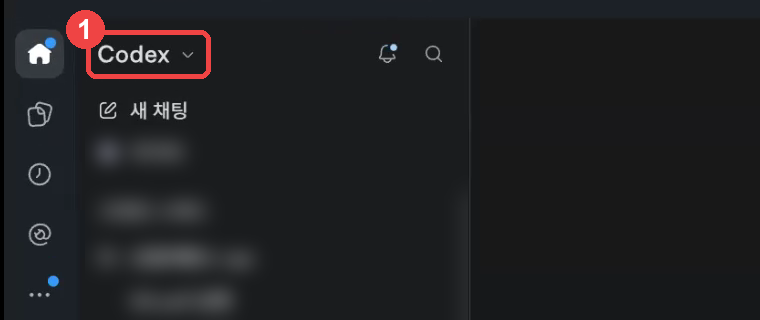
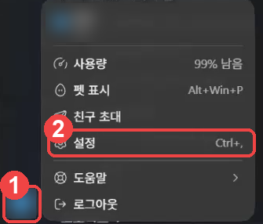
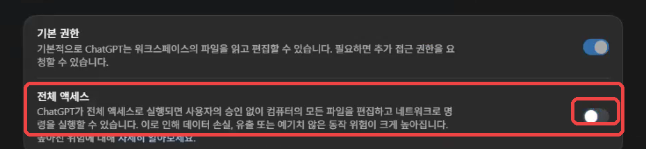
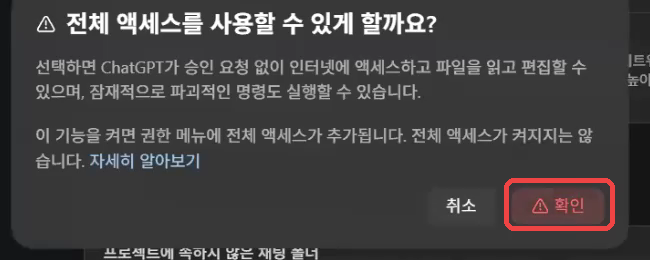
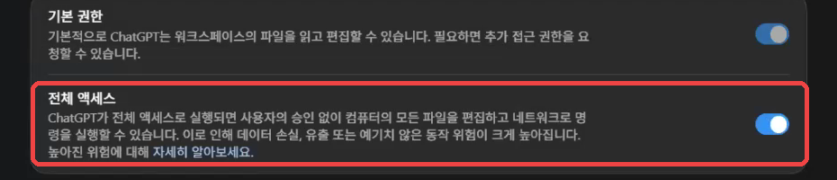
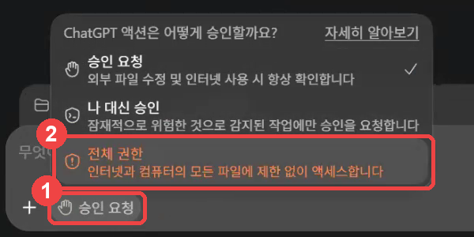
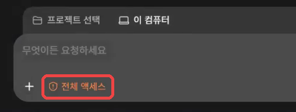

# 3기 Aside 연결 다시 맞추기 — 화면 보며 따라 하기

AI 자동화 스터디 3기 · 11월 4일(수) 모임 초반에 다 같이 합니다 · 미리 해 보셔도 됩니다

> 😥 "Aside에 로그인돼 있는데 AI가 로그인이 안 됐다고 해요"
> 😥 "다시 로그인하면 이미 로그인돼 있다고 나와요"

이런 말을 들으셨다면 **로그인 문제가 아닙니다.** ChatGPT 앱이 Aside에 손을 댈 수 있게 **권한**을 열어 주지 않아서 생기는 일입니다.
이 안내서대로 **한 번만** 맞춰 두면, 그다음부터는 새 대화에서도 그대로 됩니다.

> **준비물과 시간**
>
> - ChatGPT 앱 — 지금까지 쓰던 그 앱입니다.
> - Aside 브라우저 — 없으면 5단계에서 설치합니다.
> - 걸리는 시간: 약 20분
> - 그림은 **Windows 화면**입니다. **Mac도 화면이 같습니다.** 단축키의 `Ctrl` 을 `Cmd` 로 바꿔 누르면 됩니다.

## 한눈에 보기

| 순서 | 할 일 | 누가 |
|---|---|---|
| 1 | 앱이 「Codex」로 열려 있는지 보기 | 나 |
| 2 | 설정에서 「전체 액세스」 켜기 | 나 |
| 3 | 대화에서 「전체 권한」 고르기 | 나 |
| 4 | 앞으로도 계속 그렇게 — 설정 파일에 적어 두기 | Codex (상자 하나) |
| 5 | Aside 설치·로그인 (이미 했으면 건너뜀) | 나 |
| 6 | Aside 연결 맞추기 | Codex (상자 하나) |
| 7 | 연결 확인 | Codex (상자 하나) |

## 1단계. 앱이 「Codex」로 열려 있는지 보기

ChatGPT 앱을 엽니다. **왼쪽 위**에 **「Codex ⌄」** 라고 쓰여 있으면 됩니다.



- **「ChatGPT」** 라고 쓰여 있으면 그 글자를 눌러 **「Codex」** 로 바꿉니다.
- 왜 중요한가요? **ChatGPT 쪽에서 연 대화에는 권한 단추가 아예 없습니다.** 그래서 3단계를 할 수 없습니다.

## 2단계. 설정에서 「전체 액세스」 켜기

**① 설정 열기** — **왼쪽 아래 동그라미(내 이름 첫 글자)** 를 누르고, 나온 메뉴에서 **「설정」** 을 누릅니다.
(키보드로는 Windows `Ctrl` + `,` · Mac `Cmd` + `,`)



**② 「전체 액세스」 스위치 켜기** — 설정이 열리면 왼쪽 **「일반」** 이 골라져 있습니다. 오른쪽 **「권한」** 칸의 두 번째 줄 **「전체 액세스」** 스위치를 누릅니다.



**③ 확인 창에서 「확인」** — 「전체 액세스를 사용할 수 있게 할까요?」 창이 뜨면 **「확인」** 을 누릅니다.



**④ 스위치가 파랗게 바뀌면 됩니다.**



> **여기서 끝이 아닙니다.** 확인 창에도 쓰여 있듯이, 이 스위치는 대화의 메뉴에 「전체 권한」을 **보이게** 할 뿐 **켜 주지는 않습니다.** 그래서 3단계가 꼭 필요합니다. 많은 분이 여기서 멈춰서 막혔습니다.

## 3단계. 대화에서 「전체 권한」 고르기

1. 왼쪽 위 **「새 채팅」** 을 누릅니다.
2. 입력창 **아래 왼쪽**의 **「승인 요청」** 단추를 누릅니다.
3. 나온 메뉴 맨 아래 **주황색 「전체 권한」** 을 누릅니다.



**단추가 주황색 「전체 액세스」 로 바뀌면 끝입니다.** ✅



> **알아 두세요**
>
> - 앱은 **마지막으로 고른 권한을 기억합니다.** 다음에 여는 새 대화도 「전체 액세스」로 시작합니다.
> - **예전 대화**는 그 대화를 처음 만들 때의 권한을 그대로 씁니다. 「어떤 대화는 되고 다른 대화는 안 된다」는 이 때문입니다. 예전 대화에서 안 되면 그 대화에서도 3단계를 한 번 하거나, 새 대화로 옮기세요.
> - 「전체 액세스」에서는 **AI가 묻지 않고 바로 일합니다.** "파일을 지우겠다"는 말이 나오면 입력창에 "지우지 말고 해 줘"라고 써서 멈춥니다.

## 4단계. 앞으로도 계속 그렇게 — 설정 파일에 적어 두기

3단계만 해도 됩니다. 그래도 앱이 가끔 「승인 요청」으로 돌아가는 일이 있어서, **ChatGPT 앱의 설정 파일에도 적어 둡니다.**
파일을 직접 찾을 필요는 없습니다. **3단계에서 연 대화(「전체 액세스」인 대화)** 에 아래 상자를 붙여 넣으면 Codex가 합니다.

**복사해서 붙여 넣는 법 (아래 상자 모두 같습니다)**

1. 상자의 **「문장 복사」** 단추를 누릅니다. (GitHub에서 보고 있으면 상자 오른쪽 위 **네모 두 개 겹친 단추**)
2. ChatGPT 앱의 **입력창을 한 번 누르고** `Ctrl` + `V` (Mac `Cmd` + `V`) → `Enter`.

**▶ 상자 ① — 전체 액세스를 설정 파일에 적기**

```text
ChatGPT 앱(Codex)이 앞으로 매번 묻지 않고 전체 액세스로 일하도록 설정해 줘.
1. 내 사용자 설정 파일 config.toml 을 찾아 줘. Windows는 %USERPROFILE%\.codex\config.toml, Mac은 ~/.codex/config.toml 이야. 없으면 새로 만들어.
2. 고치기 전에 같은 폴더에 config.toml.bak 으로 복사해 둬.
3. 파일 맨 위, 대괄호 [ ] 로 시작하는 첫 줄보다 앞에 아래 두 줄을 넣어 줘. 이미 있으면 값만 바꾸고, 다른 줄은 지우거나 바꾸지 마.
approval_policy = "never"
sandbox_mode = "danger-full-access"
4. 끝나면 바꾼 두 줄만 보여 주고, 앱을 완전히 껐다 켜라고 알려 줘.
```

**Codex가 끝났다고 하면 앱을 완전히 껐다 켭니다.**

- **Windows:** 창을 닫은 뒤, 화면 **오른쪽 아래 작업 표시줄**의 `^` 를 눌러 ChatGPT 아이콘이 보이면 마우스 오른쪽 단추 → **종료**. 그리고 다시 엽니다.
- **Mac:** `Cmd` + `Q` 로 끄고 다시 엽니다.

다시 연 뒤 **새 채팅**을 눌렀을 때 입력창 아래가 **「전체 액세스」** 면 성공입니다. 「승인 요청」이면 3단계를 한 번 더 합니다.

> **되돌리고 싶으면** 아무 대화에서나: "config.toml 에 넣은 두 줄을 지우고 config.toml.bak 으로 되돌려 줘"

## 5단계. Aside 설치·로그인 — 이미 했으면 건너뜁니다

**작업 표시줄(Mac은 Dock)에 Aside가 있고, 열었을 때 로그인 화면이 아니면 6단계로 가세요.**

1. https://aside.com/download 를 엽니다. 내 컴퓨터에 맞는 설치 파일이 저절로 받아집니다.
2. 받은 파일을 **두 번 눌러** 설치합니다.
   - Windows: 「이 앱이 디바이스를 변경할 수 있도록 허용하시겠어요?」가 뜨면 **「예」**.
   - Mac: 받은 Aside를 **응용 프로그램(Applications)** 폴더로 끌어다 놓고 엽니다.
3. Aside가 처음 열리면 **로그인(Sign in)** 화면이 나옵니다. 계정이 없으면 새로 만듭니다. **ChatGPT에 쓰는 것과 같은 구글 계정**으로 만들면 기억할 것이 줄어듭니다.
4. 이어서 나오는 **다른 브라우저 데이터 가져오기(Import)**, **비밀번호 관리자(Password Manager)** 화면은 **「Skip」** 을 누릅니다.
5. Aside는 **켜 둔 채로** ChatGPT 앱으로 돌아갑니다.

> Aside 설정의 **Models → Providers → ChatGPT Subscription 연결은 하지 않아도 됩니다.** 우리 실습은 ChatGPT 앱(Codex)이 Aside를 직접 움직이기 때문입니다. (Aside 안의 AI를 따로 쓰는 심화 #3에서만 필요합니다.)

## 6단계. Aside 연결 맞추기 — 상자 하나

**Aside를 켜 둔 채로**, 「전체 액세스」인 대화에 아래 상자를 붙여 넣습니다.
**읽지 않아도 됩니다.** 복사해서 붙여 넣기만 하세요. 글이 계속 올라오는 것은 Codex가 일하는 중입니다. 5~10분 기다립니다.

**▶ 상자 ② — Aside 연결 맞추기**

```text
나는 컴퓨터 초보자야. ChatGPT 앱(Codex)이 Aside 브라우저를 직접 움직여 웹 일을 하도록 연결을 맞춰 줘. 내가 할 일은 최소로 줄이고, 끝나면 쉬운 한국어로 짧게 알려 줘.
지금 이 대화는 「전체 액세스」야. Aside 오류가 나도 로그인 문제라고 단정하지 말고 오류 원문을 보여 줘. Aside 다시 설치·로그아웃·결제·Aside 안 ChatGPT 계정 연결·원격 제어는 요구하지 마.

1. aside 명령(Aside CLI)이 있는지 확인해 줘. Windows는 PowerShell에서 Test-Path "$env:LOCALAPPDATA\Aside\CLI\current\aside.exe" 로 본다. 없으면 Aside 공식 설치 명령으로 설치해. 이 설치에 한해 PowerShell(Mac은 터미널)로 Aside 공식 주소(releases.aside.com)에서 내려받아도 돼. 서명 확인을 빼거나 보안을 끄지 마.
   - Windows: 맨 아래 [Windows 설치 명령]을 그대로 실행
   - Mac: curl -fsSL https://releases.aside.com/install.sh | bash
   설치 직후 aside 라고만 쳐서 안 잡히면, Windows는 전체 경로 "$env:LOCALAPPDATA\Aside\CLI\current\aside.exe" 로 실행해.
2. aside --update 와 aside guide 를 실행해 읽어 줘.
3. aside skills install --target codex 로 aside-browser 스킬을 설치하고(이미 있으면 그대로 둬), 실제 SKILL.md 위치를 확인해 줘.
4. Codex가 실제로 읽는 전역 지침 파일(보통 사용자 홈의 .codex 폴더에 있는 AGENTS.md)을 찾아, 원래 내용은 그대로 두고 아래 규칙이 없으면 덧붙여 줘. 예전에 넣은 Aside 규칙이 있으면 겹치지 않게 이 문장으로 정리해 줘.
   "웹사이트를 열고 읽고 입력하는 웹 작업은 Aside(aside CLI와 aside-browser 스킬)로 한다. 쓰기 전에 aside --update 와 aside guide 를 실행해 읽는다. Codex가 aside repl로 직접 읽고 클릭하며, aside exec처럼 Aside 안의 AI에게 일을 넘기는 명령은 쓰지 않는다. 내 마우스·키보드와 내가 보고 있는 창·탭은 건드리지 않는다. Aside가 안 되면 다른 브라우저로 바꾸지 말고 오류 원문과 함께 나에게 알린다. 단, Aside CLI를 설치·업데이트할 때는 Aside 공식 주소(releases.aside.com, docs.aside.com)에서 내려받아도 된다."
5. 끝나면 세 줄로 알려 줘. ① aside 명령: 새로 설치함 / 이미 있었음 ② 스킬 위치 ③ 규칙을 적은 파일. 아직 웹사이트는 열지 마.

[Windows 설치 명령 — 출처 https://docs.aside.com/help/developers]
$ErrorActionPreference = 'Stop'
$ProgressPreference = 'SilentlyContinue'
$installer = Join-Path $env:TEMP 'aside-install.ps1'
$publisher = 'CN=AT YOUR SIDE INC, O=AT YOUR SIDE INC, L=San Francisco, S=California, C=US'
Invoke-WebRequest -UseBasicParsing -Uri https://releases.aside.com/install.ps1 -OutFile $installer
$signature = Get-AuthenticodeSignature -LiteralPath $installer
if ($signature.Status -ne 'Valid' -or $null -eq $signature.SignerCertificate -or $signature.SignerCertificate.Subject -ne $publisher -or $null -eq $signature.TimeStamperCertificate) {
  throw "Aside CLI installer signature verification failed ($($signature.Status): $($signature.StatusMessage))."
}
& $installer
```

**Codex가 세 줄로 알려 주면, 앱을 완전히 껐다 켭니다.** (4단계와 같은 방법) 방금 설치한 aside 명령과 스킬을 앱이 알아보게 하려는 것입니다.

## 7단계. 연결 확인 — 상자 하나

다시 연 ChatGPT 앱에서 **「새 채팅」** 을 누르고, 입력창 아래가 **「전체 액세스」** 인지 봅니다. 그리고 아래 상자를 붙여 넣습니다.

**▶ 상자 ③ — 연결 확인**

```text
Aside 연결을 확인해 줘. aside-browser 스킬을 읽고, aside repl로 네이버 첫 화면(https://www.naver.com)을 열어 페이지 제목만 알려 줘. 실패하면 로그인 문제라고 하지 말고, 오류 원문과 내가 할 일 한 가지만 알려 줘.
```

**「NAVER」 같은 제목이 나오면 연결 끝입니다.** 🎉
이제 수요일 실습을 바로 할 수 있습니다.

## 안 하셔도 되는 것

- Aside 안에서 ChatGPT·Claude 계정 연결하기 (Models → Providers → Subscription)
- Aside 다시 설치하기, 로그아웃했다 다시 로그인하기, 컴퓨터 재시작 반복하기
- 결제, Pro 요금제, 원격 제어(Remote Control) 켜기

AI가 이런 것을 하라고 하면 이렇게 답하세요: "기본 실습에는 필요 없다고 들었어. 다른 방법으로 해 줘."

## 잘 안될 때

| 이럴 때 | 이렇게 하세요 |
|---|---|
| 입력창 아래에 권한 단추(「승인 요청」)가 없다 | **1단계**: 왼쪽 위가 「Codex」인지 봅니다. 「ChatGPT」면 Codex로 바꾸고 새 채팅을 엽니다. |
| 「승인 요청」 메뉴에 「전체 권한」이 없다 | **2단계**: 설정의 「전체 액세스」 스위치가 파란지 봅니다. 켜도 없으면 회사·기관이 관리하는 PC일 수 있습니다. 개인 PC로 해 보세요. |
| "로그인이 안 됐다", "Cannot open Windows installation key", "fetch failed", "Aside isn't running" | 대부분 **권한** 문제입니다. 입력창 아래가 「전체 액세스」인지 먼저 봅니다. 아니면 **3단계**. 맞는데도 나오면 오류 화면을 캡처해 Q&A에 올립니다. |
| "aside 명령을 찾을 수 없다" | 앱을 **완전히** 껐다 켭니다(4단계 끝의 방법). 그래도 같으면 **6단계 상자 ②**를 다시 붙여 넣습니다. |
| 옛 대화에서는 안 되고 새 대화에서는 된다 | 정상입니다. 옛 대화는 처음 권한을 그대로 씁니다. 그 대화에서 3단계를 하거나 새 대화에서 하세요. |
| Windows 7 PC | Aside가 설치되지 않습니다. Windows 10 이상 PC가 필요합니다. |
| 무엇이 문제인지 모르겠다 | 화면을 캡처해(Windows `Windows 키` + `Shift` + `S`, Mac `Cmd` + `Shift` + `4`) 입력창에 붙여 넣고 "이 오류를 네가 해결해 줘"라고 씁니다. |

그래도 안 되면 캡처와 함께 [스터디 허브 Q&A 챗봇](https://study.saedongne.com/automation/qna.html)이나 질문 게시판에 올려 주세요. **비밀번호·인증 번호가 보이는 부분은 가리고** 올립니다.

**한 문장으로 기억하기:** 설정에서 「전체 액세스」를 켜고, 대화에서 「전체 권한」을 고르면 Aside가 움직입니다.
