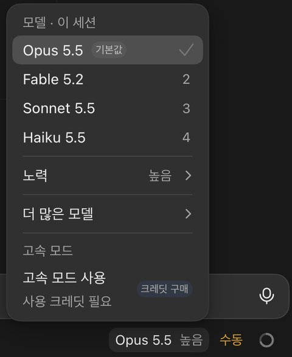
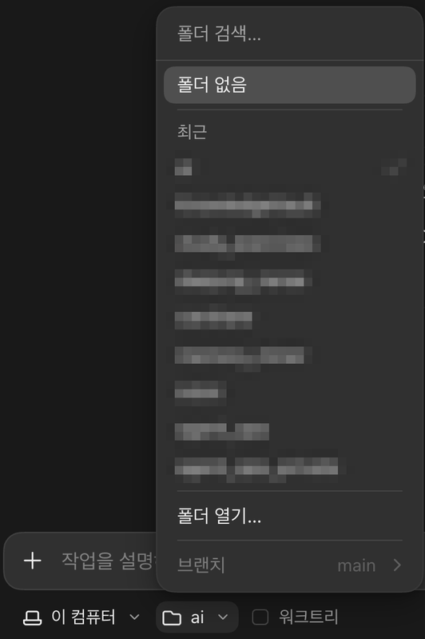
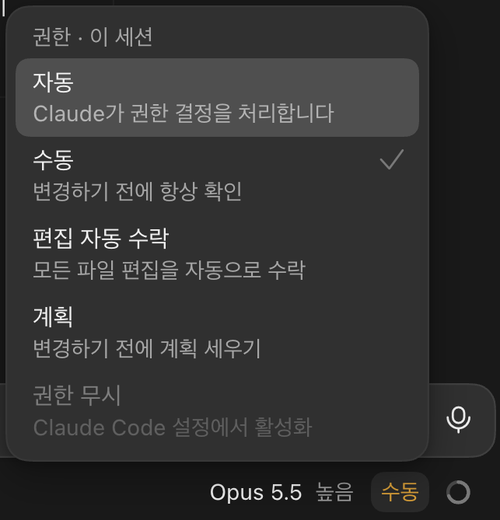

# 4기는 Claude 앱으로 실습합니다 — 결제 옮기기와 Claude 앱 준비

AI 자동화 스터디 4기 · 사전 안내 · 2026년 11월 15일

12월 16일(수)에 시작하는 4기에서는 **Claude 앱**을 실습의 기본 도구로 씁니다.

- **수요 모임의 실습 시연은 Claude 앱으로 합니다.**
- **모든 실습 안내서에는 ChatGPT 앱(Codex) 안내도 함께 넣습니다.** ChatGPT 앱에 이미 익숙한 분은 ChatGPT 앱으로도 충분히 따라오실 수 있습니다.
- **ChatGPT 앱이 아직 서툴다고 느끼시면, 유료 계정을 Claude로 옮겨서 Claude 앱으로 실습에 참여해 주세요.** 시연과 같은 화면을 보며 따라 하는 것이 훨씬 쉽습니다.

---

# ■ 꼭 하실 것 — 유료 AI 계정(한 달 20달러, 약 3만 원)을 하나만 쓰시는 분

| 언제 | 할 일 |
|---|---|
| **11월 25일(수) 3기 마지막 모임이 끝나면** | **ChatGPT 결제를 취소합니다.** 취소해도 다음 결제일까지는 그대로 쓸 수 있습니다 |
| **12월 12일(토)** (4기 첫 모임 4일 전) | **Claude 유료 계정(Pro)에 가입합니다** |
| **12월 13일(일)부터** (4기 첫 모임 3일 전) | **Claude 앱을 설치하고 준비합니다** — 아래 「Claude 앱 준비하기」 |

- **두 결제가 1~2주 겹칠 수 있습니다.** 그동안은 두 AI를 모두 쓰시면 됩니다.
- 겹치는 기간이 부담스러우시면 맨 아래 **「부록 — 결제가 겹치지 않게 하고 싶은 분」**을 보세요.

### ChatGPT 결제 취소하는 곳

- ChatGPT 앱이나 chatgpt.com에서 **왼쪽 아래 내 이름 → 설정 → 왼쪽 목록의 「결제」**로 갑니다. 화면 맨 아래 **「플랜 취소」**를 누릅니다. 취소해도 결제 기간이 끝날 때까지 모든 기능을 그대로 쓸 수 있습니다.
- **다음 결제일**은 같은 화면의 결제 내역에서 봅니다. 지난번에 결제한 날의 한 달 뒤 같은 날이 다음 결제일입니다.
- 메뉴를 못 찾으시면 ChatGPT에게 「유료 구독은 어디에서 취소해?」라고 물어보세요.

---

# ■ 그대로 ChatGPT를 쓰셔도 되는 분

**「나는 꼭 ChatGPT를 쓰고 싶다. 모임 시연을 Claude 앱으로 해도 ChatGPT 앱으로 잘 따라갈 자신이 있다」는 분**은 ChatGPT 결제를 그대로 두셔도 됩니다. 4기 안내서에는 ChatGPT 앱 안내가 함께 들어 있습니다.

### 그림을 만들어야 하는 분은 꼭 보세요

20달러짜리 Claude 계정(Pro)에는 **그림(이미지)을 새로 만드는 기능이 없습니다.** ChatGPT에서는 되는데 Claude에서는 안 되는 큰 기능은 이것 하나입니다.

이 기능이 꼭 필요하시면 둘 중 하나를 고르세요.

1. ChatGPT 앱으로 실습을 따라옵니다.
2. ChatGPT와 Claude를 **둘 다 유료로 씁니다**(한 달 약 6만 원).

---

# ■ 둘 다 쓰시면 좋은 분

**ChatGPT 앱으로 하시는 일이 많고 사용 한도에 자주 걸리시는 분**께는 두 AI를 모두 유료로 쓰시는 것을 권합니다.

- **사용 한도가 두 배가 되는 효과가 있습니다.** 5시간 한도와 일주일 한도가 AI마다 따로 있어서, 한쪽이 막히면 다른 쪽으로 이어서 일할 수 있습니다.
- **같은 폴더에서 두 AI에게 일을 나눠 맡길 수 있습니다.** 예를 들어 한쪽은 자료를 정리하고, 다른 쪽은 그 자료로 글을 씁니다.

---

# ■ 왜 Claude 앱인가요

- **Claude 앱은 ChatGPT 앱과 함께 세계에서 가장 많이 쓰이는 AI 에이전트 도구입니다.** 내 컴퓨터의 폴더에서 파일을 읽고 만들며 일하는 AI입니다. 한 번 경험해 두면 쓸모가 많습니다.
- **여러 AI 도구를 써 보는 경험 자체가 아주 유용하고 꼭 필요한 경험입니다.** 도구는 계속 바뀝니다. 두 가지를 써 보면 다음에 무엇이 나와도 금방 익힙니다.
- **지금은 Claude의 AI 모델이 ChatGPT보다 안정적으로 앞서 있고, 이런 상황이 당분간 이어질 것이라는 시각이 있습니다.** 객관적인 평가 수치도 이를 뒷받침합니다.
- 물론 **두 AI 모두 여러분이 쓰시기에 전혀 부족함이 없을 만큼 똑똑합니다.** 어느 쪽을 쓰셔도 실습은 됩니다.

---

# ■ Claude 앱 준비하기 (12월 13일부터, 약 30분)

### 1. 설치

1. **[claude.com/download](https://claude.com/download)** 에 들어갑니다.
2. Windows 컴퓨터는 Windows용, Mac은 Mac용을 받아 설치합니다.
3. 앱을 켜고 **ChatGPT에 가입할 때 썼던 구글 계정과 같은 구글 계정**으로 로그인합니다. 계정이 하나라 기억할 것이 줄어듭니다.

### 2. 유료 계정(Pro) 가입 — 12월 12일

- 앱 **왼쪽 아래 내 이름 → 「모든 플랜 보기」**에서 **Pro**를 고르고 결제합니다. claude.ai 웹사이트에서 가입해도 같습니다.
- **월 결제**로 하세요. 1년 결제는 4기를 해 보고 정해도 늦지 않습니다.

### 3. 화면을 한국어로

화면이 영어로 나오면 **왼쪽 아래 내 이름 → 「Language」(언어) → 한국어**를 고릅니다.

### 4. 「Code」 화면 고르기

왼쪽 위에 단추가 두 개 있습니다. 왼쪽의 말풍선 모양은 평소 대화하는 「Claude」 화면이고, **오른쪽 `</>` 모양이 「Code」 화면**입니다. **4기 실습은 「Code」 화면에서 합니다.** 앱을 켤 때마다 `</>` 모양을 눌렀는지 먼저 봅니다.

- 3기에 쓰던 ChatGPT 앱(Codex) 화면과 비슷합니다. 내 컴퓨터의 폴더에서 파일을 읽고 만들며 일합니다.
- 아래 7에서 맞추는 **「권한 무시」를 쓸 수 있습니다.** AI가 일할 때마다 허락을 묻지 않습니다. 「Claude」 화면에는 이 설정이 없습니다.
- AI가 실행한 명령과 파일에서 바뀐 곳이 함께 나옵니다. 처음에는 낯설어도 괜찮습니다. 다 읽지 않아도 되고, AI가 마지막에 정리해 주는 결과만 보시면 됩니다.


### 5. 모델은 Sonnet, 노력은 Medium

입력창 아래 오른쪽에 지금 모델 이름(예: 「Opus」)이 적힌 단추를 누릅니다. **Sonnet**을 고르고, 같은 메뉴의 **「노력」**에서 **Medium**(화면에는 「보통」 또는 「중간」)을 고릅니다. 실습에 충분히 똑똑하고, 사용 한도도 덜 씁니다. 대화 중간에는 모델을 바꾸지 않습니다.



### 6. 일할 폴더 연결하기

Claude가 내 컴퓨터의 파일로 일하려면 폴더를 연결해야 합니다.

1. 「Code」 화면 왼쪽 위 **「새로 만들기」**를 누릅니다.
2. 입력창 아래의 **폴더 단추**(폴더 모양 옆에 폴더 이름이나 「폴더 없음」)를 누르고 아래쪽 **「폴더 열기…」**를 고릅니다.
3. 실습할 폴더를 고릅니다. 3기 때 만든 `내창고`(세컨드 브레인) 폴더가 있으면 그것을 골라도 됩니다.
4. 처음 연결할 때 이 폴더를 믿어도 되는지 묻는 창이 나오면 **허용**을 누릅니다.

한 번 연 폴더는 다음부터 이 목록의 「최근」에 나옵니다. 새로 만들 때마다 입력창 아래에 **「이 컴퓨터」**와 **실습 폴더 이름**이 보이는지 보고 시작합니다.



### 7. 매번 묻지 않게 하기 — 「권한 무시」를 늘 켜 두기

3기에 ChatGPT 앱을 「전체 액세스」로 맞춘 것과 같은 일입니다. Claude 앱에서는 이 설정을 **「권한 무시」**라고 부릅니다. 켜 두면 AI가 파일을 만들거나 명령을 실행할 때마다 허락을 묻지 않습니다.

**① 앱에서 「권한 무시」를 쓸 수 있게 켜기.** 왼쪽 아래 내 이름 → **설정 → 왼쪽 목록의 「Claude Code」** → 「세션」의 **「권한 우회 모드 허용」** 스위치를 켭니다. 「모든 권한을 우회할까요?」 창이 뜨면 허용합니다.



**② 늘 「권한 무시」로 시작하게 설정 파일에 적기.** **「새로 만들기」**를 누르고 폴더 단추에 6에서 연 폴더가 보이는지 본 뒤, 아래 상자를 복사해서 보냅니다. AI가 파일을 고쳐도 되는지 물으면 **허용**을 누릅니다.

```text
Claude 앱이 앞으로 매번 묻지 않고 「권한 무시」로 일하도록 설정해 줘.
1. 내 사용자 설정 파일 settings.json 을 찾아 줘. Windows는 %USERPROFILE%\.claude\settings.json, Mac은 ~/.claude/settings.json 이야. 없으면 새로 만들어.
2. 고치기 전에 같은 폴더에 settings.json.bak 으로 복사해 둬.
3. 아래 두 가지를 넣어 줘. 이미 있으면 값만 바꾸고, 다른 내용은 지우거나 바꾸지 마. 파일 형식(JSON)이 깨지지 않게 해.
- "permissions" 안에 "defaultMode": "bypassPermissions"
- 맨 바깥에 "skipDangerousModePermissionPrompt": true
4. 끝나면 바꾼 줄만 보여 주고, 앱을 완전히 껐다 켜라고 알려 줘.
```

**③ AI가 끝났다고 하면 앱을 완전히 껐다 켭니다.**

- **Windows:** 창을 닫은 뒤, 화면 **오른쪽 아래 작업 표시줄**의 `^` 를 눌러 Claude 아이콘이 보이면 마우스 오른쪽 단추 → **종료**. 그리고 다시 엽니다.
- **Mac:** `Cmd` + `Q` 로 끄고 다시 엽니다.

**④ 확인.** 다시 연 뒤 「Code」 화면에서 「새로 만들기」를 눌렀을 때 입력창 아래 오른쪽 권한 단추가 **「권한 무시」**면 성공입니다.

> **알아 두세요**
>
> - **「권한 무시」는 「Code」 화면에만 있습니다.** 왼쪽 말풍선 모양(「Claude」 화면)으로 가 있으면 권한 단추에 「권한 무시」가 없습니다. 실습은 늘 `</>` 모양(「Code」 화면)에서 합니다.
> - 「권한 무시」에서는 **AI가 묻지 않고 바로 일합니다.** 「파일을 지우겠다」는 말이 나오면 입력창에 「지우지 말고 해 줘」라고 써서 멈춥니다.
> - **되돌리고 싶으면** 이렇게 보냅니다: 「settings.json 에 넣은 두 가지를 지우고 settings.json.bak 으로 되돌려 줘」

### 8. 잘 되는지 확인하기

폴더를 연결한 채로 아래 상자의 글을 복사해서 보냅니다.

```text
이 폴더에 어떤 파일들이 있는지 쉬운 말로 다섯 줄로 알려 줘. 파일은 고치지 마.
```

폴더 안의 파일 이야기가 나오면 준비가 끝났습니다.

### 9. (선택) 3기 때 정한 「대답 규칙」 옮기기

3기 7주차에 ChatGPT 앱의 전역 지침(AGENTS.md)에 「대답 규칙」을 넣으셨으면, 같은 규칙을 Claude에도 넣을 수 있습니다. **ChatGPT 결제가 끝나기 전에** 하세요.

1. ChatGPT 앱(Codex)에 아래 상자를 보냅니다.

```text
내 전역 지침 AGENTS.md 에서 「대답 규칙」 부분을 그대로 보여 줘. 고치지 말고, 복사하기 쉽게 한 덩어리로 보여 줘.
```

2. 나온 글을 복사합니다.
3. Claude 앱 「Code」 화면에서 「새로 만들기」를 누르고 아래 상자를 보냅니다. 상자 맨 아래 줄 다음에 복사한 글을 붙여 넣고 보냅니다. Claude의 전역 지침 파일(CLAUDE.md)에 들어가서, 「Code」 화면에서 하는 모든 일에 적용됩니다.

```text
아래 「대답 규칙」을 내 전역 지침 파일에 넣어 줘. Windows는 %USERPROFILE%\.claude\CLAUDE.md, Mac은 ~/.claude/CLAUDE.md 야. 없으면 새로 만들고, 이미 있으면 다른 내용은 지우거나 바꾸지 말고 맨 아래에 붙여 줘. 끝나면 넣은 부분만 보여 줘.
```

---

# ■ 잘 안될 때 보실 것

| 이런 일이 있으면 | 이렇게 합니다 |
|---|---|
| 「Code」 화면에서 권한 단추가 「권한 무시」가 아닙니다 | 설정 → Claude Code의 「권한 우회 모드 허용」이 켜져 있는지 봅니다. 켜져 있으면 권한 단추를 눌러 「권한 무시」를 직접 고릅니다. 그래도 새로 만들 때마다 돌아가면 7의 상자를 한 번 더 보내고 앱을 껐다 켭니다 |
| 폴더를 고르는 단추나 「권한 무시」가 안 보입니다 | 왼쪽 위에서 `</>` 모양(「Code」 화면)을 골랐는지 봅니다. 말풍선 모양(「Claude」 화면)이면 `</>` 모양을 누르고 「새로 만들기」를 누릅니다. 그래도 없으면 앱을 최신 버전으로 업데이트하고 껐다 켭니다 |
| 왼쪽 아래에 업데이트 안내가 있습니다 | 눌러서 업데이트합니다. 앱이 다시 켜집니다 |
| 화면 이름이 이 안내와 다릅니다 | 앱 버전에 따라 이름과 자리가 다를 수 있습니다. Claude에게 「폴더를 연결하려면 어디를 누르면 돼?」처럼 하고 싶은 일을 그대로 물어봅니다 |
| 결제 날짜가 헷갈립니다 | 아래 부록의 표를 봅니다. 그래도 모르겠으면 기본 안내(11월 25일 이후 ChatGPT 취소, 12월 12일 Claude 가입)대로 하시면 됩니다 |
| 그 밖에 막혔습니다 | 스터디 허브 [Q&A](https://study.saedongne.com/automation/qna.html)에 물어보세요 |

---

# 부록 — 결제가 겹치지 않게 하고 싶은 분

먼저 ChatGPT의 **다음 결제일**을 확인합니다(위 「ChatGPT 결제 취소하는 곳」). 그리고 아래 표에서 내 경우를 찾습니다.

| ChatGPT 다음 결제일 | 할 일 |
|---|---|
| **11월 26일(목) ~ 12월 12일(토)** | **지금 ChatGPT 결제를 취소합니다.** 취소해도 결제일까지는 계속 쓸 수 있으니 3기 마지막 모임까지 그대로 쓰시면 됩니다. 그다음 4기 시작 전 적당한 때(늦어도 12월 12일)에 Claude Pro에 가입합니다 |
| **11월 25일(수) 이전** | **지금 ChatGPT 결제를 취소합니다.** ChatGPT가 끝나는 날에 맞춰 Claude Pro에 가입하고, 위 「Claude 앱 준비하기」를 따라 합니다. **남은 3기 실습은 Claude 앱으로 따라오시면 됩니다.** [9주차 실습 안내서](../3기/실습/3기_9주차_실습_내_일에_맞는_스킬_찾아_쓰기.md) 맨 아래에 Claude 앱 안내가 있습니다 |
| **12월 13일(일) 이후** | 기본 안내대로 하시면 됩니다. ChatGPT는 언제 취소해도 결제일까지 쓸 수 있습니다 |
