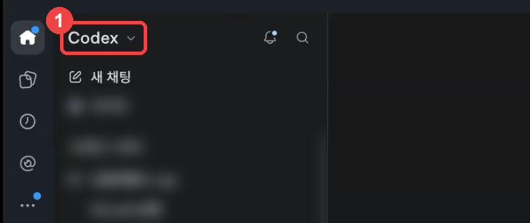
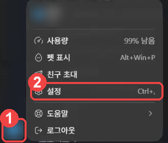
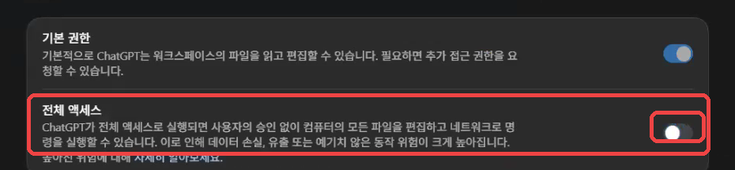
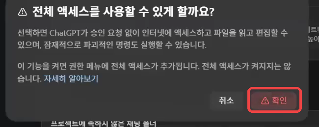
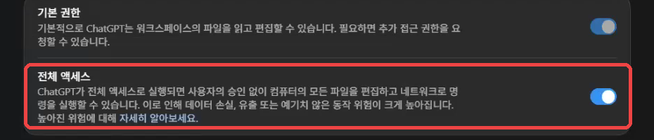
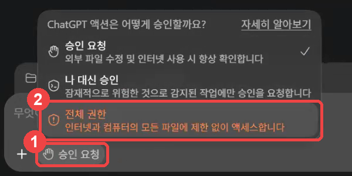
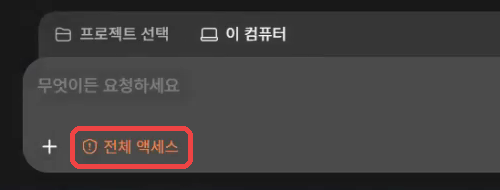
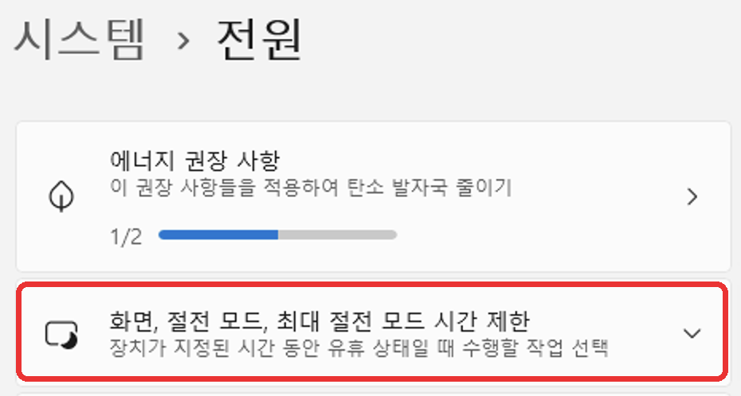
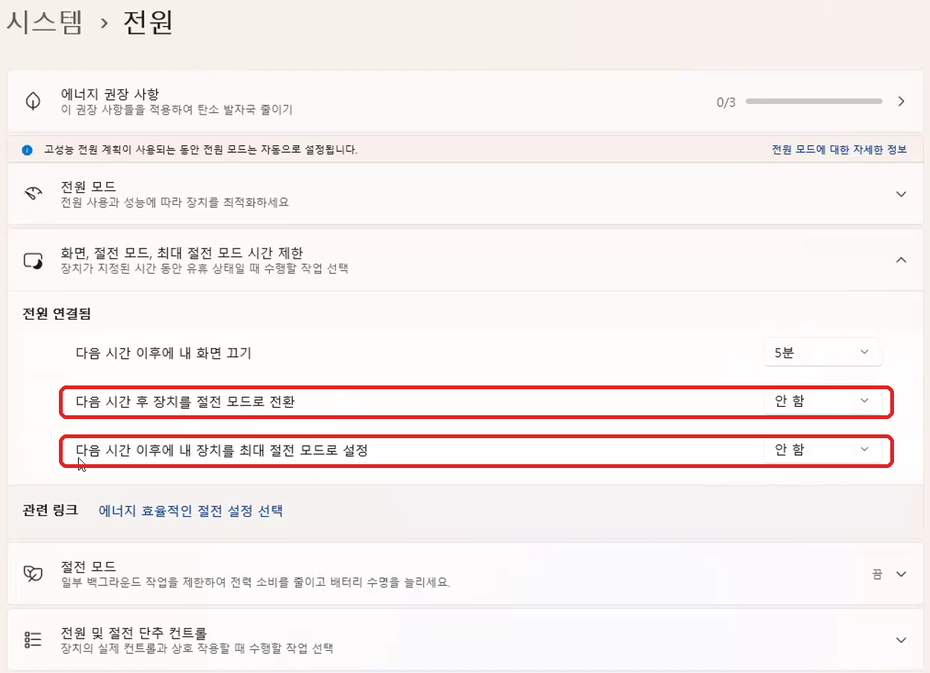

# 대정요양병원·요양원 직원을 위한 AI 활용 안내서

경영지원본부(원무과 · 총무과 · 시설과) · 처음 쓰는 분도 순서대로 따라 하면 됩니다 · 2026년 11월 기준

<a id="map"></a>

## 한눈에 보기

| 순서 | 할 일 | 누가 | 시간 | |
|---|---|---|---|---|
| [0](#rules) | 시작 전에 — 병원에서 AI 쓸 때 지킬 네 가지, 준비물, 앱 고르기 | 읽기 | 5분 | **꼭** |
| [1](#step1) | 앱 설치하고 로그인하기 (ChatGPT 앱 또는 Claude 앱) | 나 | 15분 | **꼭** |
| [2](#step2) | AI가 멈추지 않고 일하게 권한 맞추기 | 나 | 5분 | **꼭** |
| [3](#step3) | 쉬운 말 대답 + 병원 업무 규칙 적어 두기 | AI (상자 하나) | 5분 | **꼭** |
| [4](#step4) | Aside 브라우저 연결 — 웹사이트 일을 맡기려면 | 나 + AI (상자 둘) | 20분 | **꼭** |
| [5](#step5) | 컴퓨터 사용(Computer Use) 켜기 — 엑셀 같은 내 컴퓨터 프로그램 일을 맡기려면 | 나 | 5분 | 필요할 때 |
| [6](#step6) | 컴퓨터가 잠들지 않게 하기 | 나 | 3분 | 큰 일 맡길 때 |
| [7](#step7) | 일 맡기는 법 — 기본 다섯 가지 | 읽기 | 3분 | **꼭** |
| [8](#step8) | 바로 해 보는 작은 일 — 부서별 예시 | 나 + AI | 일마다 5~15분 | |
| [9](#step9) | 큰 일 통째로 맡기기 — 사람이면 며칠~몇 주 걸릴 일 다섯 가지 | AI (나는 인증·승인만) | 며칠 | |
| [10](#help) | 잘 안될 때 | | | |

> **처음이라면 이렇게 나눠서 하세요.**
> 첫날: 0~3단계 → 8단계의 작은 일 하나. 둘째 날: 4~6단계 → 작은 일 두세 개. 익숙해지면 9단계 큰 일.
> 준비(1~6단계)는 **한 번만** 하면 됩니다.

**이 안내서를 보는 법**

- 회색 상자는 **AI에게 붙여 넣는 글**입니다. 상자의 **「문장 복사」** 단추를 누르고, AI 앱의 입력창을 한 번 누른 뒤 **`Ctrl` + `V`**(붙여넣기) → **`Enter`**. 상자 안은 읽지 않아도 됩니다.
- **[ ]** 로 된 부분만 내 것으로 바꿉니다. 모르는 칸은 비워 둬도 AI가 묻거나 알아서 정합니다.
- **`Ctrl` + `V`** 처럼 쓰인 것은 앞의 키(`Ctrl`)를 누른 채 뒤의 키(`V`)를 누르라는 뜻입니다.
- 그림은 모두 **Windows 화면**입니다.

---

<a id="rules"></a>

## 0단계. 시작 전에

### 병원에서 AI를 쓸 때 꼭 지킬 네 가지

1. **환자·보호자 개인정보는 AI에게 보여 주지 않습니다.** 이름, 주민등록번호, 연락처, 주소, 병명·진료 내용이 들어간 파일과 화면이 해당됩니다. 직원의 주민등록번호·연락처·주소·계좌번호·건강 정보도 같습니다. 필요하면 그 칸을 지운 파일을 따로 만들어 씁니다.
2. **병원 전산 프로그램은 AI에게 맡기지 않습니다.** 전자의무기록(EMR), 보험 청구, 전자결재·그룹웨어 화면은 보는 것도 시키지 않습니다. 개인정보가 화면에 있기 때문입니다.
3. **돈·제출·발송·공개·삭제는 사람이 승인합니다.** 이 안내서의 설정과 상자에는 「누르기 직전에 멈추고 묻기」가 들어 있습니다. AI가 **「✋ 승인 필요」** 를 보여 주면 내용을 읽고 **「승인」** 이라고 답할 때만 진행합니다.
4. **법·제도·기준·금액은 담당자가 원문으로 한 번 더 확인합니다.** AI는 출처(기관 이름과 주소)와 확인한 날짜를 붙이게 설정합니다. 그래도 틀릴 수 있습니다.

### 준비물

- **컴퓨터:** Windows 10 이상 PC. 휴대폰으로는 할 수 없습니다.
- **프로그램 설치 권한:** 병원 PC에서 설치가 막혀 있으면 전산 담당자에게 「ChatGPT 앱(또는 Claude 앱)과 Aside 브라우저 설치」를 부탁합니다.
- **AI 유료 요금제 하나:** ChatGPT **Plus** 또는 Claude **Pro**. 각각 월 20달러 안팎입니다(2026년 11월 기준, 결제 화면의 금액이 정확합니다). **무료 계정으로는 이 안내서의 기능이 안 되거나 금방 사용 한도에 걸립니다.**
- **이메일 계정:** 구글 계정이 있으면 로그인이 가장 쉽습니다.

> **병원이 단체 요금제로 사려면** 먼저 한두 명이 개인 요금제로 이 안내서를 끝까지 해 본 뒤 정하세요. 단체 요금제는 기능이 다릅니다. 예를 들어 Claude 단체 요금제(Team)에서는 5단계의 컴퓨터 사용이 안 됩니다(2026년 11월 기준).

### 앱은 하나만 고릅니다

| | **ChatGPT 앱** | **Claude 앱** |
|---|---|---|
| 만든 회사 | OpenAI | Anthropic |
| 요금제 | ChatGPT Plus 이상 | Claude Pro 이상 |
| AI가 내 컴퓨터에서 일하는 곳 | 앱 안의 **「Codex」** | 앱 안의 **「코드(Code)」** 탭 |
| 이 안내서의 그림 | **있음** | 없음 (글로 안내) |
| 상자(붙여 넣는 글) | 같은 상자를 씁니다 | 같은 상자를 씁니다 |

**처음이면 ChatGPT 앱을 권합니다.** 이 안내서의 그림이 ChatGPT 앱 화면이고, 같은 방법을 AI 자동화 스터디 참가자 여러 명이 먼저 해 봤습니다. 이미 Claude를 쓰고 있다면 Claude 앱으로 해도 됩니다. **둘 다 할 필요는 없습니다.** 아래 단계에서 내가 고른 앱의 부분(A 또는 B)만 하면 됩니다.

---

<a id="step1"></a>

## 1단계. 앱 설치하고 로그인하기

브라우저(크롬·엣지)에서 여는 chatgpt.com, claude.ai 와는 **다른 것**입니다. 컴퓨터에 **프로그램으로 설치하는 앱**이어야 AI가 내 컴퓨터에서 파일을 만들고 프로그램을 다룰 수 있습니다.

<a id="step1-chatgpt"></a>

### 1-A. ChatGPT 앱

**① 설치**

1. 아래 주소를 누릅니다. 설치 파일이 **다운로드 폴더**에 받아집니다.
    👉 <https://get.microsoft.com/installer/download/9PLM9XGG6VKS?cid=website_cta_psi>
2. 받은 파일을 **두 번 눌러** 실행합니다. (안 보이면 **`Windows 키` + `E`** → 왼쪽 **다운로드**에서 찾습니다.)
3. **Microsoft Store** 창이 열리면 **「설치」** 를 누르고 끝날 때까지 기다립니다.
4. **「열기」** 를 누릅니다. 다음부터는 **`Windows 키`** 를 누르고 `ChatGPT` 라고 쳐서 엽니다.

위 주소가 안 열리면 **Microsoft Store** 앱에서 `ChatGPT` 를 검색해, 만든 곳이 **OpenAI** 인 앱을 설치합니다.

**② 로그인**

1. 앱이 열리면 **「로그인」** 을 누릅니다.
2. **ChatGPT 유료 계정**으로 로그인합니다. 구글 계정으로 가입했다면 **「Google로 계속하기」**.
3. 로그인 화면이 인터넷 창으로 열리면 거기서 로그인합니다. 끝나면 앱으로 돌아옵니다.

**③ 내 대화가 AI 학습에 쓰이지 않게 끄기**

1. 왼쪽 아래 **동그라미(내 이름 첫 글자)** → **「설정」**.
2. 왼쪽 **「데이터 관리」** → **「모델 개선을 위한 데이터 학습 허용」** 스위치를 **끕니다.**

**④ Codex 열기**

**왼쪽 위**가 **「Codex ⌄」** 인지 봅니다. **「ChatGPT」** 라고 쓰여 있으면 그 글자를 눌러 **「Codex」** 로 바꿉니다.



> **왜 Codex인가요?** 「ChatGPT」 쪽은 대화만 합니다. **「Codex」 쪽이어야 AI가 내 컴퓨터에서 파일을 만들고 프로그램을 설치하며 일합니다.** 이 안내서의 모든 상자는 Codex 쪽에 붙여 넣습니다.

**⑤ 작업 폴더 만들기**

1. **「새 채팅」** 을 누릅니다. 폴더를 고르라는 창이 뜹니다.
2. 창 왼쪽에서 **문서**를 누릅니다. 빈 곳에서 **마우스 오른쪽 단추 → 새로 만들기 → 폴더**, 이름은 `AI작업` → `Enter`.
3. 그 폴더를 한 번 누르고 **「폴더 선택」**. 「이 폴더를 신뢰할까요?」라고 물으면 **「신뢰」** (방금 만든 빈 폴더라 안전합니다).
4. 화면 맨 아래 **입력창**이 보이면 1단계 끝입니다.

<a id="step1-claude"></a>

### 1-B. Claude 앱

**① 설치**

1. <https://claude.com/download> 를 엽니다.
2. **Windows용**을 받아 두 번 눌러 설치합니다. 「이 앱이 디바이스를 변경할 수 있도록 허용하시겠어요?」가 뜨면 **「예」**.

**② 로그인과 요금제**

1. **「Google로 계속하기」** 또는 이메일로 로그인합니다.
2. **Pro 이상** 유료 요금제여야 합니다. 무료 요금제에서는 「코드(Code)」 탭을 쓸 수 없습니다.

**③ 내 대화가 AI 학습에 쓰이지 않게 끄기**

왼쪽 아래 **내 이름** → **「설정」** → **「개인정보 보호(Privacy)」** → **「Claude 개선에 도움(Help improve Claude)」** 스위치를 **끕니다.**

**④ 코드(Code) 탭 열고 작업 폴더 고르기**

1. 왼쪽 위의 **「코드(Code)」** 를 누릅니다. (「채팅(Chat)」 쪽은 대화만 합니다. **AI가 내 컴퓨터에서 일하는 곳은 「코드」 탭입니다.**)
2. 입력창 아래 **환경 단추**에서 **「로컬(Local)」** 이 골라져 있는지 봅니다.
3. 옆의 **폴더 단추** → **「폴더 열기(Open folder…)」** → **문서** 안에 `AI작업` 폴더를 새로 만들어 고릅니다. 「이 폴더를 신뢰할까요?」라고 물으면 허용합니다.
4. 맨 아래 **입력창**이 보이면 1단계 끝입니다.

> 「Git이 필요합니다(Git is required)」가 나오면 <https://git-scm.com/downloads/win> 에서 **Git for Windows** 를 받아, 설치 화면에서 계속 **「Next」** 만 눌러 설치하고 Claude 앱을 다시 엽니다.

---

<a id="step2"></a>

## 2단계. AI가 멈추지 않고 일하게 권한 맞추기

AI는 파일을 만들거나 프로그램을 설치할 때마다 「해도 될까요?」라고 묻습니다. 일이 클수록 수십 번 묻다가 멈춰 버립니다. 그래서 **AI가 묻지 않고 일하게** 맞춰 둡니다. 대신 [0단계의 네 가지](#rules)와 3단계의 병원 업무 규칙으로 위험한 일은 막습니다.

<a id="step2-chatgpt"></a>

### 2-A. ChatGPT 앱

**① 설정에서 「전체 액세스」 켜기**

1. 왼쪽 아래 **동그라미** → **「설정」**. (키보드로는 `Ctrl` + `,`)

    

2. 왼쪽 **「일반」** 에서 오른쪽 **「권한」** 칸의 **「전체 액세스」** 스위치를 누릅니다.

    

3. 「전체 액세스를 사용할 수 있게 할까요?」 창에서 **「확인」**.

    

4. 스위치가 **파랗게** 바뀌면 됩니다.

    

> **여기서 끝이 아닙니다.** 이 스위치는 대화의 메뉴에 「전체 권한」을 **보이게** 할 뿐입니다. 아래 ②가 꼭 필요합니다.

**② 대화에서 「전체 권한」 고르기**

1. 왼쪽 위 **「새 채팅」** 을 누릅니다.
2. 입력창 **아래 왼쪽**의 **「승인 요청」** 단추를 누릅니다.
3. 메뉴 맨 아래 **주황색 「전체 권한」** 을 누릅니다.

    

단추가 **주황색 「전체 액세스」** 로 바뀌면 끝입니다. ✅ 앱은 마지막으로 고른 권한을 기억해서, 다음 새 채팅도 「전체 액세스」로 시작합니다.



**③ 앞으로도 계속 그렇게 — 상자 하나**

앱이 가끔 「승인 요청」으로 돌아가는 일이 있어서 설정 파일에도 적어 둡니다. 방금 연 「전체 액세스」 대화에 붙여 넣습니다.

**▶ 상자 ① — 전체 액세스를 설정 파일에 적기 (ChatGPT 앱만)**

```text
ChatGPT 앱(Codex)이 앞으로 매번 묻지 않고 전체 액세스로 일하도록 설정해 줘.
1. 내 사용자 설정 파일 config.toml 을 찾아 줘. %USERPROFILE%\.codex\config.toml 이야. 없으면 새로 만들어.
2. 고치기 전에 같은 폴더에 config.toml.bak 으로 복사해 둬.
3. 파일 맨 위, 대괄호 [ ] 로 시작하는 첫 줄보다 앞에 아래 두 줄을 넣어 줘. 이미 있으면 값만 바꾸고, 다른 줄은 지우거나 바꾸지 마.
approval_policy = "never"
sandbox_mode = "danger-full-access"
4. 끝나면 바꾼 두 줄만 보여 주고, 앱을 완전히 껐다 켜라고 알려 줘.
```

AI가 끝났다고 하면 [앱을 완전히 껐다 켭니다](#restart). 다시 연 뒤 새 채팅의 입력창 아래가 **「전체 액세스」** 면 성공입니다.

<a id="step2-claude"></a>

### 2-B. Claude 앱

1. 코드(Code) 탭의 **입력창 근처 권한 모드 단추**를 누릅니다. (처음에는 **「수동(Manual)」** 으로 되어 있습니다.)
2. **「자동(Auto)」** 을 고릅니다.
    - 자동에서는 AI가 안전한 일은 묻지 않고 하고, 위험해 보이는 일은 스스로 멈춥니다.
    - 목록에 「자동」이 없으면 「수동」 그대로 둡니다. 그때는 AI가 물을 때마다 내용을 보고 **허용** 단추를 누릅니다.
3. **4단계의 상자 ②를 보낼 때만** 「수동」으로 바꿉니다. 프로그램을 내려받아 설치하는 일은 자동 모드가 막을 수 있어서입니다. 설치가 끝나면 다시 「자동」으로 돌립니다.

> 「권한 우회(Bypass permissions)」 모드는 쓰지 않습니다. 이 안내서의 일에는 「자동」이면 충분합니다.

<a id="restart"></a>

### 앱을 「완전히」 껐다 켜는 법 (이 안내서에서 여러 번 씁니다)

창의 X만 누르면 앱이 화면 오른쪽 아래에 숨어서 계속 켜져 있습니다. 새 설정을 읽게 하려면 완전히 꺼야 합니다.

창을 닫은 뒤, 화면 **오른쪽 아래 작업 표시줄**의 **`^`** 를 누릅니다. ChatGPT(또는 Claude) 아이콘을 **마우스 오른쪽 단추**로 누르고 **「종료」**. 그리고 다시 엽니다.

---

<a id="step3"></a>

## 3단계. 쉬운 말 대답 + 병원 업무 규칙 적어 두기 — 상자 하나

AI는 원래 개발자에게 하듯 어렵게 말합니다. 아래 상자 하나로 **모든 대화에서** 이렇게 바뀝니다.

| 구분 | 이렇게 바뀝니다 |
|---|---|
| 맨 위 | **📍 지금 상태** · **🙋 내가 할 일** · **❓ 내가 정할 것**만 짧게 |
| 말투 | 쉬운 말, 존댓말. 영어 낱말과 명령어는 빠집니다 |
| 병원 업무 규칙 | 개인정보·병원 전산 금지, 결제·제출·발송 전 승인, 법·기준에는 출처 |

**예시 — 바꾼 뒤의 대답**

> **📍 지금 상태:** ⏳ 하는 중이에요 ■■■□□ 3/5단계
> **🙋 내가 할 일:** 없어요
> **❓ 내가 정할 것:** 안내문 글씨 크기를 골라 주세요. ① 크게 (추천) ② 보통 — 번호만 답하면 돼요.
>
> ─── 더 알고 싶으면 ───
> 안내문 3장 중 2장을 만들었어요. 문서의 「AI작업」 폴더에 있어요.

**하는 법**

1. **「전체 액세스」인 새 채팅**(Claude 앱은 코드 탭의 새 세션)을 엽니다.
2. 아래 상자를 붙여 넣고 보냅니다.
3. AI가 끝났다고 하면 [앱을 완전히 껐다 켭니다](#restart).
4. 새 채팅에서 `앞으로 나에게 어떤 모양으로 대답할지 예시를 하나 보여 줘.` 라고 보냅니다. 맨 위에 **「📍 지금 상태」, 「🙋 내가 할 일」** 이 보이면 끝입니다. 🎉

**▶ 상자 ② — 쉬운 말 대답 + 병원 업무 규칙 (두 앱 공통)**

```text
앞으로 네 대답이 쉽고 짧아지고, 병원 업무 규칙을 지키도록 아래 두 규칙을 너의 전역 지침에 적어 줘.

1. 네가 모든 대화에서 읽는 전역 지침 파일을 찾아 줘.
   - 네가 ChatGPT 앱의 Codex라면: %USERPROFILE%\.codex\AGENTS.md
   - 네가 Claude 앱의 코드 탭(Claude Code)이라면: %USERPROFILE%\.claude\CLAUDE.md
   파일이 없으면 새로 만들어.
2. 고치기 전에 같은 폴더에 .bak 을 붙인 이름으로 복사해 둬.
3. 원래 있던 내용은 지우거나 바꾸지 마. 파일 맨 끝에 [대답 규칙]과 [병원 업무 규칙]을 「## 대답 규칙」 줄부터 끝까지 그대로 덧붙여 줘. 같은 제목이 이미 있으면 그 부분만 이것으로 바꿔.
4. 이 대화에서도 지금부터 이 규칙대로 대답해. 끝나면 이 규칙의 모양으로 세 줄 안에 알려 주고, 앱을 완전히 껐다 켜라고 알려 줘.

[대답 규칙]
## 대답 규칙
나는 컴퓨터 전문가가 아니다. 나와 대화할 때 하는 대답은 이 규칙을 따른다. 내가 그 대화에서 따로 부탁한 방식이 있으면 그것을 먼저 따른다.

일을 맡았을 때의 대답은 맨 위에 꼭 알아야 할 것만 이 순서로 쓴다.
- 📍 지금 상태: ✅ 끝났어요 / ⏳ 하는 중이에요 / ⚠️ 막혔어요 중 하나와 한 줄 설명. 단계가 여럿이면 「■■■□□ 3/5단계」처럼 보여 준다.
- 🙋 내가 할 일: 번호를 붙여 한 줄에 한 가지씩, 한 번에 세 가지까지만. 어느 프로그램의 어디에 있는 무슨 단추인지 화면에 보이는 글자 그대로 쓴다. 없으면 「없어요」라고 쓴다.
- ❓ 내가 정할 것: 꼭 내가 정해야 하는 것만 모아서 쓴다. 보기를 ①②③으로 주고 추천하는 보기에 「(추천)」을 붙여 번호만 답해도 되게 한다. 없으면 이 줄은 쓰지 않는다.
- ✋ 승인 필요: 돈이 들거나 되돌리기 어려운 일(결제, 제출, 공개, 발송, 삭제)은 하기 전에 멈추고 무엇을, 왜, 얼마가 드는지 쓴다.
그 아래에 「─── 더 알고 싶으면 ───」 줄을 넣고, 만든 것과 열어 볼 곳, 참고할 내용을 쓴다.
간단한 질문에는 이 틀 없이 쉬운 말로 짧게 답한다.

쉽게 쓰는 법
- 중학생이 읽어도 알아듣는 말로 쓴다. 한 문장에 한 가지만 짧게 쓴다. 친절한 존댓말(~해요)로 쓴다.
- 영어 낱말, 전문 용어, 명령어, 코드, 긴 파일 경로는 쓰지 않는다. 꼭 써야 하면 바로 뒤 괄호에 쉬운 말로 풀어 준다. 파일 위치는 「문서의 AI작업 폴더」처럼 말한다.
- 어떤 기술을 썼는지, 무슨 문제가 생겨 어떻게 고쳤는지 같은 만드는 과정 이야기는 하지 않는다. 결과와 내가 할 일만 말한다. 과정은 내가 「자세히」라고 물을 때만 쉬운 말로 설명한다.
- 오류 원문이 필요하면 「─── 더 알고 싶으면 ───」 아래에 「물어볼 때 쓰는 원문」이라고 적고 넣는다.
- 비교와 목록은 3칸 이하의 표로, 순서는 「① → ② → ③」 화살표로 보여 준다.
- 맨 위 부분은 휴대폰 한 화면에 들어가게 짧게 쓴다.
- 겁주는 말을 쓰지 않는다. 문제가 생기면 「제가 다른 방법으로 해 볼게요」처럼 무엇을 할지 말한다. 안 된 것을 됐다고 하지 않는다.
- 이 규칙은 나와 대화할 때의 대답에만 쓴다. 내가 만들어 달라고 한 문서, 보고서, 안내문, 프로그램의 내용은 그 목적과 읽을 사람에 맞게 쓴다.

[병원 업무 규칙]
## 병원 업무 규칙
나는 요양병원·요양원의 경영지원 부서(원무·총무·시설 등)에서 일한다. 일을 할 때 이 규칙을 지킨다.
- 환자·보호자의 이름, 주민등록번호, 연락처, 주소, 병명·진료 내용과 직원의 주민등록번호, 연락처, 주소, 계좌번호, 건강 정보는 다루지 않는다. 파일이나 화면에서 이런 정보를 발견하면 더 읽거나 옮기지 말고 멈춘 뒤 나에게 알린다.
- 병원 전산 프로그램(전자의무기록, 보험 청구, 전자결재·그룹웨어)은 열거나 보거나 입력하거나 고치지 않는다.
- 결제, 신청·제출, 메일·문자 발송, 게시·공개, 삭제는 하기 직전에 멈추고 「✋ 승인 필요」로 무엇을, 왜, 비용을 보여 준다. 내가 「승인」이라고 답할 때만 한다.
- 비밀번호, 인증번호, 카드번호, 주민등록번호는 묻지도 입력하지도 않는다. 내가 화면에 직접 넣는다.
- 법·제도·지원사업·평가 기준·금액처럼 틀리면 안 되는 내용은 출처(기관 이름과 주소)와 확인한 날짜를 붙이고 「담당자 최종 확인 필요」라고 표시한다. 모르는 것을 지어내지 않는다.
- 만든 파일은 이 대화의 작업 폴더에 저장하고, 병원에서 바로 여는 형식(엑셀, 워드, PDF, 파워포인트)으로 만든다.
```

**내 마음에 맞게 고치기** — 아무 대화에서나 이렇게 말하고, 앱을 껐다 켭니다.

| 이럴 때 | 이렇게 쓰기 |
|---|---|
| 너무 쉽다 | "전역 지침의 대답 규칙에서 「중학생」을 「대학생」으로 바꿔 줘" |
| 아직도 길다 | "전역 지침의 대답 규칙에 「맨 위는 다섯 줄 안으로」를 더해 줘" |
| 과정도 알고 싶다 | "전역 지침의 대답 규칙에서 「만드는 과정 이야기는 하지 않는다」를 빼 줘" |

---

<a id="step4"></a>

## 4단계. Aside 브라우저 연결 — 웹사이트 일을 맡기려면

**Aside** 는 **AI가 쓰는 인터넷 창**입니다. 크롬·엣지 같은 브라우저인데, AI가 이 창을 직접 움직여 웹사이트를 찾고, 읽고, 입력합니다. **내가 쓰는 크롬·엣지와 내 마우스는 건드리지 않습니다.** 그동안 나는 다른 일을 할 수 있습니다.

로그인처럼 사람이 해야 하는 화면이 나오면 AI가 그 화면을 Aside에 띄워 두고 **「🙋 사람 차례」** 라고 알려 줍니다. 나는 Aside 창에서 그것만 하면 됩니다.

### 4-1. Aside 설치하고 로그인하기 (나)

**작업 표시줄에 Aside가 있고, 열었을 때 로그인 화면이 아니면 4-2로 가세요.**

1. <https://aside.com/download> 를 엽니다. 내 컴퓨터에 맞는 설치 파일이 받아집니다.
2. 받은 파일을 **두 번 눌러** 설치합니다. 「이 앱이 디바이스를 변경할 수 있도록 허용하시겠어요?」가 뜨면 **「예」**.
3. Aside가 열리면 **로그인(Sign in)** 화면이 나옵니다. 계정이 없으면 새로 만듭니다. **AI 앱에 쓰는 것과 같은 구글 계정**으로 만들면 기억할 것이 줄어듭니다.
4. 이어서 나오는 **다른 브라우저 데이터 가져오기(Import)**, **비밀번호 관리자(Password Manager)** 화면은 **「Skip」** 을 누릅니다.
5. Aside는 **켜 둔 채로** AI 앱으로 돌아갑니다.

> Aside 화면은 영어입니다. 위에 적은 글자만 찾아 누르면 됩니다. **Aside 결제, Aside 안에서 ChatGPT·Claude 계정 연결(Models → Providers)은 하지 않습니다.** 우리는 AI 앱이 Aside를 직접 움직이게 합니다.

### 4-2. Aside 연결 맞추기 — 상자 하나 (AI)

1. **ChatGPT 앱:** 「전체 액세스」인 새 채팅을 엽니다.
    **Claude 앱:** 코드 탭 새 세션을 열고 권한 모드를 **「수동(Manual)」** 으로 바꿉니다. AI가 설치할 때마다 허락을 물으면 **허용**을 누릅니다.
2. Aside를 켜 둔 채로 아래 상자를 붙여 넣고 보냅니다. 글이 계속 올라오는 것은 AI가 일하는 중입니다. **5~10분** 기다립니다.
3. AI가 세 줄로 결과를 알려 주면 [앱을 완전히 껐다 켭니다](#restart). Claude 앱은 다시 연 뒤 권한 모드를 **「자동」** 으로 돌립니다.

> 화면이 어두워지며 「이 앱이 디바이스를 변경할 수 있도록 허용하시겠어요?」가 뜨면 Windows의 확인 창입니다. **AI가 방금 「관리자 권한이 필요하다」고 말한 직후에만 「예」**, 아무 일도 안 시켰는데 뜨면 **「아니요」** 를 누릅니다.

**▶ 상자 ③ — Aside 연결 맞추기 (두 앱 공통)**

```text
나는 컴퓨터 초보자야. 이 AI 앱이 Aside 브라우저를 직접 움직여 웹 일을 하도록 연결을 맞춰 줘. 내가 할 일은 최소로 줄이고, 끝나면 쉬운 한국어로 짧게 알려 줘.
Aside 오류가 나도 로그인 문제라고 단정하지 말고 오류 원문을 보여 줘. Aside 다시 설치·로그아웃·결제·Aside 안의 AI 계정 연결·원격 제어는 요구하지 마.

먼저 네가 어느 쪽인지 확인해. ChatGPT 앱의 Codex면 아래에서 [Codex], Claude 앱의 코드 탭(Claude Code)이면 [Claude]를 따라.

1. aside 명령(Aside CLI)이 있는지 확인해 줘. PowerShell에서 Test-Path "$env:LOCALAPPDATA\Aside\CLI\current\aside.exe" 로 본다. 없으면 맨 아래 [Windows 설치 명령]을 PowerShell에서 그대로 실행해 설치해. 이 설치에 한해 Aside 공식 주소(releases.aside.com)에서 내려받아도 돼. 서명 확인을 빼거나 보안을 끄지 마.
   설치 직후 aside 라고만 쳐서 안 잡히면, 전체 경로 "$env:LOCALAPPDATA\Aside\CLI\current\aside.exe" 로 실행해.
2. aside --update 와 aside guide 를 실행해 읽어 줘.
3. aside-browser 스킬을 설치해 줘(이미 있으면 그대로 둬). [Codex] aside skills install --target codex  [Claude] aside skills install --target claude-code
   실제 SKILL.md 위치를 확인해 줘.
4. 네가 모든 대화에서 읽는 전역 지침 파일을 찾아([Codex] 사용자 홈의 .codex\AGENTS.md, [Claude] 사용자 홈의 .claude\CLAUDE.md), 원래 내용은 그대로 두고 아래 규칙이 없으면 덧붙여 줘. 예전에 넣은 Aside 규칙이 있으면 겹치지 않게 이 문장으로 정리해 줘.
   "웹사이트를 열고 읽고 입력하는 웹 작업은 Aside(aside CLI와 aside-browser 스킬)로 한다. 쓰기 전에 aside --update 와 aside guide 를 실행해 읽는다. 내가 aside repl로 직접 읽고 클릭하며, aside exec처럼 Aside 안의 AI에게 일을 넘기는 명령은 쓰지 않는다. 사용자의 마우스·키보드와 사용자가 보고 있는 창·탭은 건드리지 않는다. 로그인·인증처럼 사람이 할 화면은 Aside 탭에 띄워 두고 닫지 않은 채 「🙋 사람 차례: [탭 제목] 탭에서 [할 일]」로 알린다. Aside가 안 되면 다른 브라우저로 바꾸지 말고 오류 원문과 함께 알린다. 단, Aside CLI를 설치·업데이트할 때는 Aside 공식 주소(releases.aside.com, docs.aside.com)에서 내려받아도 된다."
5. 끝나면 세 줄로 알려 줘. ① aside 명령: 새로 설치함 / 이미 있었음 ② 스킬 위치 ③ 규칙을 적은 파일. 그리고 앱을 완전히 껐다 켜라고 알려 줘. 아직 웹사이트는 열지 마.

[Windows 설치 명령 — 출처 https://docs.aside.com/help/developers]
$ErrorActionPreference = 'Stop'
$ProgressPreference = 'SilentlyContinue'
$installer = Join-Path $env:TEMP 'aside-install.ps1'
$publisher = 'CN=AT YOUR SIDE INC, O=AT YOUR SIDE INC, L=San Francisco, S=California, C=US'
Invoke-WebRequest -UseBasicParsing -Uri https://releases.aside.com/install.ps1 -OutFile $installer
$signature = Get-AuthenticodeSignature -LiteralPath $installer
if ($signature.Status -ne 'Valid' -or $null -eq $signature.SignerCertificate -or $signature.SignerCertificate.Subject -ne $publisher -or $null -eq $signature.TimeStamperCertificate) {
  throw "Aside CLI installer signature verification failed ($($signature.Status): $($signature.StatusMessage))."
}
& $installer
```

### 4-3. 연결 확인 — 상자 하나

다시 연 앱에서 **새 채팅**(Claude 앱은 코드 탭 새 세션)을 열고 붙여 넣습니다.

**▶ 상자 ④ — 연결 확인**

```text
Aside 연결을 확인해 줘. aside-browser 스킬을 읽고, aside repl로 네이버 첫 화면(https://www.naver.com)을 열어 페이지 제목만 알려 줘. 실패하면 로그인 문제라고 하지 말고, 오류 원문과 내가 할 일 한 가지만 알려 줘.
```

**「NAVER」 같은 제목이 나오면 연결 끝입니다.** 🎉 확인하는 동안 내 마우스와 보고 있던 창이 그대로였는지도 봅니다.

---

<a id="step5"></a>

## 5단계. 컴퓨터 사용(Computer Use) 켜기 — 내 컴퓨터 프로그램 일을 맡기려면

**컴퓨터 사용**을 켜면 AI가 **내 화면을 보고 마우스와 키보드를 직접 움직여** 엑셀, 워드, 한글, 파일 탐색기 같은 프로그램을 다룹니다. 사람이 하던 클릭과 입력을 AI가 대신 합니다.

| | **Aside** (4단계) | **컴퓨터 사용** (5단계) |
|---|---|---|
| 무엇을 | **웹사이트** 일 | **내 컴퓨터 프로그램** 일 (엑셀, 워드, 한글, 파일 탐색기) |
| 내 화면 | 건드리지 않습니다. 나는 다른 일을 해도 됩니다 | **내 마우스·키보드가 움직입니다.** 그동안 손을 떼고 지켜봅니다 |
| 먼저 쓸 것 | 웹 일은 항상 Aside | 파일을 직접 만드는 것으로 안 될 때만 |

> AI는 컴퓨터 사용 없이도 엑셀·워드 **파일을 직접 만들고 고칩니다.** 컴퓨터 사용은 「지금 열려 있는 엑셀 화면에서」처럼 **화면 속 프로그램을 다뤄야 할 때** 씁니다.
>
> **병원 전산 프로그램(EMR, 보험 청구, 전자결재)에는 컴퓨터 사용을 쓰지 않습니다.** 허락 창이 뜨면 **엑셀, 워드, 한글, 파워포인트, 파일 탐색기만** 허용합니다.

<a id="step5-chatgpt"></a>

### 5-A. ChatGPT 앱

**켜기**

1. 왼쪽 아래 **동그라미** → **「설정」** → 왼쪽 **「컴퓨터 사용」**.
2. **「제어」** 칸의 **「모든 앱」** 줄을 봅니다.
    - **「설치」** 단추가 있으면 누르고, 나오는 안내대로 진행합니다.
    - 스위치가 꺼져 있으면 눌러 **파랗게** 켭니다.

**쓰기**

입력창에 **`@`** 를 치면 목록이 나옵니다. **「컴퓨터」** 를 고르고 할 일을 씁니다.

```text
@컴퓨터 문서의 AI작업 폴더에 있는 [11월 소모품 주문.xlsx]를 엑셀로 열어서, 품목별 합계 줄을 맨 아래에 넣어 줘. 저장은 다른 이름([11월 소모품 주문_합계.xlsx])으로 하고, 원래 파일은 바꾸지 마.
```

- 처음 쓰는 프로그램이면 **「ChatGPT가 Excel을(를) 사용하도록 허용할까요?」** 창이 뜹니다. **「이 대화 허용」** 을 누릅니다. 매번 묻지 않게 하려면 **「항상 허용」**.
- 「항상 허용」한 프로그램은 **설정 → 컴퓨터 사용 → 「항상 허용된 앱」** 에서 지울 수 있습니다.
- AI가 일하는 동안 마우스·키보드에서 손을 뗍니다. 다룰 프로그램이 화면에 보여야 하고, **PC를 잠그면 멈춥니다.** 멈추려면 입력창 옆 **정지(■)** 단추를 누릅니다.

<a id="step5-claude"></a>

### 5-B. Claude 앱

**켜기**

1. 왼쪽 아래 **내 이름** → **「설정」** → **「기능(Capabilities)」**.
2. **「컴퓨터 사용(Computer use)」** 칸의 **「컴퓨터 사용 활성화(Enable computer use)」** 스위치를 켭니다.
    - 「기능」에 그 칸이 없으면 **「설정」 → 「시스템(System)」** 의 **「이 컴퓨터(This computer)」** 에서 찾습니다.
    - 보이지 않으면 앱을 최신 판으로 업데이트합니다. 이 기능은 **Pro·Max 같은 개인 유료 요금제**에서만 됩니다.
3. 켜자마자 됩니다. 앱을 다시 켤 필요는 없습니다.

**쓰기**

코드 탭에서 그냥 말하면 됩니다. 예: `문서의 AI작업 폴더의 [11월 소모품 주문.xlsx]를 엑셀로 직접 열어서 …`

- 프로그램마다 처음에 허락을 묻습니다. **「이번 세션 허용(Allow for this session)」** 을 누릅니다. 병원 전산 프로그램이면 **「거부(Deny)」**.
- 컴퓨터가 깨어 있고 Claude 앱이 켜져 있어야 합니다.

---

<a id="step6"></a>

## 6단계. 컴퓨터가 잠들지 않게 하기

**컴퓨터가 잠들면 AI도 멈춥니다.** 오래 걸리는 일, 며칠 뒤 회신을 기다리는 일(9단계)을 맡길 때 해 둡니다.

<a id="step6-windows"></a>

### Windows 설정에서 절전 끄기 (두 앱 공통)

1. **`Windows 키` + `I`** → Windows **설정** 창이 열립니다.
2. 왼쪽 **「시스템」** → 오른쪽 **「전원」** (노트북은 **「전원 및 배터리」**).
3. **「화면, 절전 모드, 최대 절전 모드 시간 제한」** 을 눌러 펼칩니다.

    

4. **「전원 연결됨」** 아래 두 줄을 모두 **「안 함」** 으로 바꿉니다.
    - **「다음 시간 후 장치를 절전 모드로 전환」** → 안 함
    - **「다음 시간 이후에 내 장치를 최대 절전 모드로 설정」** → 안 함

    

- **「화면 끄기」 줄은 그대로 둬도 됩니다.** 화면만 꺼지는 것은 AI를 멈추지 않습니다.
- 한 줄만 보이면 그 줄만 「안 함」으로 합니다.
- **노트북은 전원을 꽂고, 덮개를 닫지 않습니다.**
- 병원 PC가 전산실에서 절전을 관리하면 이 설정이 막혀 있을 수 있습니다. 그때는 전산 담당자에게 묻습니다.

### 앱 쪽 설정 (있으면 함께 켭니다)

- **Claude 앱:** **「설정」** → **「데스크톱 앱(Desktop app)」** 또는 **「이 컴퓨터 → 시스템」** 의 **「컴퓨터 깨어 있게 유지(Keep computer awake)」** 를 켭니다.
- **ChatGPT 앱:** 따로 켤 스위치가 없습니다. 위의 Windows 설정만 하면 됩니다.

> **퇴근할 때 PC를 꺼야 한다면** 큰 일은 낮에 맡기고, 다음 날 아침 같은 대화에 **「진행기록 읽고 이어서 해 줘」** 라고 쓰면 이어서 합니다.

---

<a id="step7"></a>

## 7단계. 일 맡기는 법 — 기본 다섯 가지

1. **일 하나에 새 채팅 하나, 폴더 하나.** 새 채팅을 열 때 작업 폴더를 `문서\AI작업` 안에 일 이름으로 새로 만듭니다. 예: `AI작업\보호자안내문`.
2. **파일은 그 폴더에 넣습니다.** 입력창에 파일을 끌어다 놓아도 됩니다. **개인정보를 지운 파일만** 넣습니다.
3. **상자를 붙이고 [ ] 부분만 내 것으로** 바꿔 보냅니다.
4. **AI가 부르면 이렇게 합니다.**
    - **「🙋 사람 차례」** → 알려 준 Aside 탭에서 로그인·인증을 직접 합니다. 끝나면 대화에 「했어」.
    - **「✋ 승인 필요」** → 내용을 읽고 맞으면 「승인」, 아니면 「하지 마」.
    - **「❓ 내가 정할 것」** → 번호만 답합니다.
5. **결과 보기와 이어 하기.** `만든 파일을 열어 줘` 라고 쓰거나, 파일 탐색기에서 작업 폴더를 엽니다. 다음 날 이어서 할 때는 같은 대화에 `진행기록 읽고 이어서 해 줘`.

> 대답이 어려우면 그 자리에서 **「쉬운 말로 다시 말해 줘」**. 결과가 마음에 안 들면 **「○○를 이렇게 고쳐 줘」** 라고 몇 번이든 다시 시킵니다. 사람에게 다시 부탁하는 것과 같습니다.

---

<a id="step8"></a>

## 8단계. 바로 해 보는 작은 일 — 부서별 예시

하나에 5~15분 걸립니다. 7단계대로 **새 채팅·새 폴더**에서 합니다. 파일이 필요한 일은 먼저 그 폴더에 파일을 넣습니다.

<a id="small-wonmu"></a>

### 원무과

**① 보호자 안내 문자 — 세 가지 판**

```text
보호자에게 보낼 안내 문자를 써 줘. 내용: [예: 12월 1일부터 면회 시간이 오후 2시~5시로 바뀜. 면회 전 손 소독과 마스크 필수].
70~80대 보호자도 바로 알아듣게 ① 90자 안쪽 짧은 문자 ② 자세한 문자 ③ 병동 게시판용 큰 글씨 A4 한 장, 세 가지로 만들어 줘. ③은 워드와 PDF로 저장해 줘.
```

**② 보호자 민원 답변 초안**

```text
보호자 민원에 보낼 답변 초안을 써 줘. 이름과 병실은 빼고 상황만 적을게.
민원 내용: [예: 주말에 전화했는데 아무도 안 받았다]
우리가 확인한 사실: [예: 주말 원무 전화는 병동으로 돌려지게 되어 있었는데 돌려지지 않았다]
앞으로 할 조치: [예: 주말 착신 전환 점검표를 만들어 매주 금요일 확인]
사과는 분명하게, 변명처럼 들리지 않게, 300자 안쪽으로 두 가지 판을 써 줘.
```

**③ 제도 설명 안내문 한 장**

```text
[예: 본인부담상한제 / 요양병원 입원 시 간병비 / 장기요양등급 신청 방법]을 보호자에게 설명하는 A4 한 장 안내문을 만들어 줘.
국민건강보험공단, 보건복지부 같은 공식 사이트에서 최신 내용을 Aside로 확인하고, 맨 아래에 출처 주소와 확인 날짜를 적어 줘. 큰 글씨, 쉬운 말, 워드와 PDF로.
```

**④ 외국어 안내문 (간병인·보호자용)**

```text
작업 폴더의 [안내문 파일]을 [중국어, 베트남어, 영어]로 옮겨 줘. 원문과 번역을 나란히 둔 표로 워드 파일을 만들고, 병원 용어는 현장에서 실제로 쓰는 쉬운 말로 옮겨 줘.
```

**⑤ 월별 통계 엑셀 정리 (이름 없는 숫자 자료만)**

```text
작업 폴더의 [입퇴원 집계.xlsx]는 환자 이름이 없는 숫자 자료야. 월별 입원·퇴원 수와 병상 가동률 표, 그래프를 새 시트에 만들고, 지난해 같은 달과 비교한 세 줄 요약을 써 줘. 원래 시트는 바꾸지 마.
```

<a id="small-chongmu"></a>

### 총무과 · 인사

**① 회의 녹음 → 회의록**

```text
작업 폴더의 [회의 녹음 파일]을 받아 적어서 회의록을 만들어 줘. ① 결정된 것 ② 할 일(누가·언제까지) ③ 다음 회의 안건으로 나눠서 워드로 저장해 줘.
받아 적는 데 필요한 프로그램은 설치해도 돼. 녹음은 내 컴퓨터 안에서만 처리하고 다른 사이트에 올리지 마.
```

**② 공문·기안문 초안**

```text
[받는 곳]에 보낼 공문 초안을 써 줘. 내용: [ ]. 붙임 자료: [ ].
작업 폴더에 우리 병원 공문 양식 파일이 있으면 그 모양에 맞추고, 없으면 일반 공문 형식으로 워드 파일을 만들어 줘.
```

**③ 직원 법정 의무교육 관리표**

```text
요양병원·요양원 직원이 해마다 받아야 하는 법정 의무교육을 모두 찾아 표로 만들어 줘. 교육 이름, 근거 법, 대상, 주기, 시간, 무료로 받을 수 있는 곳(사이트 주소).
공식 사이트에서 Aside로 확인하고 출처와 확인 날짜를 붙여 줘. 그리고 직원별 이수 여부를 적는 엑셀 관리표도 만들어 줘(이름 칸은 비워 둬).
```

**④ 견적서 여러 장 비교**

```text
작업 폴더의 견적서 PDF [3]개를 읽어서 품목, 규격, 단가, 수량, 합계, 배송비, 조건을 한 표로 비교해 줘. 규격이 다른 것은 표시하고, 같은 조건으로 맞췄을 때 가장 싼 곳과 이유를 세 줄로 알려 줘. 엑셀로 저장해 줘.
```

**⑤ 규정 개정 전후 비교**

```text
작업 폴더의 [옛 규정 파일]과 [새 규정 파일]을 비교해서 바뀐 조항만 「바뀌기 전 / 바뀐 뒤 / 우리 부서가 할 일」 표로 정리해 줘. 워드로 저장해 줘.
```

<a id="small-siseol"></a>

### 시설과

**① 고장 사진 → 조치와 업체 설명**

```text
작업 폴더의 사진은 [어디]의 [무엇]이야. 증상: [예: 물이 샌다 / 소리가 난다].
무엇이 문제로 보이는지, 우리가 먼저 해 볼 수 있는 안전한 조치, 업체에 보낼 설명 문자를 써 줘. 전기·가스·승강기·소방처럼 자격이 필요한 일은 「업체 필요」라고 분명히 적어 줘.
```

**② 점검 일정 → 달력 파일**

```text
작업 폴더의 [점검 일정.xlsx]를 읽어서 앞으로 3개월 일정을 달력 파일(.ics)로 만들어 줘. 일정마다 하루 전 알림을 넣어 줘. 구글 캘린더나 아웃룩에 넣는 방법도 쉬운 말로 알려 줘.
```

**③ 전기·가스 요금 분석**

```text
작업 폴더의 전기·가스 요금 고지서 PDF [12]개월치를 읽어서 월별 사용량·요금 표와 그래프를 엑셀로 만들어 줘. 지난해보다 많이 늘어난 달을 짚고, 요양병원·요양원에서 해 볼 수 있는 절약 방법 다섯 가지를 비용이 적게 드는 순서로 써 줘.
```

**④ 시설 수리 요청 접수 양식**

```text
직원들이 시설 수리를 요청할 때 쓸 구글 설문지를 만들어 줘. 항목: 요청자 부서, 위치(층·호실), 무엇이 어떤지, 급한 정도(바로/오늘/이번 주), 사진 첨부.
내 구글 계정으로 Aside에서 만들고(로그인은 사람 차례로 부탁해), 응답은 구글 시트로 모이게 해 줘. 링크를 공개하기 전에 승인을 받아.
```

**⑤ 계절 대비 점검표**

```text
[폭염 / 한파 / 정전 / 집중호우] 대비 시설 점검표를 요양병원·요양원 기준으로 A4 한 장 큰 글씨로 만들어 줘. 체크 칸, 점검자, 날짜 칸을 넣고, 공식 자료의 출처를 맨 아래에 적어 줘. 워드와 PDF로.
```

<a id="small-common"></a>

### 누구나

**① 긴 공문·지침 요약**

```text
작업 폴더의 [공문 PDF]를 읽고 ① 세 줄 요약 ② 우리 부서가 할 일과 마감일 ③ 헷갈리는 말 풀이로 정리해 줘.
```

**② 엑셀에서 찾고 모으기**

```text
작업 폴더의 [파일.xlsx]에서 [예: 금액이 50만 원 넘는 줄]만 골라 새 시트에 모아 주고, 합계를 맨 아래 넣어 줘. 원래 시트는 바꾸지 마.
```

**③ 보고 자료 만들기**

```text
작업 폴더의 [자료 파일]을 바탕으로 본부장 보고용 발표자료 [5]장을 파워포인트로 만들어 줘. 큰 글씨, 한 장에 한 가지, 마지막 장은 「결정해 주실 것」.
```

**④ 웹에서 최신 내용 조사**

```text
[예: 2027년 요양병원 수가 변경 / 노인복지시설 소방 기준 개정]에 대해 정부·공공기관 사이트에서 최신 내용을 Aside로 찾아 A4 한 장으로 정리해 줘. 출처 주소와 확인 날짜를 붙이고, 우리 병원이 준비할 것을 따로 적어 줘.
```

---

<a id="step9"></a>

## 9단계. 큰 일 통째로 맡기기 — 사람이면 며칠~몇 주 걸릴 일

사람이 손으로 하면 며칠에서 몇 주가 걸리는 일을 통째로 맡깁니다. **내가 하는 일은 세 가지뿐입니다.**

> - **🙋 인증** — 로그인, 인증번호
> - **💳 결제** — 돈이 드는 단추
> - **✋ 승인** — 제출·발송·공개처럼 되돌리기 어려운 단추
>
> 나머지 조사, 정리, 문서 만들기는 AI가 합니다.

| | 큰 일 (주로 맡을 부서) | 사람이 하면 | 결과물 |
|---|---|---|---|
| **A** | 우리 기관이 받을 수 있는 지원사업 전부 찾기 (총무·본부) | 1~2주 | 가능성 순 지원 목록, 서류 목록, 신청 달력 |
| **B** | 법정 점검·교육·신고 1년 달력 (시설·총무) | 1주 | 엑셀 총괄표, 달력 파일, 부서별 담당표 |
| **C** | 평가 대비 점검표 — 요양병원 인증, 요양원 장기요양기관 평가 (본부 전체) | 2~3주 | 기준별 준비 서류 목록, 우리 서류와 비교한 빠진 것 목록 |
| **D** | 보호자 안내 자료 한 벌 (원무) | 1~2주 | 입원 안내서, 자주 묻는 질문 30개, 전화 응대 대본, 외국어판 |
| **E** | 소모품 구매 비교와 견적 요청 (총무·시설) | 3~5일 | 같은 규격 가격 비교표, 견적 요청 메일 |

사람 차례는 거의 없습니다. A는 실제 신청할 때, E는 견적 메일을 보낼 때 내가 승인합니다.

**하는 법:** 6단계(절전 끄기)를 해 두고 → 7단계대로 새 채팅·새 폴더 → 상자를 붙여 [ ]를 채워 보냅니다. 상자 아래쪽의 **[일하는 방식]** 은 다섯 상자 모두 같습니다. 지우지 말고 그대로 보냅니다.

**ChatGPT 앱이면** 보내기 전에 입력창에 **`/goal`** 을 치고 목록에서 **「목표」** 를 고르면 끝까지 더 꾸준히 일합니다. 목록에 없으면 건너뜁니다.

### A. 우리 기관이 받을 수 있는 지원사업 전부 찾기

```text
우리 기관이 받을 수 있는 정부·지자체·공공기관 지원사업과 공모를 하나도 놓치지 않고 찾아서 신청 준비까지 해 줘.

[우리 기관]
- 종류: [요양병원 / 노인요양시설(요양원) / 둘 다]
- 지역(시·군·구): [ ]
- 규모: [병상 수 또는 정원, 직원 수]
- 관심 분야: [예: 시설 개보수, 소방·안전 설비, 에너지 절약 설비, 직원 채용·교육, 장비 구입, 디지털 전환]
- 이미 받고 있거나 받았던 지원: [ ]

[해 줄 일]
1. 보건복지부, 시·도와 시·군·구청, 국민건강보험공단, 건강보험심사평가원, 고용노동부(고용24), 한국에너지공단, 안전보건공단, 기업마당의 공고를 Aside로 조사해 줘. 올해 남은 것과 내년 초 예정된 것을 모두.
2. 찾은 지원을 엑셀 표로 정리해 줘. 이름, 주는 곳, 지원 내용과 금액, 자격 조건, 우리 기관이 해당할 가능성(높음·중간·낮음과 이유), 마감일, 신청 방법, 필요 서류, 공고 주소.
3. 가능성 높은 것부터 신청 순서와 달력(.ics)을 만들어 줘.
4. 가능성 높은 것 세 개는 신청서·사업계획서 초안을 워드로 써 줘. 우리 기관에 대해 모르는 칸은 [확인 필요]로 비워 둬.
5. 온라인 신청은 하지 마. 신청 화면 주소와 준비할 것만 정리해 줘.

[일하는 방식]
- 묻지 말고 네가 판단해서 끝까지 해. 내 결정이 꼭 필요한 것만 모아 한 번에 물어봐.
- 이 폴더에 진행기록.md를 만들고 단계마다 한 일, 남은 일, 다음 할 일을 적어. 다시 시작하면 이 파일부터 읽고 이어서 해.
- 회신·심사처럼 기다릴 것이 생기면 진행기록.md의 「기다리는 것」 표에 무엇을, 어디서, 언제까지 확인할지 적어. 정기 확인 예약을 만들 수 있으면(ChatGPT 앱은 이 대화에 붙는 예약, Claude 앱은 예약 작업) 매일 오전 9시와 오후 5시에 확인하게 걸고, 못 만들면 내가 「이어서 해 줘」라고 할 때 확인해. 일이 다 끝나면 예약을 지워.
- 웹 일은 aside-browser 스킬을 읽고 aside repl로 네가 직접 해. 내 마우스·키보드와 내가 보던 창은 건드리지 마.
- 로그인·인증번호처럼 사람이 할 화면은 Aside 탭에 띄워 두고 「🙋 사람 차례: [탭 제목] 탭에서 [할 일]」이라고 쓴 뒤, 기다리는 동안 다른 일을 먼저 해.
- 전역 지침의 [병원 업무 규칙]을 지켜. 개인정보와 병원 전산 프로그램은 다루지 말고, 결제·제출·발송·공개는 직전에 멈춰 「✋ 승인 필요」를 보여 줘.
- 법·기준·금액에는 출처와 확인 날짜를 붙이고 모르는 것은 [확인 필요]로 둬. 같은 방법이 두 번 실패하면 다른 방법을 찾고, 안 된 것을 됐다고 하지 마.
- 필요한 프로그램은 설치해도 돼. 설치한 것은 진행기록에 적어.
- 큰 단계가 끝날 때마다 세 줄로 알려 주고, 다 끝나면 만든 파일 목록, 내가 직접 열어 볼 곳, 남은 일을 정리해 줘.
```

### B. 법정 점검·교육·신고 1년 달력

```text
우리 기관이 법으로 해야 하는 점검·검사·교육·신고·보고를 하나도 빠짐없이 찾아서 1년 달력과 총괄표로 만들어 줘.

[우리 기관]
- 종류: [요양병원 / 노인요양시설(요양원) / 둘 다]
- 건물: [층수, 연면적, 지은 해]
- 있는 설비: [예: 승강기 2대, 비상발전기, 저수조, 가스보일러, 스프링클러, 자동화재탐지설비, 산소 배관]
- 직원 수: [ ]
- 이미 하고 있는 점검 일정 파일: [있으면 작업 폴더에 넣었다고 적기]

[해 줄 일]
1. 소방, 전기, 승강기, 가스, 저수조·수질, 실내공기질, 감염관리, 환경(의료폐기물), 산업안전, 직원 법정 의무교육, 행정 신고·보고를 분야별로 조사해 줘. 법령 원문(국가법령정보센터)과 담당 기관 안내를 Aside로 확인해.
2. 엑셀 총괄표를 만들어 줘. 분야, 할 일, 근거 법령(조항), 주기, 마감 또는 권장 시기, 직접 하는지 업체에 맡기는지, 담당 부서(원무·총무·시설 중), 안 했을 때 불이익, 출처 주소와 확인 날짜.
3. 우리 일정 파일이 있으면 비교해서 빠진 것과 날짜가 다른 것을 따로 표로 보여 줘.
4. 내년 1월부터 12월까지 달력 파일(.ics)을 만들어 줘. 일정마다 2주 전과 하루 전 알림을 넣어.
5. 부서별 담당표를 A4 한 장씩 워드로 만들어 줘.

[일하는 방식]
- 묻지 말고 네가 판단해서 끝까지 해. 내 결정이 꼭 필요한 것만 모아 한 번에 물어봐.
- 이 폴더에 진행기록.md를 만들고 단계마다 한 일, 남은 일, 다음 할 일을 적어. 다시 시작하면 이 파일부터 읽고 이어서 해.
- 회신·심사처럼 기다릴 것이 생기면 진행기록.md의 「기다리는 것」 표에 무엇을, 어디서, 언제까지 확인할지 적어. 정기 확인 예약을 만들 수 있으면(ChatGPT 앱은 이 대화에 붙는 예약, Claude 앱은 예약 작업) 매일 오전 9시와 오후 5시에 확인하게 걸고, 못 만들면 내가 「이어서 해 줘」라고 할 때 확인해. 일이 다 끝나면 예약을 지워.
- 웹 일은 aside-browser 스킬을 읽고 aside repl로 네가 직접 해. 내 마우스·키보드와 내가 보던 창은 건드리지 마.
- 로그인·인증번호처럼 사람이 할 화면은 Aside 탭에 띄워 두고 「🙋 사람 차례: [탭 제목] 탭에서 [할 일]」이라고 쓴 뒤, 기다리는 동안 다른 일을 먼저 해.
- 전역 지침의 [병원 업무 규칙]을 지켜. 개인정보와 병원 전산 프로그램은 다루지 말고, 결제·제출·발송·공개는 직전에 멈춰 「✋ 승인 필요」를 보여 줘.
- 법·기준·금액에는 출처와 확인 날짜를 붙이고 모르는 것은 [확인 필요]로 둬. 같은 방법이 두 번 실패하면 다른 방법을 찾고, 안 된 것을 됐다고 하지 마.
- 필요한 프로그램은 설치해도 돼. 설치한 것은 진행기록에 적어.
- 큰 단계가 끝날 때마다 세 줄로 알려 주고, 다 끝나면 만든 파일 목록, 내가 직접 열어 볼 곳, 남은 일을 정리해 줘.
```

### C. 평가 대비 점검표 — 요양병원 인증 · 요양원 장기요양기관 평가

```text
우리 기관이 받는 평가를 대비해서, 기준마다 준비할 서류와 증빙을 정리하고 우리가 가진 서류와 비교해 빠진 것을 찾아 줘.

[우리 기관]
- 종류: [요양병원 / 노인요양시설(요양원) / 둘 다]
- 다음 평가 예정: [예: 요양병원 인증 2027년 상반기 / 장기요양기관 평가 2027년]
- 우리 규정·지침·서식 파일: [작업 폴더의 「우리서류」 폴더에 넣었다 — 개인정보가 없는 규정, 지침, 빈 서식만]
- 이번에 볼 범위: [예: 경영지원 부서 담당 기준만 / 전체]

[해 줄 일]
1. 요양병원이면 의료기관평가인증원의 요양병원 인증 기준과 건강보험심사평가원의 요양병원 적정성 평가를, 요양원이면 국민건강보험공단의 장기요양기관 평가 기준을 Aside로 찾아 최신판을 확인해 줘. 판 번호와 확인 날짜를 적어.
2. 기준마다 「무엇을 보는지 / 준비할 서류·증빙 / 담당 부서(원무·총무·시설·간호 등)」 엑셀 표를 만들어 줘.
3. 「우리서류」 폴더의 파일을 읽고 기준과 하나씩 맞춰 봐. 「있음 / 고칠 것 있음 / 없음」으로 표시하고, 고칠 것은 무엇을 고칠지 한 줄로 적어.
4. 「없음」과 「고칠 것 있음」은 담당 부서별로 모아 우선순위(평가 비중이 크고 준비가 오래 걸리는 것부터)와 준비 일정표를 만들어 줘.
5. 없는 서식 중 다섯 개는 초안을 워드로 만들어 줘. 우리 기관에 맞춰야 할 칸은 [확인 필요]로 둬.
- 파일을 읽다가 환자·직원 개인정보가 보이면 그 파일은 더 읽지 말고 목록에 「개인정보 있음 — 제외」로 적어.

[일하는 방식]
- 묻지 말고 네가 판단해서 끝까지 해. 내 결정이 꼭 필요한 것만 모아 한 번에 물어봐.
- 이 폴더에 진행기록.md를 만들고 단계마다 한 일, 남은 일, 다음 할 일을 적어. 다시 시작하면 이 파일부터 읽고 이어서 해.
- 회신·심사처럼 기다릴 것이 생기면 진행기록.md의 「기다리는 것」 표에 무엇을, 어디서, 언제까지 확인할지 적어. 정기 확인 예약을 만들 수 있으면(ChatGPT 앱은 이 대화에 붙는 예약, Claude 앱은 예약 작업) 매일 오전 9시와 오후 5시에 확인하게 걸고, 못 만들면 내가 「이어서 해 줘」라고 할 때 확인해. 일이 다 끝나면 예약을 지워.
- 웹 일은 aside-browser 스킬을 읽고 aside repl로 네가 직접 해. 내 마우스·키보드와 내가 보던 창은 건드리지 마.
- 로그인·인증번호처럼 사람이 할 화면은 Aside 탭에 띄워 두고 「🙋 사람 차례: [탭 제목] 탭에서 [할 일]」이라고 쓴 뒤, 기다리는 동안 다른 일을 먼저 해.
- 전역 지침의 [병원 업무 규칙]을 지켜. 개인정보와 병원 전산 프로그램은 다루지 말고, 결제·제출·발송·공개는 직전에 멈춰 「✋ 승인 필요」를 보여 줘.
- 법·기준·금액에는 출처와 확인 날짜를 붙이고 모르는 것은 [확인 필요]로 둬. 같은 방법이 두 번 실패하면 다른 방법을 찾고, 안 된 것을 됐다고 하지 마.
- 필요한 프로그램은 설치해도 돼. 설치한 것은 진행기록에 적어.
- 큰 단계가 끝날 때마다 세 줄로 알려 주고, 다 끝나면 만든 파일 목록, 내가 직접 열어 볼 곳, 남은 일을 정리해 줘.
```

### D. 보호자 안내 자료 한 벌

```text
처음 입원·입소하는 분의 보호자에게 드릴 안내 자료를 한 벌로 만들어 줘. 지금은 직원마다 설명이 달라서 같은 질문이 반복된다.

[우리 기관]
- 종류: [요양병원 / 요양원 / 둘 다]
- 홈페이지 주소: [ ]
- 지금 쓰는 안내문·입원 서류 양식: [작업 폴더의 「기존안내」 폴더에 넣었다 — 빈 양식만]
- 자주 받는 질문 메모: [예: 면회 시간, 외출·외박, 준비물, 비용, 간병, 퇴원 절차]

[해 줄 일]
1. 홈페이지와 「기존안내」 폴더를 읽고, 우리 기관의 실제 규칙(면회, 외출·외박, 준비물, 식사, 세탁, 비용 납부, 퇴원)을 정리해 줘. 서로 다른 내용이 있으면 표로 보여 주고 어느 것이 맞는지 나에게 물어봐.
2. 비용은 우리 기관이 게시한 자료에 있는 금액만 그대로 써. 없는 금액은 지어내지 말고 [원무과 확인]으로 둬. 본인부담상한제, 장기요양 본인부담 같은 제도 설명은 공식 사이트에서 확인해 출처를 붙여.
3. 만들 것: ① 입원·입소 안내서(A4 4쪽 안쪽, 큰 글씨) ② 자주 묻는 질문과 답 30개 ③ 원무과 전화 응대 대본(상황별 10개) ④ 병동 게시용 한 장 요약 ⑤ 안내서를 [중국어, 베트남어]로 옮긴 판.
4. 모두 워드와 PDF로 만들고, 고친 곳을 쉽게 찾게 목차를 넣어 줘.
5. 홈페이지 게시나 문자 발송은 하지 마. 게시용 글만 따로 파일로 만들어 둬.

[일하는 방식]
- 묻지 말고 네가 판단해서 끝까지 해. 내 결정이 꼭 필요한 것만 모아 한 번에 물어봐.
- 이 폴더에 진행기록.md를 만들고 단계마다 한 일, 남은 일, 다음 할 일을 적어. 다시 시작하면 이 파일부터 읽고 이어서 해.
- 회신·심사처럼 기다릴 것이 생기면 진행기록.md의 「기다리는 것」 표에 무엇을, 어디서, 언제까지 확인할지 적어. 정기 확인 예약을 만들 수 있으면(ChatGPT 앱은 이 대화에 붙는 예약, Claude 앱은 예약 작업) 매일 오전 9시와 오후 5시에 확인하게 걸고, 못 만들면 내가 「이어서 해 줘」라고 할 때 확인해. 일이 다 끝나면 예약을 지워.
- 웹 일은 aside-browser 스킬을 읽고 aside repl로 네가 직접 해. 내 마우스·키보드와 내가 보던 창은 건드리지 마.
- 로그인·인증번호처럼 사람이 할 화면은 Aside 탭에 띄워 두고 「🙋 사람 차례: [탭 제목] 탭에서 [할 일]」이라고 쓴 뒤, 기다리는 동안 다른 일을 먼저 해.
- 전역 지침의 [병원 업무 규칙]을 지켜. 개인정보와 병원 전산 프로그램은 다루지 말고, 결제·제출·발송·공개는 직전에 멈춰 「✋ 승인 필요」를 보여 줘.
- 법·기준·금액에는 출처와 확인 날짜를 붙이고 모르는 것은 [확인 필요]로 둬. 같은 방법이 두 번 실패하면 다른 방법을 찾고, 안 된 것을 됐다고 하지 마.
- 필요한 프로그램은 설치해도 돼. 설치한 것은 진행기록에 적어.
- 큰 단계가 끝날 때마다 세 줄로 알려 주고, 다 끝나면 만든 파일 목록, 내가 직접 열어 볼 곳, 남은 일을 정리해 줘.
```

### E. 소모품 구매 비교와 견적 요청

```text
우리 기관이 자주 사는 소모품을 같은 규격으로 가격 비교하고, 더 싸게 살 수 있는 곳에 견적 요청 메일까지 준비해 줘.

[품목]
- 품목 목록: [작업 폴더의 「품목.xlsx」 — 품목, 규격, 한 달 사용량, 지금 단가, 지금 업체] 또는 [예: 성인용 기저귀 대형, 속기저귀, 물티슈, 일회용 장갑, 손 소독제, 마스크]
- 배송 받을 지역: [시·군]
- 조건: [예: 월 1회 정기 배송, 세금계산서 발행, 반품 가능]

[해 줄 일]
1. 품목마다 온라인 쇼핑몰, 의료·요양 소모품 전문 업체, 공공 조달 가격을 Aside로 조사해 줘. 규격(크기, 매수, 흡수량 등)을 맞춰서 「한 개당 가격」으로 비교해.
2. 엑셀 비교표를 만들어 줘. 품목, 규격, 업체, 판매 단위 가격, 한 개당 가격, 배송비, 정기 배송·세금계산서 가능 여부, 주소, 확인 날짜. 지금 단가보다 싼 곳은 색으로 표시하고, 한 달·1년 절약 금액을 계산해 줘.
3. 지금보다 싸고 조건이 맞는 업체 [3]곳에 보낼 견적 요청 메일을 업체별로 써 줘. 보내지는 말고 파일로 저장해. 내가 승인하면 내 메일함에서 보내는 것까지 도와줘.
4. 회신이 오면 받은 견적을 비교표에 더해서 최종 추천을 해 줘.
- 구매·결제는 하지 마. 장바구니에 담는 것도 하지 마.

[일하는 방식]
- 묻지 말고 네가 판단해서 끝까지 해. 내 결정이 꼭 필요한 것만 모아 한 번에 물어봐.
- 이 폴더에 진행기록.md를 만들고 단계마다 한 일, 남은 일, 다음 할 일을 적어. 다시 시작하면 이 파일부터 읽고 이어서 해.
- 회신·심사처럼 기다릴 것이 생기면 진행기록.md의 「기다리는 것」 표에 무엇을, 어디서, 언제까지 확인할지 적어. 정기 확인 예약을 만들 수 있으면(ChatGPT 앱은 이 대화에 붙는 예약, Claude 앱은 예약 작업) 매일 오전 9시와 오후 5시에 확인하게 걸고, 못 만들면 내가 「이어서 해 줘」라고 할 때 확인해. 일이 다 끝나면 예약을 지워.
- 웹 일은 aside-browser 스킬을 읽고 aside repl로 네가 직접 해. 내 마우스·키보드와 내가 보던 창은 건드리지 마.
- 로그인·인증번호처럼 사람이 할 화면은 Aside 탭에 띄워 두고 「🙋 사람 차례: [탭 제목] 탭에서 [할 일]」이라고 쓴 뒤, 기다리는 동안 다른 일을 먼저 해.
- 전역 지침의 [병원 업무 규칙]을 지켜. 개인정보와 병원 전산 프로그램은 다루지 말고, 결제·제출·발송·공개는 직전에 멈춰 「✋ 승인 필요」를 보여 줘.
- 법·기준·금액에는 출처와 확인 날짜를 붙이고 모르는 것은 [확인 필요]로 둬. 같은 방법이 두 번 실패하면 다른 방법을 찾고, 안 된 것을 됐다고 하지 마.
- 필요한 프로그램은 설치해도 돼. 설치한 것은 진행기록에 적어.
- 큰 단계가 끝날 때마다 세 줄로 알려 주고, 다 끝나면 만든 파일 목록, 내가 직접 열어 볼 곳, 남은 일을 정리해 줘.
```

**큰 일을 맡긴 뒤에는**

- 몇 시간에 한 번 대화를 열어 **「🙋 사람 차례」, 「✋ 승인 필요」** 가 있는지 봅니다. 없으면 그대로 둡니다.
- 다 안 끝나도 괜찮습니다. 컴퓨터를 켜 두면 계속 일하고, 꺼졌다면 다음에 **「진행기록 읽고 이어서 해 줘」**.
- 결과물은 **초안**입니다. 기관에 내거나 보호자에게 드리기 전에 담당자가 읽고 고칩니다.

**다른 일도 똑같이 맡길 수 있습니다.** 위 상자 하나를 골라 [해 줄 일] 부분만 내 일로 바꿔 쓰면 됩니다. 예: 직원 채용 공고와 면접 질문 만들기, 연간 행사 계획과 준비물 목록, 업무 매뉴얼을 사진과 함께 만들기, 부서 업무를 엑셀로 정리해 반복 업무 찾기.

---

<a id="help"></a>

## 10단계. 잘 안될 때

**먼저 해 볼 것: 화면을 캡처해 AI에게 보여 주기.** `Windows 키` + `Shift` + `S`로 오류 화면을 찍고, AI 입력창에 `Ctrl` + `V` 로 붙인 뒤 **「이 오류를 네가 해결해 줘」** 라고 보냅니다. 대부분 이것으로 풀립니다.

| 이럴 때 | 이렇게 하세요 |
|---|---|
| 앱 설치가 막혔다 · 「관리자 권한」이 필요하다 | 병원 PC 관리 정책 때문입니다. 전산 담당자에게 설치를 부탁합니다. |
| ChatGPT 앱 왼쪽 위에 「Codex」가 없다 | 앱을 [완전히 껐다 켭니다](#restart). 왼쪽 아래 내 이름을 눌러 **유료 계정**으로 로그인했는지 봅니다. 왼쪽 아래 **파란 단추(아래 화살표)** 가 있으면 눌러 앱을 업데이트합니다. |
| Claude 앱에 「코드(Code)」 탭이 없다 · 쓸 수 없다고 한다 | **Pro 이상 유료 요금제**인지 봅니다. 앱을 최신 판으로 업데이트합니다. |
| AI가 「권한이 없어요」, 「승인해 주세요」라고 자꾸 묻는다 | ChatGPT 앱은 입력창 아래가 **「전체 액세스」** 인지 봅니다([2-A](#step2-chatgpt)). 예전 대화는 처음 권한을 그대로 쓰니 **새 채팅**에서 합니다. Claude 앱은 권한 모드가 **「자동」** 인지 봅니다([2-B](#step2-claude)). |
| 「aside 명령을 찾을 수 없다」 | 앱을 [완전히 껐다 켭니다](#restart). 그래도 같으면 [상자 ③](#step4)을 다시 붙여 넣습니다. |
| 「로그인이 안 됐다」, 「fetch failed」, 「Aside isn't running」 | Aside가 켜져 있는지 봅니다. 대부분 **권한** 문제입니다. 위의 「권한이 없어요」 줄을 확인하고 새 채팅에서 다시 합니다. |
| Claude 앱에서 「차단됨」, 「blocked」 | 자동 모드가 위험해 보이는 일을 막은 것입니다. 그 일이 맞으면 권한 모드를 **「수동」** 으로 바꾸고 다시 시킨 뒤, 물을 때 **허용**을 누릅니다. 끝나면 「자동」으로 돌립니다. |
| 「사용 한도에 도달했다」 | 요금제의 사용량을 다 쓴 것입니다. 표시된 시간까지 기다리면 다시 됩니다. 급하면 다른 AI 앱으로 이어서 합니다. |
| 마우스가 멋대로 움직인다 | 컴퓨터 사용(5단계) 중입니다. 손을 떼고 기다리거나, 멈추려면 입력창 옆 **정지(■)** 를 누릅니다. 웹 일이면 「컴퓨터 사용 말고 Aside로 해 줘」라고 씁니다. |
| AI가 개인정보가 있는 파일을 열려고 한다 | 입력창에 **「그 파일은 읽지 마. 개인정보가 있어」** 라고 바로 씁니다. 그 파일은 작업 폴더에서 빼냅니다. |
| AI 대답이 어렵다 | 「쉬운 말로 다시 말해 줘」. 계속 어려우면 [3단계](#step3)를 다시 합니다. |
| 결과가 틀린 것 같다 | 「어디서 확인했어? 출처 주소를 보여 줘」라고 묻고, 원문을 직접 엽니다. |
| Windows 7 PC | Aside가 설치되지 않습니다. Windows 10 이상 PC에서 합니다. |

그래도 안 되면 캡처한 화면과 함께 **이 안내서를 전해 준 담당자**에게 물어봅니다. **비밀번호·인증번호·개인정보가 보이는 부분은 가리고** 보냅니다.

### 하지 않아도 되는 것

AI가 이런 것을 하라고 하면 **「이 안내서에서는 필요 없다고 했어. 다른 방법으로 해 줘」** 라고 답합니다.

- Aside 안에서 ChatGPT·Claude 계정 연결(Models → Providers)
- Aside 결제, AI 앱의 더 비싼 요금제 결제
- 원격 제어(휴대폰 연결) 켜기
- Windows 보안·백신 끄기, 컴퓨터 사용자 이름 바꾸기

---

**한 문장으로 기억하기:** 앱 하나 설치하고, 권한·규칙·Aside를 한 번 맞춰 두면, 그다음부터는 상자를 붙여 넣고 「🙋 사람 차례」와 「✋ 승인 필요」만 처리하면 됩니다.

<sub>참고한 공식 안내 (2026-11-10 확인): [ChatGPT 컴퓨터 사용](https://learn.chatgpt.com/docs/computer-use) · [ChatGPT 앱 빠른 시작](https://learn.chatgpt.com/docs/quickstart) · [Claude 데스크톱 앱](https://code.claude.com/docs/en/desktop-quickstart) · [Claude 컴퓨터 사용](https://support.claude.com/en/articles/14128542-let-claude-use-your-computer-in-cowork) · [Aside 개발자 안내](https://docs.aside.com/help/developers)</sub>
