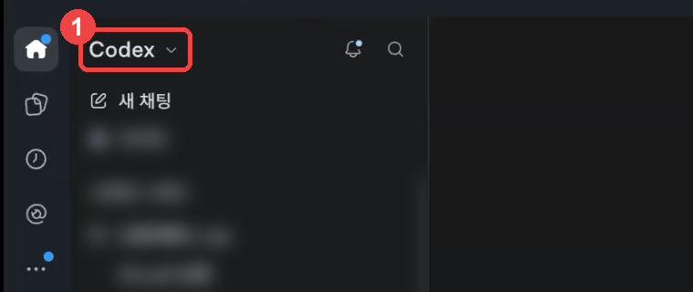
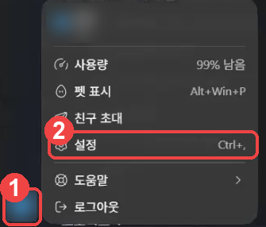
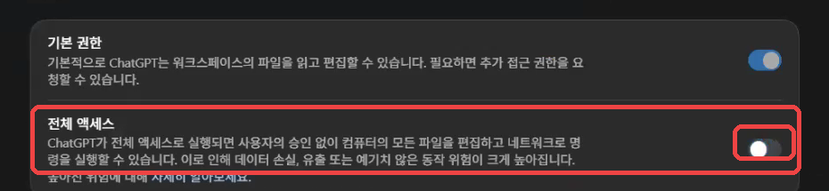
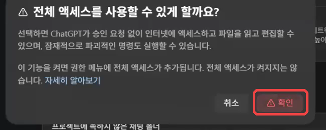
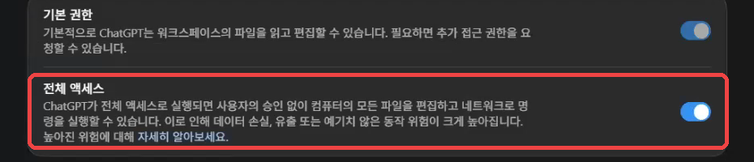
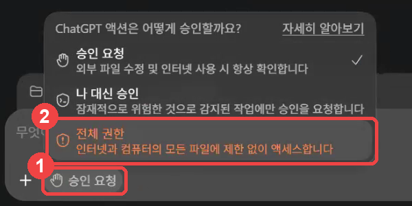
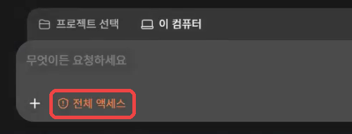
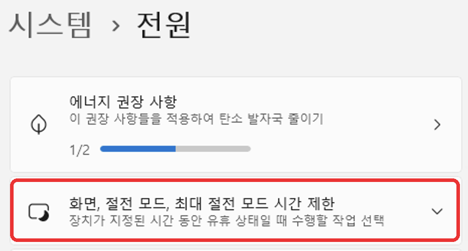
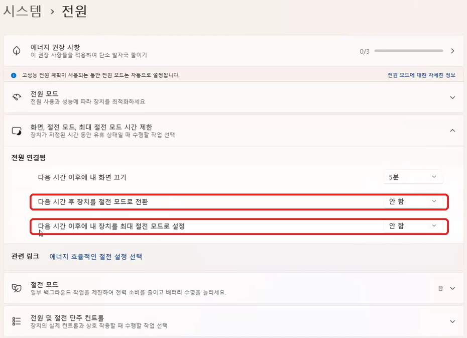

# 도움님을 위한 고급 AI 활용 안내서

명상 센터에서 활동하는 도움님과 AI를 생활에 써 보고 싶은 분을 위한 자율학습 안내서 · 2026년 11월 12일 기준

스터디 시간에 맞춰 참여하기 어려워도 괜찮습니다. **내 시간에 한 가지씩**, 이 안내서의 상자를 복사해서 해 보세요. 컴퓨터에 익숙하지 않은 분도 설치부터 따라오도록 순서와 화면을 넣었습니다.

여기서 배우는 고급 활용은 **AI가 자료를 직접 조사하고, 비교하고, 내가 쓸 파일까지 완성하게 맡기는 것**입니다. 사회와 심리, 경제를 공부할 때도, 행정 업무와 건강 정보를 알아볼 때도, 도움 활동을 준비할 때도 써 볼 수 있습니다.

<a id="map"></a>

## 한눈에 보기

| 순서 | 할 일 | 누가 | 시간 | |
|---|---|---|---|---|
| [막히면](#rescue) | 설치 없이 ChatGPT.com에 화면 보여 주고 물어보기 | 나 | 필요할 때 | 먼저 위치만 보기 |
| [0](#rules) | 시작 전에 — AI 쓸 때 지킬 네 가지, 준비물, 앱 고르기 | 읽기 | 5분 | **꼭** |
| [1](#step1) | 앱 설치하고 로그인하기 (ChatGPT 앱 또는 Claude 앱) | 나 | 15분 | **꼭** |
| [2](#step2) | AI가 멈추지 않고 일하게 권한 맞추기 | 나 | 5분 | **꼭** |
| [3](#step3) | 쉬운 말 대답 + 생활과 도움 활동 규칙 적어 두기 | AI (상자 하나) | 5분 | **꼭** |
| [4](#step4) | Aside 브라우저 연결 — 웹사이트 일을 맡기려면 | 나 + AI (상자 둘) | 20분 | **꼭** |
| [5](#step5) | 컴퓨터 사용(Computer Use) 켜기 — 엑셀 같은 내 컴퓨터 프로그램 일을 맡기려면 | 나 | 5분 | 필요할 때 |
| [6](#step6) | 컴퓨터가 잠들지 않게 하기 | 나 | 3분 | 큰 일 맡길 때 |
| [7](#step7) | 일 맡기는 법 — 기본 다섯 가지 | 읽기 | 3분 | **꼭** |
| [8](#step8) | 바로 해 보는 작은 일 — 생활과 도움 활동 예시 16가지 | 나 + AI | 일마다 5~15분 | |
| [9](#step9) | 큰 일 통째로 맡기기 — 조사에서 완성 파일까지 다섯 가지 | AI + 나의 확인 | 작업마다 다름 | |
| [참고](#chat-extra) | ChatGPT와 Gemini로 짧게 질문하고 배우기 | 나 + AI | 5~10분 | 선택 |
| [10](#help) | 잘 안될 때 | | | |

> **처음이라면 이렇게 나눠서 하세요.**
> 첫날: 0~1단계(설치와 로그인). 다음 시간: 2~3단계(권한과 규칙) → [8단계 ① 안내문](#small-first). 그다음: 4단계(Aside) → [8단계 ③ 사회 이슈](#small-society). 5단계는 화면 속 프로그램을 다룰 때, 6단계는 오래 일시킬 때 합니다. 익숙해지면 9단계에서 큰 일을 하나 고릅니다.
> 하루에 다 할 필요는 없습니다. 표의 시간은 대략적인 준비 시간이며, 설치나 AI 작업을 기다리는 시간은 더 걸릴 수 있습니다.
> 준비(1~6단계)는 **한 번만** 하면 됩니다.

**이 안내서를 보는 법**

- 회색 상자는 **AI에게 붙여 넣는 글**입니다. 상자의 **「문장 복사」** 단추를 누르고, AI 앱의 입력창을 한 번 누른 뒤 **`Ctrl` + `V`**(붙여넣기) → **`Enter`**. 상자마다 위에 적힌 목적과 남는 결과를 보고 고릅니다. 설치 상자는 내 계정의 AI 앱에만 붙입니다.
- **[ ]** 로 된 부분만 내 것으로 바꿉니다. 예시 그대로 먼저 해 봐도 됩니다. 날짜·금액 등 결과에 중요한 칸을 모르면 비워 두고 AI가 묻게 합니다.
- **`Ctrl` + `V`** 처럼 쓰인 것은 앞의 키(`Ctrl`)를 누른 채 뒤의 키(`V`)를 누르라는 뜻입니다.
- 이 안내서는 **Windows 컴퓨터**를 기준으로 합니다. 그림과 단축키도 Windows입니다.
- 웹 안내서에서 외부 사이트 주소를 누르면 **새 탭**으로 열립니다. 안내서 탭은 그대로 두고 오가면 됩니다.
- **붙여넣기 연습:** 아무 상자에서 「문장 복사」 → AI 앱 아래 입력창을 한 번 누르기 → `Ctrl` + `V` → **보내기 단추(위쪽 화살표)** 를 누릅니다. 긴 글의 [ ]를 고친 뒤에는 보내기 단추를 쓰면 줄바꿈과 헷갈리지 않습니다.
- **쉬었다 이어 보기:** 이 안내서 주소를 즐겨찾기에 넣고 마지막으로 끝낸 단계 번호를 메모합니다. 이미 끝낸 설치는 다음에 또 하지 않습니다.

---

<a id="rescue"></a>

## 시작하다 막히면 — 설치 없이 ChatGPT.com에 물어보세요

**앱 설치나 설정이 안 돼도 도움을 받을 수 있습니다.** 크롬이나 엣지에서 여는 **ChatGPT.com**에 지금 화면을 보여 주면 됩니다. 이때는 ChatGPT 앱이나 Aside가 없어도 됩니다.

### ① 안내서는 그대로 두고, 도움받을 인터넷 창 열기

1. 지금 보고 있는 안내서는 닫지 않습니다.
2. 크롬·엣지 맨 위 탭 옆의 **`+`** 를 누릅니다. 새 탭이 열립니다.
3. 맨 위 **주소창**을 누르고 `chatgpt.com`을 입력한 뒤 `Enter`를 누릅니다. 또는 [여기를 눌러 ChatGPT.com을 엽니다](https://chatgpt.com).
4. 로그인 화면이면 **내가 AI에 쓰는 계정**으로 로그인합니다. 구글로 가입했다면 **「Google로 계속하기」**를 누릅니다. 처음 가입하면 화면의 가입 안내를 따릅니다.
5. 글을 쓰는 입력창이 보이면 준비됐습니다. 별도 유료 결제부터 하지 않습니다.

> **이때 구분해 주세요.** 평소 실습은 **설치한 ChatGPT 앱(Codex)** 에서 합니다. 설치가 막혔을 때는 **크롬·엣지의 ChatGPT.com**에서 설명을 받습니다. 웹의 AI가 내 컴퓨터 화면을 저절로 보거나 직접 고치는 것은 아니므로, 아래 방법으로 화면이나 오류 문장을 알려 줍니다.

### ② 막힌 화면을 필요한 부분만 찍기

1. 막혀 있는 프로그램이나 설정 화면을 띄웁니다.
2. 키보드의 **`Windows 키` + `Shift` + `S`** 를 함께 누릅니다. 화면이 어두워지고 위쪽에 캡처 도구가 나타납니다.
3. **오류 글자와 관련 단추가 있는 부분만** 마우스로 드래그합니다. 이름, 이메일, 비밀번호, 인증번호와 회원정보가 들어가지 않게 범위를 잡습니다. 잘못 찍었으면 `Esc`로 취소하고 다시 합니다.
4. 크롬·엣지의 ChatGPT.com 탭으로 돌아갑니다. 입력창을 한 번 누른 뒤 **`Ctrl` + `V`**. 작은 그림이 붙으면 됐습니다.
5. 아래 상자의 **「문장 복사」**를 누르고, ChatGPT.com 입력창의 그림 옆에 **`Ctrl` + `V`**로 글도 붙입니다. **보내기 단추(위쪽 화살표)**를 누릅니다.

**▶ 설치·설정 중 도움받는 상자 — ChatGPT.com에 붙입니다**

```text
나는 컴퓨터를 잘 모르는 Windows 사용자야.
「도움님을 위한 고급 AI 활용 안내서」를 혼자 따라 하고 있어.

지금 하는 단계: [예: 1단계 ChatGPT 앱 설치 / 2단계 전체 액세스 / 4단계 Aside 연결].
하고 싶은 일: [예: 앱을 설치하고 로그인하기].
방금 한 일: [예: 받은 설치 파일을 두 번 눌렀음].
지금 막힌 점: [예: 첨부한 화면이 나오고 다음으로 못 감].

첨부한 화면을 보고 지금 내가 할 일 한 가지만 알려 줘.
어느 프로그램의 어디에 있는 무슨 단추인지 화면에 보이는 글자 그대로 설명해 줘.
한 번에 여러 단계나 긴 명령어를 주지 마. 내가 결과를 말하면 그다음 한 가지만 알려 줘.
모르는 원인을 단정하지 말고, 화면이 더 필요하면 어느 부분을 찍을지 알려 줘.
설치나 메뉴 정보는 현재 공식 안내를 확인하고, 버전·로그인·권한 중 어디서 막혔는지 나눠 확인해 줘.
비밀번호와 인증번호는 나에게 묻지 마. 보안·백신 끄기, 계정 이름 바꾸기, 추가 결제부터 시키지 마.
```

**내가 이어서 할 일:** AI가 말한 행동 하나를 합니다. 그런 다음 **「눌렀더니 이렇게 됐어」**라고 쓰고 새 화면을 붙입니다. 화면에 그 단추가 없으면 **「그 단추가 없어. 지금 화면 기준으로 알려 줘」**라고 합니다.

### ③ 그림이 안 붙거나 캡처가 어려우면

사진 첨부 단추가 없거나 한도 안내가 뜨면 **글만 보내도 됩니다.** 오류 문장은 전부 옮기지 않아도 됩니다. 눈에 보이는 제목과 글자 몇 줄을 그대로 적습니다. 읽을 수 없는 곳을 짐작해서 채우지 않습니다.

```text
나는 Windows 컴퓨터 초보자야. 앱 설치나 설정 중 막혔고 지금 사진을 붙일 수 없어.
프로그램 이름: [예: Microsoft Store / ChatGPT / Aside].
지금 하는 단계: [예: 안내서 1단계].
화면에 보이는 제목: [보이는 대로 적기].
오류 문장이나 단추 글자: [보이는 대로 적기].
방금 누른 것: [ ].
이미 해 본 것과 결과: [없으면 없음].
다음에 할 행동을 한 가지만 쉬운 말로 알려 줘. 판단에 꼭 필요한 것이 빠졌으면 질문도 하나씩 해 줘. 모르면 모른다고 하고 원인을 추측해서 단정하지 마.
```

**ChatGPT.com 로그인도 안 되면:** 같은 구글 계정을 쓰고 있는지 먼저 봅니다. 비밀번호 재설정은 해당 서비스의 공식 로그인 화면에서 직접 합니다. [Gemini](https://gemini.google.com)에 로그인돼 있다면 위 상자를 거기에 붙여 설명을 받아도 됩니다. 둘 다 이용할 수 없거나 AI 안내대로 두 번 해도 같은 곳에서 막히면, 아래 [담당자에게 도움 청하기](#human-help)로 갑니다.

**설치나 설정이 풀리면:** 안내서에서 하던 단계로 돌아옵니다. 웹에서 받은 설치 상자를 웹에 계속 보내지 않고, **설치한 ChatGPT 앱(Codex)** 의 입력창에 붙입니다.

---

<a id="rules"></a>

## 0단계. 시작 전에

### AI를 쓸 때 꼭 지킬 네 가지

1. **회원과 가족의 개인정보, 개인 상담기록은 AI에게 보여 주지 않습니다.** 실명, 연락처, 주소, 주민등록번호, 계좌번호와 건강 정보가 담긴 파일·사진·화면은 넣지 않습니다. 실습은 가상 자료나 이름 없는 집계로 합니다.
2. **인증과 민감한 화면은 내가 다룹니다.** 비밀번호와 인증번호를 대화에 적지 않습니다. 은행, 카드, 보험, 세금과 개인 진료기록 화면을 AI에게 맡기지 않습니다. 행정 업무는 공개된 공식 안내를 조사하고 준비물을 만드는 것부터 합니다.
3. **돈·제출·발송·공개·삭제는 사람이 승인합니다.** AI가 **「✋ 승인 필요」** 를 보여 주면 대상, 내용, 금액을 읽고 결정합니다. 이 안내서의 큰 실습은 초안과 준비 자료까지만 만들며 실제 신청이나 발송은 하지 않습니다.
4. **중요한 사실은 원문으로 한 번 더 확인합니다.** 법·제도·금액·건강 정보에는 출처 주소와 확인 날짜를 붙이게 합니다. AI의 말만으로 지원 대상, 진단, 치료나 투자 결정을 확정하지 않습니다. 명상이 치료 효과를 보장하거나 치료를 대신한다고 쓰지 않습니다.

### 준비물

- **컴퓨터:** 이 안내서의 화면을 따라 할 Windows PC. 휴대폰만으로는 본 실습의 내 컴퓨터 파일 작업과 Aside 연결을 할 수 없습니다. 설치 가능한 운영체제는 각 공식 다운로드 화면에서 확인합니다.
- **프로그램 설치 권한:** 함께 쓰는 센터 PC에서는 관리자에게 「ChatGPT 앱과 Aside 브라우저 설치가 가능한지」 확인합니다. 설치 제한을 임의로 풀지 않습니다.
- **AI 유료 요금제 하나:** ChatGPT **Plus** 또는 Claude **Pro**. 본 안내서는 유료 플랜을 기준으로 합니다. 이미 구독 중이면 같은 계정으로 로그인합니다. 가격, 세금과 제공 기능은 가입하는 날 **공식 결제 화면**에서 확인합니다. [요금제별 기능 확인](https://learn.chatgpt.com/docs/pricing).
- **이메일 계정:** 구글 계정이 있으면 로그인이 가장 쉽습니다.

> **처음에는 유료 플랜 하나로 시작하세요.** 이 안내서의 주 경로는 **ChatGPT 앱(Codex) + Aside**입니다. 이미 Claude Pro를 쓰는 분을 위해 대체 경로도 남겨 두었습니다. 두 앱을 모두 결제할 필요는 없습니다. 무료 대화 도구의 활용은 [잠깐 참고](#chat-extra)에 모았습니다.

### 앱은 하나만 고릅니다

| | **ChatGPT 앱** | **Claude 앱** |
|---|---|---|
| 만든 회사 | OpenAI | Anthropic |
| 요금제 | ChatGPT Plus 이상 | Claude Pro 이상 |
| 이 안내서에서 쓰는 곳 | 앱 안의 **「Codex」** | 앱 안의 **「코드(Code)」** 탭 |
| 이 안내서의 그림 | **있음** | 없음 (글로 안내) |
| 상자(붙여 넣는 글) | 같은 상자를 씁니다 | 같은 상자를 씁니다 |

**처음이면 ChatGPT 앱을 권합니다.** 이 안내서의 그림이 ChatGPT 앱 화면이고, 같은 방법을 AI 자동화 스터디 참가자 여러 명이 먼저 해 봤습니다. 이미 Claude를 쓰고 있다면 Claude 앱으로 해도 됩니다. **둘 다 할 필요는 없습니다.** 아래 단계에서 내가 고른 앱의 부분(A 또는 B)만 하면 됩니다.

---

<a id="step1"></a>

## 1단계. 앱 설치하고 로그인하기

> **여기서 막히면:** [이 단계에서 자주 막히는 곳](#install-help)을 봅니다. 앱이 안 열리면 [설치 없이 ChatGPT.com에 물어보는 방법](#rescue)을 따라 하세요.

이 안내서의 설치와 권한 설정은 **컴퓨터에 프로그램으로 설치하는 앱**에서 합니다. 웹사이트에서도 대화와 일부 파일 작업을 할 수 있지만, 여기서는 **내 컴퓨터의 작업 폴더를 고르고 Aside를 연결하는 방식**을 따라 합니다.

<a id="step1-chatgpt"></a>

### 1-A. ChatGPT 앱

**① 설치**

Windows는 아래 네 순서를 따라 합니다.

1. 아래 주소를 누릅니다. 설치 파일이 **다운로드 폴더**에 받아집니다.
    👉 <https://get.microsoft.com/installer/download/9PLM9XGG6VKS?cid=website_cta_psi>
2. 받은 파일을 **두 번 눌러** 실행합니다. (안 보이면 **`Windows 키` + `E`** → 왼쪽 **다운로드**에서 찾습니다.)
3. **Microsoft Store** 창이 열리면 **「설치」** 를 누르고 끝날 때까지 기다립니다.
4. **「열기」** 를 누릅니다. 다음부터는 **`Windows 키`** 를 누르고 `ChatGPT` 라고 쳐서 엽니다.

위 Windows 주소가 안 열리면 **Microsoft Store** 앱에서 `ChatGPT` 를 검색해, 만든 곳이 **OpenAI** 인 앱을 설치합니다.

**② 로그인**

1. 앱이 열리면 **「로그인」** 을 누릅니다.
2. **ChatGPT 유료 계정**으로 로그인합니다. 구글 계정으로 가입했다면 **「Google로 계속하기」**.
3. 로그인 화면이 인터넷 창으로 열리면 거기서 로그인합니다. 끝나면 앱으로 돌아옵니다.

**③ 내 대화가 AI 학습에 쓰이지 않게 끄기**

1. 왼쪽 아래 **동그라미(내 이름 첫 글자)** → **「설정」**.
2. 왼쪽 **「데이터 관리」** → **「모델 개선을 위한 데이터 학습 허용」** 스위치를 **끕니다.**

**④ Codex 열기**

**왼쪽 위**가 **「Codex ⌄」** 인지 봅니다. **「ChatGPT」** 라고 쓰여 있으면 그 글자를 눌러 **「Codex」** 로 바꿉니다.



> **어디에 붙이나요?** 이 안내서는 **ChatGPT 앱(Codex)** 을 기준으로 작업 폴더와 설정을 맞춥니다. 「ChatGPT」 아래에도 채팅과 Work 등 다른 모드가 있으므로, 설치·설정 상자는 **왼쪽 위가 「Codex」인 곳**에 붙여 넣습니다.

**⑤ 작업 폴더 만들기**

1. **「새 채팅」** 을 누릅니다. 폴더를 고르라는 창이 뜹니다.
2. 창 왼쪽에서 **문서**를 누릅니다. 빈 곳에서 **마우스 오른쪽 단추 → 새로 만들기 → 폴더**, 이름은 `AI작업` → `Enter`.
3. 그 폴더를 한 번 누르고 **「폴더 선택」**. 「이 폴더를 신뢰할까요?」라고 물으면 **「신뢰」** (방금 만든 빈 폴더라 안전합니다).
4. 화면 맨 아래 **입력창**이 보이면 1단계 끝입니다.

<a id="step1-claude"></a>

### 1-B. Claude 앱

**① 설치**

1. <https://claude.com/download> 를 엽니다.
2. **Windows용**을 받아 두 번 눌러 설치합니다. 「이 앱이 디바이스를 변경할 수 있도록 허용하시겠어요?」가 뜨면 **「예」**.

**② 로그인과 요금제**

1. **「Google로 계속하기」** 또는 이메일로 로그인합니다.
2. **Pro 이상** 유료 요금제여야 합니다. 무료 요금제에서는 「코드(Code)」 탭을 쓸 수 없습니다.

**③ 내 대화가 AI 학습에 쓰이지 않게 끄기**

왼쪽 아래 **내 이름** → **「설정」** → **「개인정보 보호(Privacy)」** → **「Claude 개선에 도움(Help improve Claude)」** 스위치를 **끕니다.**

**④ 코드(Code) 탭 열고 작업 폴더 고르기**

1. 왼쪽 위의 **「코드(Code)」** 를 누릅니다. (**이 안내서에서 쓰는 곳은 「코드」 탭입니다.**)
2. 입력창 아래 **환경 단추**에서 **「로컬(Local)」** 이 골라져 있는지 봅니다.
3. 옆의 **폴더 단추** → **「폴더 열기(Open folder…)」** → **문서** 안에 `AI작업` 폴더를 새로 만들어 고릅니다. 「이 폴더를 신뢰할까요?」라고 물으면 허용합니다.
4. 맨 아래 **입력창**이 보이면 1단계 끝입니다.

> 「Git이 필요합니다(Git is required)」가 나오면 <https://git-scm.com/downloads/win> 에서 **Git for Windows** 를 받아, 설치 화면에서 계속 **「Next」** 만 눌러 설치하고 Claude 앱을 다시 엽니다.

---

<a id="step2"></a>

## 2단계. AI가 멈추지 않고 일하게 권한 맞추기

> **여기서 막히면:** [이 단계에서 자주 막히는 곳](#permissions-help)을 봅니다. 앱이 안 열리면 [설치 없이 ChatGPT.com에 물어보는 방법](#rescue)을 따라 하세요.

AI는 파일을 만들거나 프로그램을 설치할 때마다 「해도 될까요?」라고 묻습니다. 일이 클수록 수십 번 묻다가 멈춰 버립니다. 그래서 여기서는 **AI가 파일 작업을 계속할 수 있게** 권한을 맞춥니다. **전체 액세스는 작업 폴더 밖의 파일도 읽고 바꿀 수 있는 권한**입니다. 내가 관리하는 개인용 컴퓨터에서, 개인정보를 넣지 않은 작업 폴더로 실습합니다. 공유 PC에서는 관리자의 허용 범위 안에서 진행합니다. [0단계의 네 가지](#rules)와 다음 단계의 규칙도 함께 지킵니다. 규칙 문장이 접근 자체를 기술적으로 막아 주는 것은 아닙니다.

<a id="step2-chatgpt"></a>

### 2-A. ChatGPT 앱

**① 설정에서 「전체 액세스」 켜기**

1. 왼쪽 아래 **동그라미** → **「설정」**. (키보드로는 `Ctrl` + `,`)

    

2. 왼쪽 **「일반」** 에서 오른쪽 **「권한」** 칸의 **「전체 액세스」** 스위치를 누릅니다.

    

3. 「전체 액세스를 사용할 수 있게 할까요?」 창에서 **「확인」**.

    

4. 스위치가 **파랗게** 바뀌면 됩니다.

    

> **여기서 끝이 아닙니다.** 이 스위치는 대화의 메뉴에 「전체 권한」을 **보이게** 할 뿐입니다. 아래 ②가 꼭 필요합니다.

**② 대화에서 「전체 권한」 고르기**

1. 왼쪽 위 **「새 채팅」** 을 누릅니다.
2. 입력창 **아래 왼쪽**의 **「승인 요청」** 단추를 누릅니다.
3. 메뉴 맨 아래 **주황색 「전체 권한」** 을 누릅니다.

    

단추가 **주황색 「전체 액세스」** 로 바뀌면 끝입니다. ✅ 앱은 마지막으로 고른 권한을 기억해서, 다음 새 채팅도 「전체 액세스」로 시작합니다.



**③ 앞으로도 계속 그렇게 — 상자 하나**

앱이 가끔 「승인 요청」으로 돌아가는 일이 있어서 설정 파일에도 적어 둡니다. 방금 연 「전체 액세스」 대화에 붙여 넣습니다.

**▶ 상자 ① — 전체 액세스를 설정 파일에 적기 (ChatGPT 앱만)**

```text
ChatGPT 앱(Codex)이 앞으로 매번 묻지 않고 전체 액세스로 일하도록 설정해 줘.
1. 내 사용자 설정 파일 config.toml을 찾아 줘. %USERPROFILE%\.codex\config.toml 이야. 없으면 새로 만들어.
2. 고치기 전에 같은 폴더에 config.toml.bak 으로 복사해 둬.
3. 파일 맨 위, 대괄호 [ ] 로 시작하는 첫 줄보다 앞에 아래 두 줄을 넣어 줘. 이미 있으면 값만 바꾸고, 다른 줄은 지우거나 바꾸지 마.
approval_policy = "never"
sandbox_mode = "danger-full-access"
4. 끝나면 바꾼 두 줄만 보여 주고, 앱을 완전히 껐다 켜라고 알려 줘.
```

AI가 끝났다고 하면 [앱을 완전히 껐다 켭니다](#restart). 다시 연 뒤 새 채팅의 입력창 아래가 **「전체 액세스」** 면 성공입니다.

<a id="step2-claude"></a>

### 2-B. Claude 앱

1. 코드(Code) 탭의 **입력창 근처 권한 모드 단추**를 누릅니다. (처음에는 **「수동(Manual)」** 으로 되어 있습니다.)
2. **「자동(Auto)」** 을 고릅니다.
    - 자동에서는 AI가 안전한 일은 묻지 않고 하고, 위험해 보이는 일은 스스로 멈춥니다.
    - 목록에 「자동」이 없으면 「수동」 그대로 둡니다. 그때는 AI가 물을 때마다 내용을 보고 **허용** 단추를 누릅니다.
3. **4단계의 상자 ②를 보낼 때만** 「수동」으로 바꿉니다. 프로그램을 내려받아 설치하는 일은 자동 모드가 막을 수 있어서입니다. 설치가 끝나면 다시 「자동」으로 돌립니다.

> 「권한 우회(Bypass permissions)」 모드는 쓰지 않습니다. 이 안내서의 일에는 「자동」이면 충분합니다.

<a id="restart"></a>

### 앱을 「완전히」 껐다 켜는 법 (이 안내서에서 여러 번 씁니다)


창의 X만 누르면 앱이 화면 오른쪽 아래에 숨어서 계속 켜져 있습니다. 새 설정을 읽게 하려면 완전히 꺼야 합니다.

창을 닫은 뒤, 화면 **오른쪽 아래 작업 표시줄**의 **`^`** 를 누릅니다. ChatGPT(또는 Claude) 아이콘을 **마우스 오른쪽 단추**로 누르고 **「종료」**. 그리고 다시 엽니다.

---

<a id="step3"></a>

## 3단계. 쉬운 말 대답 + 생활과 도움 활동 규칙 적어 두기 — 상자 하나

> **여기서 막히면:** [이 단계에서 자주 막히는 곳](#permissions-help)을 봅니다. 앱이 안 열리면 [설치 없이 ChatGPT.com에 물어보는 방법](#rescue)을 따라 하세요.

AI는 원래 개발자에게 하듯 어렵게 말합니다. 아래 상자 하나로 **모든 대화에서** 이렇게 바뀝니다.

| 구분 | 이렇게 바뀝니다 |
|---|---|
| 맨 위 | **📍 지금 상태** · **🙋 내가 할 일** · **❓ 내가 정할 것**만 짧게 |
| 말투 | 쉬운 말, 존댓말. 영어 낱말과 명령어는 빠집니다 |
| 생활과 도움 활동 규칙 | 개인정보와 민감한 화면은 다루지 않기, 결제·제출·발송 전 승인, 중요한 사실에는 출처 |

**예시 — 바꾼 뒤의 대답**

> **📍 지금 상태:** ⏳ 하는 중이에요 ■■■□□ 3/5단계
> **🙋 내가 할 일:** 없어요
> **❓ 내가 정할 것:** 안내문 글씨 크기를 골라 주세요. ① 크게 (추천) ② 보통 — 번호만 답하면 돼요.
>
> ─── 더 알고 싶으면 ───
> 안내문 3장 중 2장을 만들었어요. 문서의 「AI작업」 폴더에 있어요.

**하는 법**

1. **「전체 액세스」인 새 채팅**(Claude 앱은 코드 탭의 새 세션)을 엽니다.
2. 아래 상자를 붙여 넣고 보냅니다.
3. AI가 끝났다고 하면 [앱을 완전히 껐다 켭니다](#restart).
4. 새 채팅에서 `앞으로 나에게 어떤 모양으로 대답할지 예시를 하나 보여 줘.` 라고 보냅니다. 맨 위에 **「📍 지금 상태」, 「🙋 내가 할 일」** 이 보이면 끝입니다. 🎉

**▶ 상자 ② — 쉬운 말 대답 + 생활과 도움 활동 규칙 (두 앱 공통)**

```text
앞으로 네 대답이 쉽고 짧아지고, 생활과 도움 활동 규칙을 지키도록 아래 두 규칙을 너의 전역 지침에 적어 줘.

1. 네가 모든 대화에서 읽는 전역 지침 파일을 찾아 줘.
   - 네가 ChatGPT 앱의 Codex라면: %USERPROFILE%\.codex\AGENTS.md
   - 네가 Claude 앱의 코드 탭(Claude Code)이라면: %USERPROFILE%\.claude\CLAUDE.md
   파일이 없으면 새로 만들어.
2. 고치기 전에 같은 폴더에 .bak 을 붙인 이름으로 복사해 둬.
3. 원래 있던 내용은 지우거나 바꾸지 마. 파일 맨 끝에 [대답 규칙]과 [생활과 도움 활동 규칙]을 「## 대답 규칙」 줄부터 끝까지 그대로 덧붙여 줘. 같은 제목이 이미 있으면 그 부분만 이것으로 바꿔.
4. 이 대화에서도 지금부터 이 규칙대로 대답해. 끝나면 이 규칙의 모양으로 세 줄 안에 알려 주고, 앱을 완전히 껐다 켜라고 알려 줘.

[대답 규칙]
## 대답 규칙
나는 컴퓨터 전문가가 아니다. 나와 대화할 때 하는 대답은 이 규칙을 따른다. 내가 그 대화에서 따로 부탁한 방식이 있으면 그것을 먼저 따른다.

일을 맡았을 때의 대답은 맨 위에 꼭 알아야 할 것만 이 순서로 쓴다.
- 📍 지금 상태: ✅ 끝났어요 / ⏳ 하는 중이에요 / ⚠️ 막혔어요 중 하나와 한 줄 설명. 단계가 여럿이면 「■■■□□ 3/5단계」처럼 보여 준다.
- 🙋 내가 할 일: 번호를 붙여 한 줄에 한 가지씩, 한 번에 세 가지까지만. 어느 프로그램의 어디에 있는 무슨 단추인지 화면에 보이는 글자 그대로 쓴다. 없으면 「없어요」라고 쓴다.
- ❓ 내가 정할 것: 꼭 내가 정해야 하는 것만 모아서 쓴다. 보기를 ①②③으로 주고 추천하는 보기에 「(추천)」을 붙여 번호만 답해도 되게 한다. 없으면 이 줄은 쓰지 않는다.
- ✋ 승인 필요: 돈이 들거나 되돌리기 어려운 일(결제, 제출, 공개, 발송, 삭제)은 하기 전에 멈추고 무엇을, 왜, 얼마가 드는지 쓴다.
그 아래에 「─── 더 알고 싶으면 ───」 줄을 넣고, 만든 것과 열어 볼 곳, 참고할 내용을 쓴다.
간단한 질문에는 이 틀 없이 쉬운 말로 짧게 답한다.

쉽게 쓰는 법
- 중학생이 읽어도 알아듣는 말로 쓴다. 한 문장에 한 가지만 짧게 쓴다. 친절한 존댓말(~해요)로 쓴다.
- 영어 낱말, 전문 용어, 명령어, 코드, 긴 파일 경로는 쓰지 않는다. 꼭 써야 하면 바로 뒤 괄호에 쉬운 말로 풀어 준다. 파일 위치는 「문서의 AI작업 폴더」처럼 말한다.
- 어떤 기술을 썼는지, 무슨 문제가 생겨 어떻게 고쳤는지 같은 만드는 과정 이야기는 하지 않는다. 결과와 내가 할 일만 말한다. 과정은 내가 「자세히」라고 물을 때만 쉬운 말로 설명한다.
- 오류 원문이 필요하면 「─── 더 알고 싶으면 ───」 아래에 「물어볼 때 쓰는 원문」이라고 적고 넣는다.
- 비교와 목록은 3칸 이하의 표로, 순서는 「① → ② → ③」 화살표로 보여 준다.
- 맨 위 부분은 휴대폰 한 화면에 들어가게 짧게 쓴다.
- 겁주는 말을 쓰지 않는다. 문제가 생기면 「제가 다른 방법으로 해 볼게요」처럼 무엇을 할지 말한다. 안 된 것을 됐다고 하지 않는다.
- 이 규칙은 나와 대화할 때의 대답에만 쓴다. 내가 만들어 달라고 한 문서, 보고서, 안내문, 프로그램의 내용은 그 목적과 읽을 사람에 맞게 쓴다.

[생활과 도움 활동 규칙]
## 생활과 도움 활동 규칙
나는 명상 센터에서 활동하는 도움님이며 사회·심리·경제와 일상생활의 여러 일에도 AI를 쓴다.
- 회원·가족·타인의 실명, 연락처, 주소, 주민등록번호, 계좌번호, 건강 정보와 개인 상담기록은 다루지 않는다. 발견하면 더 읽거나 옮기지 말고 나에게 알린다. 가상 자료나 식별정보 없는 집계를 우선한다.
- 은행, 카드, 보험, 세금과 개인 진료기록 화면은 열거나 보거나 입력하지 않는다. 행정 업무는 공개된 공식 안내를 조사해 준비 자료를 만든다.
- 비밀번호, 인증번호, 카드번호, 주민등록번호는 묻지도 입력하지도 않는다. 필요한 로그인과 인증은 내가 화면에서 직접 한다.
- 결제, 신청·제출, 메일·문자 발송, 게시·공개, 삭제는 직전에 멈추고 「✋ 승인 필요」로 대상, 내용과 비용을 보여 준다. 내가 구체적으로 승인할 때만 한다. 작업 요청에 하지 말라고 한 행위는 하지 않는다.
- 제도, 법, 금액과 건강 정보는 실제 확인한 원문 주소와 확인 날짜를 붙인다. 사실과 해석, 전망을 구분하고 모르는 것은 [확인 필요]로 둔다. 진단, 약 변경이나 투자 주문은 하지 않는다.
- 센터의 공식 가르침은 내가 준 자료를 따른다. 실제 회원 사례와 성공담을 만들지 않는다. 가상 예시는 가상이라고 표시한다. 명상의 치료 효과를 보장하거나 치료를 대신한다고 쓰지 않는다.
- 원본은 보존하고, 만든 파일은 이 대화의 작업 폴더에 새 이름으로 저장한다. 워드, PDF, 엑셀, 파워포인트 등 내가 열어 볼 형식으로 만든다. 완료 전 실제 파일과 중요한 출처·숫자를 확인한다.

```

**내 마음에 맞게 고치기** — 아무 대화에서나 이렇게 말하고, 앱을 껐다 켭니다.

| 이럴 때 | 이렇게 쓰기 |
|---|---|
| 너무 쉽다 | "전역 지침의 대답 규칙에서 「중학생」을 「대학생」으로 바꿔 줘" |
| 아직도 길다 | "전역 지침의 대답 규칙에 「맨 위는 다섯 줄 안으로」를 더해 줘" |
| 과정도 알고 싶다 | "전역 지침의 대답 규칙에서 「만드는 과정 이야기는 하지 않는다」를 빼 줘" |

---

<a id="step4"></a>

## 4단계. Aside 브라우저 연결 — 웹사이트 일을 맡기려면

> **여기서 막히면:** [이 단계에서 자주 막히는 곳](#aside-help)을 봅니다. 앱이 안 열리면 [설치 없이 ChatGPT.com에 물어보는 방법](#rescue)을 따라 하세요.

**Aside** 는 **AI가 쓰는 인터넷 창**입니다. 크롬·엣지 같은 브라우저인데, AI가 이 창을 직접 움직여 웹사이트를 찾고, 읽고, 입력합니다. **내가 쓰는 크롬·엣지와 내 마우스는 건드리지 않습니다.** 그동안 나는 다른 일을 할 수 있습니다.

로그인처럼 사람이 해야 하는 화면이 나오면 AI가 그 화면을 Aside에 띄워 두고 **「🙋 사람 차례」** 라고 알려 줍니다. 나는 Aside 창에서 그것만 하면 됩니다.

### 4-1. Aside 설치하고 로그인하기 (나)

**작업 표시줄에 Aside가 있고, 열었을 때 로그인 화면이 아니면 4-2로 가세요.**

1. <https://aside.com/download> 를 엽니다. 내 컴퓨터에 맞는 설치 파일이 받아집니다.
2. 받은 파일을 **두 번 눌러** 설치합니다. 「이 앱이 디바이스를 변경할 수 있도록 허용하시겠어요?」가 뜨면 **「예」**.
3. Aside가 열리면 **로그인(Sign in)** 화면이 나옵니다. 계정이 없으면 새로 만듭니다. **AI 앱에 쓰는 것과 같은 구글 계정**으로 만들면 기억할 것이 줄어듭니다.
4. 이어서 나오는 **다른 브라우저 데이터 가져오기(Import)**, **비밀번호 관리자(Password Manager)** 화면은 **「Skip」** 을 누릅니다.
5. Aside는 **켜 둔 채로** AI 앱으로 돌아갑니다.

> Aside 화면은 영어입니다. 위에 적은 글자만 찾아 누르면 됩니다. **Aside 결제, Aside 안에서 ChatGPT·Claude 계정 연결(Models → Providers)은 하지 않습니다.** 우리는 AI 앱이 Aside를 직접 움직이게 합니다.

### 4-2. Aside 연결 맞추기 — 상자 하나 (AI)

1. **ChatGPT 앱:** 「전체 액세스」인 새 채팅을 엽니다.
    **Claude 앱:** 코드 탭 새 세션을 열고 권한 모드를 **「수동(Manual)」** 으로 바꿉니다. AI가 설치할 때마다 허락을 물으면 **허용**을 누릅니다.
2. Aside를 켜 둔 채로 아래 상자를 붙여 넣고 보냅니다. 글이 계속 올라오는 것은 AI가 일하는 중입니다. **5~10분** 기다립니다.
3. AI가 세 줄로 결과를 알려 주면 [앱을 완전히 껐다 켭니다](#restart). Claude 앱은 다시 연 뒤 권한 모드를 **「자동」** 으로 돌립니다.

> 화면이 어두워지며 「이 앱이 디바이스를 변경할 수 있도록 허용하시겠어요?」가 뜨면 Windows의 확인 창입니다. **AI가 방금 「관리자 권한이 필요하다」고 말한 직후에만 「예」**, 아무 일도 안 시켰는데 뜨면 **「아니요」** 를 누릅니다.

**▶ 상자 ③ — Aside 연결 맞추기 (두 앱 공통)**

```text
나는 컴퓨터 초보자야. 이 AI 앱이 Aside 브라우저를 직접 움직여 웹 일을 하도록 연결을 맞춰 줘. 내가 할 일은 최소로 줄이고, 끝나면 쉬운 한국어로 짧게 알려 줘.
Aside 오류가 나도 로그인 문제라고 단정하지 말고 오류 원문을 보여 줘. Aside 다시 설치·로그아웃·결제·Aside 안의 AI 계정 연결·원격 제어는 요구하지 마.

먼저 네가 어느 쪽인지 확인해. ChatGPT 앱의 Codex면 아래에서 [Codex], Claude 앱의 코드 탭(Claude Code)이면 [Claude]를 따라.

1. aside 명령(Aside CLI)이 있는지 확인해 줘. PowerShell에서 Test-Path "$env:LOCALAPPDATA\Aside\CLI\current\aside.exe" 로 본다. 없으면 맨 아래 [Windows 설치 명령]을 PowerShell에서 그대로 실행해 설치해. 이 설치에 한해 Aside 공식 주소(releases.aside.com)에서 내려받아도 돼. 서명 확인을 빼거나 보안을 끄지 마.
   설치 직후 aside 라고만 쳐서 안 잡히면, 전체 경로 "$env:LOCALAPPDATA\Aside\CLI\current\aside.exe" 로 실행해.
2. aside --update 와 aside guide 를 실행해 읽어 줘.
3. aside-browser 스킬을 설치해 줘(이미 있으면 그대로 둬). [Codex] aside skills install --target codex  [Claude] aside skills install --target claude-code
   실제 SKILL.md 위치를 확인해 줘.
4. 네가 모든 대화에서 읽는 전역 지침 파일을 찾아([Codex] 사용자 홈의 .codex/AGENTS.md, [Claude] 사용자 홈의 .claude/CLAUDE.md), 원래 내용은 그대로 두고 아래 규칙이 없으면 덧붙여 줘. 예전에 넣은 Aside 규칙이 있으면 겹치지 않게 이 문장으로 정리해 줘.
   "웹사이트를 열고 읽고 입력하는 웹 작업은 Aside(aside CLI와 aside-browser 스킬)로 한다. 쓰기 전에 aside --update 와 aside guide 를 실행해 읽는다. 내가 aside repl로 직접 읽고 클릭하며, aside exec처럼 Aside 안의 AI에게 일을 넘기는 명령은 쓰지 않는다. 사용자의 마우스·키보드와 사용자가 보고 있는 창·탭은 건드리지 않는다. 로그인·인증처럼 사람이 할 화면은 Aside 탭에 띄워 두고 닫지 않은 채 「🙋 사람 차례: [탭 제목] 탭에서 [할 일]」로 알린다. Aside가 안 되면 다른 브라우저로 바꾸지 말고 오류 원문과 함께 알린다. 단, Aside CLI를 설치·업데이트할 때는 Aside 공식 주소(releases.aside.com, docs.aside.com)에서 내려받아도 된다."
5. 끝나면 세 줄로 알려 줘. ① aside 명령: 새로 설치함 / 이미 있었음 ② 스킬 위치 ③ 규칙을 적은 파일. 그리고 앱을 완전히 껐다 켜라고 알려 줘. 아직 웹사이트는 열지 마.

[Windows 설치 명령 — 출처 https://docs.aside.com/help/developers]
$ErrorActionPreference = 'Stop'
$ProgressPreference = 'SilentlyContinue'
$installer = Join-Path $env:TEMP 'aside-install.ps1'
$publisher = 'CN=AT YOUR SIDE INC, O=AT YOUR SIDE INC, L=San Francisco, S=California, C=US'
Invoke-WebRequest -UseBasicParsing -Uri https://releases.aside.com/install.ps1 -OutFile $installer
$signature = Get-AuthenticodeSignature -LiteralPath $installer
if ($signature.Status -ne 'Valid' -or $null -eq $signature.SignerCertificate -or $signature.SignerCertificate.Subject -ne $publisher -or $null -eq $signature.TimeStamperCertificate) {
  throw "Aside CLI installer signature verification failed ($($signature.Status): $($signature.StatusMessage))."
}
& $installer
```

### 4-3. 연결 확인 — 상자 하나

다시 연 앱에서 **새 채팅**(Claude 앱은 코드 탭 새 세션)을 열고 붙여 넣습니다.

**▶ 상자 ④ — 연결 확인**

```text
Aside 연결을 확인해 줘. aside-browser 스킬을 읽고, aside repl로 네이버 첫 화면(https://www.naver.com)을 열어 페이지 제목만 알려 줘. 실패하면 로그인 문제라고 하지 말고, 오류 원문과 내가 할 일 한 가지만 알려 줘.
```

**「NAVER」 같은 제목이 나오면 연결 끝입니다.** 🎉 확인하는 동안 내 마우스와 보고 있던 창이 그대로였는지도 봅니다.

---

<a id="step5"></a>

## 5단계. 컴퓨터 사용(Computer Use) 켜기 — 내 컴퓨터 프로그램 일을 맡기려면

**컴퓨터 사용**을 켜면 AI가 **내 화면을 보고 마우스와 키보드를 직접 움직여** 엑셀, 워드, 한글, 파일 탐색기 같은 프로그램을 다룹니다. 사람이 하던 클릭과 입력을 AI가 대신 합니다.

| | **Aside** (4단계) | **컴퓨터 사용** (5단계) |
|---|---|---|
| 무엇을 | **웹사이트** 일 | **내 컴퓨터 프로그램** 일 (엑셀, 워드, 한글, 파일 탐색기) |
| 내 화면 | 건드리지 않습니다. 나는 다른 일을 해도 됩니다 | **내 마우스·키보드가 움직입니다.** 그동안 손을 떼고 지켜봅니다 |
| 먼저 쓸 것 | 웹 일은 항상 Aside | 파일을 직접 만드는 것으로 안 될 때만 |

> AI는 컴퓨터 사용 없이도 엑셀·워드 **파일을 직접 만들고 고칩니다.** 컴퓨터 사용은 「지금 열려 있는 엑셀 화면에서」처럼 **화면 속 프로그램을 다뤄야 할 때** 씁니다. [공식 컴퓨터 사용 안내](https://learn.chatgpt.com/docs/computer-use)에서 내 계정의 지원 여부를 확인할 수 있습니다.
>
> **회원정보·개인 상담기록과 은행·카드·보험·세금·진료기록 화면에는 컴퓨터 사용을 쓰지 않습니다.** 허락 창이 뜨면 **엑셀, 워드, 한글, 파워포인트, 파일 탐색기만** 허용합니다.

<a id="step5-chatgpt"></a>

### 5-A. ChatGPT 앱

**켜기**

1. 왼쪽 아래 **동그라미** → **「설정」** → 왼쪽 **「컴퓨터 사용」**.
2. **「제어」** 칸의 **「모든 앱」** 줄을 봅니다.
    - **「설치」** 단추가 있으면 누르고, 나오는 안내대로 진행합니다.
    - 스위치가 꺼져 있으면 눌러 **파랗게** 켭니다.

**쓰기**

입력창에 **`@`** 를 치면 목록이 나옵니다. **「컴퓨터」** 를 고르고 할 일을 씁니다.

```text
@컴퓨터 문서의 AI작업 폴더에 있는 [11월 생활비.xlsx]를 엑셀로 열어서, 항목별 합계 줄을 맨 아래에 넣어 줘. 저장은 다른 이름([11월 생활비_합계.xlsx])으로 하고, 원래 파일은 바꾸지 마.
```

- 처음 쓰는 프로그램이면 **「ChatGPT가 Excel을(를) 사용하도록 허용할까요?」** 창이 뜹니다. **「이 대화 허용」** 을 누릅니다. 매번 묻지 않게 하려면 **「항상 허용」**.
- 「항상 허용」한 프로그램은 **설정 → 컴퓨터 사용 → 「항상 허용된 앱」** 에서 지울 수 있습니다.
- AI가 일하는 동안 마우스·키보드에서 손을 뗍니다. 다룰 프로그램이 화면에 보여야 하고, **PC를 잠그면 멈춥니다.** 멈추려면 입력창 옆 **정지(■)** 단추를 누릅니다.

<a id="step5-claude"></a>

### 5-B. Claude 앱

**켜기**

1. 왼쪽 아래 **내 이름** → **「설정」** → **「기능(Capabilities)」**.
2. **「컴퓨터 사용(Computer use)」** 칸의 **「컴퓨터 사용 활성화(Enable computer use)」** 스위치를 켭니다.
    - 「기능」에 그 칸이 없으면 **「설정」 → 「시스템(System)」** 의 **「이 컴퓨터(This computer)」** 에서 찾습니다.
    - 보이지 않으면 앱을 최신 판으로 업데이트합니다. 이 기능은 **Pro·Max 같은 개인 유료 요금제**에서만 됩니다.
3. 켜자마자 됩니다. 앱을 다시 켤 필요는 없습니다.

**쓰기**

코드 탭에서 그냥 말하면 됩니다. 예: `문서의 AI작업 폴더의 [11월 생활비.xlsx]를 엑셀로 직접 열어서 …`

- 프로그램마다 처음에 허락을 묻습니다. **「이번 세션 허용(Allow for this session)」** 을 누릅니다. 회원정보나 금융·진료기록이 있는 프로그램이면 **「거부(Deny)」**.
- 컴퓨터가 깨어 있고 Claude 앱이 켜져 있어야 합니다.

---

<a id="step6"></a>

## 6단계. 컴퓨터가 잠들지 않게 하기

**컴퓨터가 잠들면 AI도 멈춥니다.** 오래 걸리는 조사나 파일 작업(9단계)을 맡길 때 해 둡니다.

<a id="step6-windows"></a>

### Windows 설정에서 절전 끄기 (두 앱 공통)

1. **`Windows 키` + `I`** → Windows **설정** 창이 열립니다.
2. 왼쪽 **「시스템」** → 오른쪽 **「전원」** (노트북은 **「전원 및 배터리」**).
3. **「화면, 절전 모드, 최대 절전 모드 시간 제한」** 을 눌러 펼칩니다.

    

4. **「전원 연결됨」** 아래 두 줄을 모두 **「안 함」** 으로 바꿉니다.
    - **「다음 시간 후 장치를 절전 모드로 전환」** → 안 함
    - **「다음 시간 이후에 내 장치를 최대 절전 모드로 설정」** → 안 함

    

- **「화면 끄기」 줄은 그대로 둬도 됩니다.** 화면만 꺼지는 것은 AI를 멈추지 않습니다.
- 한 줄만 보이면 그 줄만 「안 함」으로 합니다.
- **노트북은 전원을 꽂고, 덮개를 닫지 않습니다.**
- 함께 쓰는 PC에서 관리자가 절전을 관리하면 이 설정이 막혀 있을 수 있습니다. 그때는 관리자에게 묻습니다.

### 앱 쪽 설정 (있으면 함께 켭니다)

- **Claude 앱:** **「설정」** → **「데스크톱 앱(Desktop app)」** 또는 **「이 컴퓨터 → 시스템」** 의 **「컴퓨터 깨어 있게 유지(Keep computer awake)」** 를 켭니다.
- **ChatGPT 앱:** 따로 켤 스위치가 없습니다. 위의 Windows 설정만 하면 됩니다.

> **퇴근할 때 PC를 꺼야 한다면** 큰 일은 낮에 맡기고, 다음 날 아침 같은 대화에 **「진행기록 읽고 이어서 해 줘」** 라고 쓰면 이어서 합니다.

---

<a id="step7"></a>

## 7단계. 일 맡기는 법 — 기본 다섯 가지

1. **일 하나에 새 채팅 하나, 폴더 하나.** 새 채팅을 열 때 작업 폴더를 `문서\AI작업` 안에 일 이름으로 새로 만듭니다. 예: `AI작업\생활안내문`.
2. **파일은 그 폴더에 넣습니다.** 입력창에 파일을 끌어다 놓아도 됩니다. **개인정보를 지운 파일만** 넣습니다.
3. **상자를 붙이고 [ ] 부분만 내 것으로** 바꿔 보냅니다.
4. **AI가 부르면 이렇게 합니다.**
    - **「🙋 사람 차례」** → 알려 준 Aside 탭에서 로그인·인증을 직접 합니다. 끝나면 대화에 「했어」.
    - **「✋ 승인 필요」** → 내용을 읽고 맞으면 「승인」, 아니면 「하지 마」.
    - **「❓ 내가 정할 것」** → 번호만 답합니다.
5. **결과 보기와 이어 하기.** `만든 파일을 열어 줘` 라고 쓰거나, 파일 탐색기에서 작업 폴더를 엽니다. 다음 날 이어서 할 때는 같은 대화에 `진행기록 읽고 이어서 해 줘`.

> 대답이 어려우면 그 자리에서 **「쉬운 말로 다시 말해 줘」**. 결과가 마음에 안 들면 **「○○를 이렇게 고쳐 줘」** 라고 몇 번이든 다시 시킵니다. 사람에게 다시 부탁하는 것과 같습니다.

---

<a id="step8"></a>

## 8단계. 바로 해 보는 작은 일 — 생활과 도움 활동 예시 16가지

**처음에는 ①부터 하나만 해 보세요.** 준비가 끝났다면 새 채팅을 열고 상자를 붙이는 것부터 시작합니다. 내 손으로 하는 준비는 보통 5~15분이며, AI가 조사하거나 파일을 만드는 시간은 따로 걸립니다.

아래 상자는 **ChatGPT 앱(Codex)** 또는 Claude 앱의 코드 탭에 붙입니다. 웹을 보는 일은 **Aside 연결 확인까지 마친 뒤** 합니다. 제목 아래의 「남는 것」이 만들어졌으면 그 실습은 끝입니다.

| 관심 있는 일 | 바로 가기 |
|---|---|
| 처음 성공해 보기 | [① 안내문](#small-first) · [② 사진 속 글](#small-photo) |
| 사회와 사람 이해하기 | [③ 사회 이슈](#small-society) · [④ 심리와 관계](#small-psychology) · [⑤ 경제 뉴스](#small-economy) |
| 행정과 건강 챙기기 | [⑥ 민원 서류](#small-admin) · [⑦ 지원제도](#small-welfare) · [⑧ 건강 정보](#small-health) · [⑨ 진료 준비](#small-visit) |
| 생활을 편하게 하기 | [⑩ 생활비](#small-budget) · [⑪ 구매 비교](#small-shopping) · [⑫ 여행](#small-travel) · [⑬ 가족 대화](#small-family) |
| 도움 활동에 쓰기 | [⑭ 강의 자료](#small-lecture) · [⑮ 회의록](#small-meeting) · [⑯ 월별 집계](#small-excel) |

<a id="small-first"></a>

### ① 첫 성공: 짧은 메모를 보기 좋은 안내문으로

**준비:** 파일 없이 바로 합니다. **남는 것:** 안내 문자와 큰 글씨 PDF 한 장.

```text
아래 메모를 읽고 처음 오는 분께 드릴 안내문을 만들어 줘.
메모: 이번 토요일 오전 10시, 동네 공원 입구에서 만나 40분 정도 천천히 걷기. 편한 신발과 물 준비. 참가비 없음. 비가 오면 취소. 담당자 연락처는 넣지 않음.

1. 휴대폰 문자로 보낼 200자 안쪽 안내문을 써 줘.
2. 큰 글씨 A4 한 장 안내문을 워드와 PDF로 만들어 이 작업 폴더에 저장해 줘.
3. PDF를 직접 확인해서 글자가 잘리거나 빈 페이지가 생기지 않게 해 줘.
없는 일정이나 연락처는 만들지 마. 누구에게도 보내거나 게시하지 마. 끝나면 내가 열어 볼 파일을 알려 줘.
```

**이어서 해 보기:** 「글씨를 더 크게 하고, 따뜻하되 지나치게 들뜨지 않은 말투로 바꿔 줘.」

**끝내기 전:** PDF를 열어 날짜, 시간, 준비물이 모두 보이는지 봅니다. 그럴듯한 대답만 있고 파일이 없으면 「말로 설명하지 말고 실제 파일을 만들어 줘」라고 합니다.

<a id="small-photo"></a>

### ② 사진 속 안내문을 읽고 내가 할 일 정리하기

**준비:** 내가 받은 안내문의 사진. 이름, 주소, 연락처, 바코드와 QR코드는 가립니다. **남는 것:** 할 일 점검표.

```text
작업 폴더의 [안내문 사진]을 읽고 내가 할 일을 큰 글씨 점검표로 만들어 줘.
① 무슨 안내인지 ② 언제까지 무엇을 해야 하는지 ③ 준비물 ④ 문의할 곳으로 나눠 줘.
사진에서 읽기 어려운 글자, 금액, 날짜는 추측하지 말고 [원문 확인 필요]라고 적어 줘. 안내문에 없는 준비물은 별도로 구분해.
워드와 PDF로 저장해 줘. 사진 속 링크를 누르거나 QR코드에 접속하거나 신청하지 마.
```

**이어서 해 보기:** 「모르는 말 세 개를 초등학생에게 설명하듯 풀어 줘.」

**끝내기 전:** 원래 사진의 마감일과 AI가 적은 마감일을 대조합니다. 의심스러운 문자나 고지서는 그 안의 링크 대신 해당 기관 공식 홈페이지에서 확인합니다.

<a id="small-society"></a>

### ③ 사회 이슈를 여러 관점에서 조사하기

**준비:** 알고 싶은 질문 하나. **남는 것:** 출처가 달린 A4 두 장 보고서.

```text
[예: 1인 가구가 늘면서 지역 공동체와 돌봄은 어떻게 바뀌고 있을까?]를 조사해 줘.
내가 40~60대 일반 시민에게 설명할 수 있게 이해하고 싶어.

Aside로 원자료를 찾아 ① 확인된 사실 ② 주요 관점과 각 근거 ③ 아직 모르는 점 ④ 우리 생활과 연결되는 점으로 정리해 줘.
정부 통계와 연구기관 자료를 먼저 보고, 중요한 주장마다 기관 이름, 자료 제목, 발표일, 원문 주소를 달아 줘. 통계의 조사 연도와 발표일을 구분해.
서로 다른 관점을 공정하게 소개하되, 근거가 약한 주장을 근거가 충분한 주장과 똑같이 취급하지 마. 네 해석은 해석이라고 밝혀 줘.
A4 두 장 보고서를 워드와 PDF로 만들고, 마지막에 생각해 볼 질문 세 개를 넣어 줘. 못 연 자료는 읽었다고 하지 마.
```

**다른 주제:** 고령화와 일자리, AI와 직업 변화, 세대 갈등, 지역 소멸, 온라인 정보와 여론.

**끝내기 전:** 핵심 근거 두 개의 링크를 직접 열고 보고서 내용이 원문과 맞는지 봅니다.

<a id="small-psychology"></a>

### ④ 심리 주제를 알아보고 관계에 적용할 질문 만들기

**준비:** 궁금한 주제 하나. 다른 사람의 상담 내용은 넣지 않습니다. **남는 것:** 개념 설명과 대화 연습지.

```text
[예: 가족과 대화할 때 조언을 먼저 하면 왜 갈등이 생길까?]를 심리학 관점에서 알아봐 줘.
Aside로 학회, 대학, 공공기관의 설명과 관련 연구를 찾아, 어려운 말을 풀어 설명해 줘.
① 핵심 개념 ② 일상에서 있을 법한 가상의 상황 두 가지 ③ 상대를 단정하지 않고 물어볼 질문 다섯 개 ④ 내가 연습할 대화 예시를 만들어 줘.
연구 결과는 어떤 사람을 대상으로 했는지, 어디까지 말할 수 있는지 함께 적어 줘. 심리검사 결과처럼 사람의 성격이나 병을 진단하지 마. 다른 사람의 속마음을 안다고 단정하지 마.
워드 문서로 만들고 출처 주소를 달아 줘.
```

**이어서 해 보기:** 「나쁜 대화와 고친 대화를 나란히 보여 줘. 고친 말은 실제로 입에서 나올 만큼 자연스럽게 해 줘.」

**끝내기 전:** 상대의 마음을 추측한 문장이 사실처럼 적혀 있지 않은지 봅니다.

<a id="small-economy"></a>

### ⑤ 금리와 물가 뉴스를 내 생활 언어로 이해하기

**준비:** 궁금한 뉴스 제목이나 질문. **남는 것:** 쉬운 설명과 가상 가계 계산표.

```text
[예: 기준금리가 바뀌면 예금 이자와 대출 이자, 물가에는 어떤 영향이 있을까?]를 설명해 줘.
Aside로 한국은행 등 공식 자료를 찾아 현재 사실을 확인하고, 원리 설명과 앞으로의 전망을 구분해 줘. 전망은 확정된 일처럼 쓰지 마.
가상의 예금 1,000만 원에서 연이율이 0.5%포인트 달라질 때 세전 연간 이자 차이를 엑셀로 계산해 줘. 실제 상품 추천은 하지 마.
경제 용어는 쉬운 말로 풀고, 확인 날짜와 출처를 붙인 설명 한 장과 계산식이 있는 엑셀 파일을 만들어 줘.
```

**이어서 해 보기:** 「금리 0.5%와 0.5%포인트가 어떻게 다른지도 예로 보여 줘.」

**끝내기 전:** 가상 계산과 실제 금융상품의 조건이 구분돼 있는지 봅니다. 이 실습으로 예금 가입이나 투자 주문을 하지는 않습니다.

<a id="small-admin"></a>

### ⑥ 행정 업무: 필요한 서류와 절차를 한 장으로

**준비:** 할 일과 시·군·구 이름. 주민등록번호나 상세 주소는 넣지 않습니다. **남는 것:** 준비물과 방문 전 확인할 것.

```text
[지역: 예 서울시 은평구]에서 [할 일: 예 여권 재발급 / 전입신고 / 가족관계증명서 발급]을 하려고 해.
Aside로 정부24와 해당 기관 공식 사이트를 찾아 오늘 확인되는 절차를 정리해 줘.
온라인과 방문 방법, 대상 조건, 준비 서류, 수수료, 처리 기간, 공식 신청 주소를 비교해 줘. 지역이나 내 조건에 따라 달라지는 것은 구분해.
실제로 확인한 안내 페이지 주소와 확인 날짜를 달아 A4 한 장 PDF로 만들어 줘. 못 찾은 것은 [기관 확인 필요]로 적고, 전화로 물을 질문도 써 줘.
공개된 안내만 읽어. 로그인, 서류 발급, 신청, 결제, 제출은 하지 마.
```

**끝내기 전:** 신청을 진행하기 전에 공식 사이트에서 내 조건과 준비물을 확인합니다. 로그인과 본인인증은 내가 직접 합니다.

<a id="small-welfare"></a>

### ⑦ 나와 가족에게 관련 있을 지원제도 찾아보기

**준비:** 지역, 연령대, 관심 분야만. 소득 증빙이나 가족의 실명은 넣지 않습니다. **남는 것:** 알아볼 제도 세 개와 문의 질문.

```text
[시·군·구]에 사는 [예: 50대]가 알아볼 만한 [예: 평생교육 / 재취업 교육 / 가족 돌봄] 지원제도를 찾아 줘.
Aside로 정부24, 복지로, 지자체와 운영기관의 공식 공고를 확인해 줘.
제도 세 개를 골라 대상 조건, 신청 기간, 지원 내용, 준비물, 문의처, 공고 원문 주소를 표로 만들어 줘. 지금 모집 중인지, 지난 공고인지도 적어 줘.
내가 대상이라고 확정하지 말고, 대상 여부를 확인하려면 어떤 조건을 더 알아봐야 하는지 써 줘. 나에게 주민등록번호나 계좌번호를 묻지 마.
워드와 PDF로 저장해 줘. 신청하거나 로그인하지 마.
```

**끝내기 전:** 모집 연도, 거주지 조건, 접수 마감일을 봅니다. 지난 공고를 현재 공고처럼 쓰지 않았는지 확인합니다.

<a id="small-health"></a>

### ⑧ 건강 정보: 광고와 근거를 나눠 읽기

**준비:** 일반적인 궁금증 하나. **남는 것:** 근거와 한계가 구분된 설명문.

```text
[예: 수면에 좋다는 건강 정보는 무엇을 기준으로 살펴봐야 할까?]를 알아봐 줘.
Aside로 질병관리청 국가건강정보포털 등 공공 보건기관의 자료와 연구를 찾아 줘. 광고와 판매 페이지는 근거로 쓰지 마.
① 비교적 근거가 분명한 내용 ② 아직 불확실한 내용 ③ 개인 상태에 따라 의료진에게 확인할 점으로 나눠 쉬운 말로 정리해 줘.
연구는 대상과 한계를 함께 적고, 원문 주소와 발표일을 붙여 줘. 효과를 보장하거나 내 병을 진단하거나 약·영양제의 복용량과 중단을 지시하지 마.
A4 두 장 이내의 PDF로 만들어 줘.
```

**다른 주제:** 건강검진 용어, 걷기 관련 정보의 근거, 중년의 수면, 스트레스와 건강에 관한 주장.

**끝내기 전:** 일반 정보와 나에게 맞는 진료 판단을 구분합니다. 명상도 치료를 대체한다고 표현하지 않습니다.

<a id="small-visit"></a>

### ⑨ 진료 전에 의사에게 물을 질문 준비하기

**준비:** 내 상황을 식별정보 없이 간단히 적은 메모. 다른 사람의 기록은 넣지 않습니다. **남는 것:** 내가 보완해서 가져갈 진료 메모.

```text
진료 전에 내 상황을 빠뜨리지 않고 설명할 메모를 만들고 싶어.
아래는 이름과 개인정보를 뺀 내 메모야.
[예: 최근 잠들기까지 오래 걸림. 시작 시기와 횟수는 아직 기록하지 않음. 진료에서 무엇을 설명해야 할지 알고 싶음.]

병명을 추측하지 말고 ① 내가 추가로 기록할 항목 ② 의사에게 물을 질문 다섯 개 ③ 진료 때 가지고 갈 자료 목록으로 정리해 줘.
내가 적지 않은 증상이나 복용약은 만들어 넣지 말고 빈칸으로 남겨. 약을 끊거나 바꾸라고 하지 마.
내가 직접 채울 수 있는 큰 글씨 워드와 PDF 한 장으로 저장해 줘.
```

**끝내기 전:** 내 말에 없던 증상이 들어가 있지 않은지 봅니다. 갑자기 심한 증상이 생기거나 응급상황이면 이 실습을 계속하지 말고 즉시 의료 도움을 받습니다.

<a id="small-budget"></a>

### ⑩ 생활비를 정리하고 계산식 있는 엑셀 만들기

**준비:** 파일 없이 아래 가상 숫자로 시작합니다. **남는 것:** 월간 예산 엑셀.

```text
가상의 한 달 생활비로 엑셀을 만들어 줘.
식비 60만 원, 교통비 12만 원, 통신비 9만 원, 공과금 18만 원, 문화생활 10만 원. 월 예산은 120만 원이야.
항목, 예산, 실제 지출, 차이, 전체 합계를 만들고 숫자를 바꾸면 합계도 바뀌게 계산식을 넣어 줘. 실제 지출은 빈칸으로 둬.
그래프 하나와 사용법 한 장을 넣어 줘. 원 단위와 만 원 단위를 섞지 마. 저장 후 합계와 계산식이 맞는지 확인해 줘.
은행이나 카드 사이트에 로그인하거나 연결하지 마.
```

**이어서 해 보기:** 「공과금을 여름과 겨울로 나눠 비교할 수 있게 바꿔 줘.」

**끝내기 전:** 숫자 하나를 직접 바꿔 합계가 달라지는지 봅니다. 금융기관의 원본 거래내역 대신 필요한 항목과 금액만 따로 옮긴 자료를 씁니다.

<a id="small-shopping"></a>

### ⑪ 구매 전에 조건을 맞춰 비교하기

**준비:** 품목, 예산, 꼭 필요한 조건. **남는 것:** 세 가지 후보 비교표.

```text
[품목: 예 가정용 공기청정기]를 [예산: 예 30만 원 이내]에서 비교해 줘.
사용 조건: [예: 방 20㎡, 소음이 작아야 함, 필터 구입이 쉬워야 함].
Aside로 제조사 공식 사양과 판매 페이지를 확인해 후보 세 개를 찾아 줘.
같은 모델과 구성을 기준으로 본체 가격, 배송비, 필터 교체 비용과 교체주기, 크기, 소음 공개 여부, 보증 조건을 엑셀로 비교해 줘. 없는 사양은 추정하지 마.
가격 확인 날짜와 원문 주소를 적고, 광고 문구와 확인된 사양을 구분해 줘. 내 조건에서 추천하는 이유와 포기하는 점을 써 줘.
장바구니 담기, 결제, 판매자 문의 발송은 하지 마.
```

**끝내기 전:** 정확한 모델명, 배송비, 소모품 비용을 봅니다. 가격은 구매하는 날 다시 확인합니다.

<a id="small-travel"></a>

### ⑫ 무리 없는 나들이와 여행 일정 만들기

**준비:** 출발 지역, 날짜, 인원, 걷기 부담. **남는 것:** 일정표와 비용표.

```text
[출발: 예 대전]에서 [날짜: 원하는 날짜]에 [인원: 예 50~60대 네 명]이 다녀올 하루 나들이를 준비해 줘.
조건: [예: 자가용, 한 번에 30분 이상 걷지 않기, 계단 적게, 1인 5만 원 이내].
Aside로 공식 관광 안내와 시설 홈페이지를 확인해 이동 시간, 운영일, 요금, 주차, 쉬는 곳을 반영한 일정표를 만들어 줘. 이동 시간과 비용 중 추정인 것은 표시해.
비가 올 때 대안과 출발 전에 다시 확인할 항목도 넣어 워드와 PDF로 만들어 줘. 출처 주소와 확인 날짜를 달아 줘.
예약, 결제, 예약 문의 발송은 하지 마.
```

**끝내기 전:** 날짜에 맞는 휴관일과 이동 부담을 봅니다. 모든 시간을 빽빽하게 채우기보다 쉴 시간을 남깁니다.

<a id="small-family"></a>

### ⑬ 가족에게 할 말을 차분하게 다듬기

**준비:** 실명 없이 적은 상황. **남는 것:** 내가 골라 고칠 대화문 세 가지.

```text
가족에게 할 말을 차분하게 다듬어 줘.
상황: [예: 주말마다 부탁을 들어주다 보니 내 쉬는 시간이 없어졌음].
내가 원하는 것: [예: 이번 주 일요일 오전은 혼자 쉬고 싶음].
상대 마음을 단정하거나 잘못을 몰아붙이지 말고, 내가 관찰한 일과 내 필요를 구분해 써 줘.
① 짧은 문자 ② 얼굴 보고 말할 세 문장 ③ 상대가 서운하다고 할 때의 답변으로 만들어 줘. 내가 적지 않은 사실이나 약속은 넣지 마.
메신저를 열거나 보내지 말고 문서 파일로만 저장해 줘.
```

**이어서 해 보기:** 「너무 상담 책 같아. 평소 가족끼리 쓰는 말로 바꿔 줘.」

**끝내기 전:** 내가 실제로 지킬 수 있는 약속인지 보고 내 말투로 고칩니다.

<a id="small-lecture"></a>

### ⑭ 도움 활동: 강의 한 꼭지를 쉽게 설명하기

**준비:** 내가 쓴 메모나 사용할 권한이 있는 자료. 회원의 사례 원문은 넣지 않습니다. **남는 것:** 강의안과 질문지.

```text
[주제: 예 일상에서 내 반응을 알아차리는 연습]으로 일반 성인에게 할 15분 강의안을 만들어 줘.
내가 꼭 전할 내용: [내 메모를 적거나 작업 폴더의 파일 이름].
처음 듣는 사람도 이해하도록 도입, 일상 예시 두 개, 설명, 스스로 생각해 볼 질문 세 개, 마무리로 구성해 줘.
가상의 예시는 가상이라고 표시해. 특정 종교나 센터의 공식 가르침을 내가 주지 않았으면 지어내지 마. 의학적 치료 효과를 보장하지 마.
워드 강의안과 참가자용 큰 글씨 PDF 한 장을 만들어 줘. 내가 읽었을 때 15분에 맞는지도 점검해 줘.
```

**끝내기 전:** 실제로 소리 내어 읽어 보고 시간과 표현을 조정합니다. AI가 짐작한 내용을 센터의 공식 설명으로 쓰지 않습니다.

<a id="small-meeting"></a>

### ⑮ 도움 활동: 회의 메모를 할 일로 정리하기

**준비:** 개인 상담과 회원정보를 뺀 회의 메모. **남는 것:** 회의록과 담당 업무표.

```text
작업 폴더의 [회의 메모.txt]를 읽고 회의록을 만들어 줘.
① 결정된 것 ② 아직 결정하지 않은 것 ③ 할 일, 담당, 기한으로 정리해 줘.
메모에 담당이나 기한이 없으면 [미정]으로 두고 지어내지 마. 사람 이름은 역할 이름으로 적어 줘.
워드 회의록과 엑셀 업무표를 만들고, 원래 메모는 바꾸지 마. 회의 참석자에게 발송하지 마.
```

**녹음을 쓰고 싶다면:** 먼저 참석자에게 녹음과 AI 처리에 동의를 받습니다. 민감한 상담 내용이 섞인 녹음은 쓰지 않습니다. 처음에는 메모로 해 보세요.

<a id="small-excel"></a>

### ⑯ 도움 활동: 이름 없는 월별 숫자를 표와 그래프로

**준비:** 회원 이름이 없는 집계표. 없다면 가상 자료로 시작합니다. **남는 것:** 표, 그래프, 요약.

```text
엑셀에서 월별 참여 횟수를 정리해 줘.
아직 파일은 없으니 아래 가상 자료로 해 줘.
9월: 첫 방문 12회, 재참여 30회.
10월: 첫 방문 15회, 재참여 28회.
11월: 첫 방문 10회, 재참여 35회.

가상 자료라고 표시하고, 월별 합계와 그래프, 눈에 보이는 변화 세 줄을 만들어 줘. 이 숫자는 사람 수가 아니라 참여 횟수이므로 서로 다른 사람의 수나 재참여율을 계산하지 마.
원인까지 숫자만으로 단정하지 말고, 더 알아볼 질문을 적어 줘. 계산식을 넣은 엑셀로 저장하고 합계가 맞는지 확인해 줘.
```

**끝내기 전:** 사람 수와 횟수를 섞지 않았는지 봅니다. 실제 자료로 바꿀 때도 회원 명단을 넣지 않고 합산한 숫자만 씁니다.

---

<a id="step9"></a>

## 9단계. 큰 일 통째로 맡기기 — 조사에서 완성 파일까지

작은 일을 두세 가지 해 봤다면, 이제 **「내가 알아보고 만들고 싶었던 것」 하나를 통째로** 맡겨 보세요. AI가 계획을 세우고, Aside로 자료를 찾고, 비교하고, 파일을 만듭니다. 나는 꼭 필요한 조건과 결과를 확인합니다.

**사람이 며칠 걸릴 수 있는 일도 맡겨 볼 수 있습니다.** AI의 소요 시간은 자료량, 사이트 접속 상태, 사용 한도에 따라 달라집니다. 한 번에 끝난다고 보장되지는 않습니다.

**시작하는 순서**

1. `문서\AI작업` 안에 그 일만 할 새 폴더를 만듭니다. 예: `중년수면_알아보기`.
2. 새 채팅에서 그 폴더를 고릅니다.
3. 아래 상자 하나를 골라 **[ ]**만 바꿔 보냅니다. 모르는 조건은 비워 둡니다.
4. AI가 질문하면 답하고 다른 일을 해도 됩니다. **로그인이나 승인이 필요하다고 알리면** 그때 확인합니다.

### A. 사회와 경제의 궁금증을 내 공부 자료로

**이럴 때:** 기사를 몇 개 읽는 데서 끝나지 않고, 한 주제를 제대로 이해하고 싶을 때.

**남는 것:** 질문별 보고서, 출처 목록, 숫자 비교표, 다음 공부 질문.

```text
[주제: 예 AI가 중장년층의 일과 배움에 주는 기회와 어려움]을 내가 스스로 공부할 수 있는 자료 묶음으로 만들어 줘.
나는 명상 센터에서 활동하는 도움님이고, 사회·심리·경제에 관심 있는 일반 성인이야. 기술과 통계 용어는 쉽게 풀어 줘.
범위: [예 한국 중심, 최근 3년을 우선하되 배경 설명에 필요한 이전 자료 포함].
특히 궁금한 것: [내 질문 두세 개. 비워 두면 네가 조사 질문을 제안해].

[해 줄 일]
1. 조사 질문과 찾아볼 자료 종류를 짧게 정한 뒤 바로 조사해 줘.
2. Aside로 공식 통계, 공공기관·연구기관 자료, 관련 연구를 찾아 줘. 최소 다섯 개의 서로 구분되는 원자료를 목표로 하되, 못 찾으면 수를 채우려고 엉뚱한 자료를 넣지 마.
3. 사실, 해석, 전망, 서로 다른 견해를 구분해 5~8쪽 보고서를 워드와 PDF로 만들어 줘. 결론을 먼저 쓰고 근거와 한계를 이어 써 줘. 같은 보도자료를 옮긴 기사들은 독립된 여러 근거로 세지 마.
4. 비교할 만한 숫자가 있으면 엑셀 표와 그래프를 만들어 줘. 단위, 통계 기준 연도와 정의를 적고, 비교할 수 없는 수치는 억지로 합치지 마.
5. 출처 목록에는 제목, 기관, 발표일, 확인 날짜, 원문 주소, 어떤 주장에 썼는지 적어 줘. 못 연 자료는 미확인으로 따로 둬.
6. 10분에 읽는 요약 두 장과 내가 더 생각해 볼 질문 다섯 개를 만들어 줘.

[일하는 방식]
- 결과에 큰 영향을 주는 질문만 착수 때 모아 물어보고 나머지는 판단해서 진행해 줘. 가정한 조건은 적어 줘.
- 이 폴더에 진행기록.md를 만들고 한 일, 남은 일, 출처와 다음 순서를 단계마다 갱신해 줘. 중단 뒤에는 이 기록으로 이어 갈 수 있게 해 줘.
- 웹은 aside-browser 스킬과 aside repl로 직접 읽어. 내 마우스와 내가 보던 창은 건드리지 마.
- 로그인이나 사람 확인이 꼭 필요하면 「🙋 사람 차례」로 탭과 할 일을 알려 줘. 같은 방법이 두 번 실패하면 다른 자료를 찾거나 한계를 밝혀 줘.
- 결제, 신청, 발송, 게시, 삭제는 하지 마. 민감한 개인정보는 수집하지 마.
- 끝나면 파일이 실제로 열리는지, PDF가 잘리지 않는지, 중요한 숫자와 인용이 원문과 맞는지 확인해 줘. 내가 확인할 핵심 세 가지와 파일 위치를 쉬운 말로 알려 줘.
```

**다른 주제:** 고령화 시대의 돌봄, 외로움과 사회적 연결, 중년 재취업, 지역 공동체, 가계의 고정지출 변화.

**내가 마지막에 볼 것:** 맨 앞 요약과 핵심 출처 두세 개를 읽고, AI의 해석에 동의하는지 생각합니다.

### B. 가족의 행정 업무를 한 번에 준비하기

**이럴 때:** 어디에 물어보고 무엇을 준비해야 할지 흩어져 있을 때.

**남는 것:** 절차 안내, 준비 서류표, 문의 질문, 일정표. 신청과 제출은 내가 합니다.

```text
[할 일: 예 부모님 돌봄과 관련해 알아볼 공적 지원 / 이사 전에 챙길 행정 절차 / 은퇴 후 지역 교육과 일자리 찾기]의 준비를 도와줘.
거주 지역: [시·군·구까지만].
관련된 사람의 연령대와 대략적인 상황: [실명, 주민등록번호, 상세 주소, 계좌번호 없이 적기].
내가 원하는 결과: [예 어디에 무엇을 문의하고 어떤 서류를 준비할지 알기].

[해 줄 일]
1. 대상을 잘못 찾지 않도록 꼭 필요한 조건만 먼저 물어봐. 민감한 식별정보나 증빙서류 원본은 요구하지 마.
2. Aside로 정부24, 복지로, 지자체와 담당 기관의 공식 안내를 찾아, 적용 가능성을 알아볼 절차와 제도를 정리해 줘.
3. 대상 조건, 접수 기간, 비용, 필요한 서류, 방문·온라인 방법, 담당 기관의 공개 문의처와 출처를 엑셀로 정리해 줘. 내 대상 여부는 확정하지 마.
4. 기관별로 전화할 때 물어볼 질문을 써 주고, 서류 준비 순서와 내가 직접 채울 점검표를 큰 글씨 PDF로 만들어 줘.
5. 아직 발표되지 않은 공고, 종료된 공고, 자료가 서로 다른 부분은 따로 표시해 줘. 실제 마감일을 확인한 일정표 파일을 만들되, 내 달력에는 등록하지 마.

[일하는 방식]
- 이 폴더의 진행기록.md에 확인한 페이지, 확인 날짜, 남은 질문과 다음 순서를 적어 줘.
- 공개된 안내만 aside repl로 읽고 내 창과 마우스는 건드리지 마.
- 로그인, 인증정보 입력, 서류 발급, 신청, 제출, 결제, 이메일·문자 발송은 하지 마. 내가 직접 할 단계로 표시해 줘.
- 웹 접근이 막히면 우회했다고 주장하지 말고, 어떤 공식 화면이나 기관에서 확인하면 되는지 알려 줘.
- 끝나면 만든 파일을 열어 확인하고, 내가 담당 기관에 먼저 확인할 세 가지만 알려 줘.
```

**내가 마지막에 볼 것:** 실제 공고와 내 조건을 담당 기관에 확인합니다. AI의 준비표는 자격 승인이나 법률 판단이 아닙니다.

### C. 건강과 심리의 한 주제를 근거로 공부하기

**이럴 때:** 인터넷의 서로 다른 말 중 무엇을 믿을지, 어디까지 알 수 있는지 정리하고 싶을 때.

**남는 것:** 쉬운 해설, 근거 비교표, 의료진에게 물을 질문과 읽을 자료.

```text
[주제: 예 중년의 수면과 스트레스 / 외로움과 사회적 관계 / 명상과 스트레스에 관한 연구]를 공부할 자료 묶음을 만들어 줘.
목적은 일반적인 이해와 전문가에게 물을 질문 준비야. 나나 다른 사람을 진단하거나 치료하는 자료가 아니야.

[해 줄 일]
1. Aside로 공공 보건기관, 전문학회와 관련 연구를 찾아 줘. 판매 페이지와 체험담을 효과의 근거로 쓰지 마.
2. 넓은 연구들을 종합한 자료가 있으면 먼저 보고, 주요 결과와 한계를 쉬운 말로 설명해 줘. 원문을 못 읽었으면 초록만 봤는지 밝혀 줘.
3. 주장별로 연구 대상, 연구 방식, 결과, 한계, 발표일과 주소를 비교표로 만들어 줘. 연관성이 있다는 말과 원인이라는 말을 구분해.
4. 비교적 확실한 내용, 아직 불확실한 내용, 전문가에게 확인할 내용으로 나눈 4~6쪽 해설서를 워드와 PDF로 만들어 줘.
5. 진료나 상담에서 물을 질문과 추가로 읽을 자료 세 개를 골라 줘. 내 상태를 판단하려고 민감한 기록을 요구하지 마.
6. 명상의 효과를 보장하거나 치료를 대체한다고 쓰지 마. 약·영양제의 복용량, 중단이나 변경을 지시하지 마.

[일하는 방식]
- 진행기록.md에 확인한 자료와 못 본 자료, 남은 작업을 적어 줘.
- 웹은 aside-browser 스킬을 읽고 aside repl로 직접 확인해. 내 마우스와 내가 보던 창은 건드리지 마.
- 결제, 예약, 회원가입, 문의 발송은 하지 마. 유료 논문에 막히면 공개된 대체 자료를 찾고 한계를 밝혀 줘.
- 인용한 내용과 원문을 대조하고 PDF를 확인한 뒤, 읽을 순서와 내가 확인할 점을 알려 줘.
```

**내가 마지막에 볼 것:** 자료가 어떤 사람에게서 얻은 결과인지 확인합니다. 개인의 건강 판단은 의료진과 상의합니다.

### D. 처음 오는 분을 위한 도움 활동 자료 한 묶음

**이럴 때:** 새 모임이나 입문 과정을 준비하면서 안내문, 강의, 준비물을 함께 맞추고 싶을 때.

**남는 것:** 진행안, 발표 자료, 참가자 안내문, 준비물표와 검토 목록.

```text
처음 오는 성인 [인원: 예 12명]을 위한 [시간: 예 60분] 모임 자료를 한 묶음으로 만들어 줘.
주제: [예 바쁜 일상에서 내 반응을 알아차리기].
참가자 상황: [예 명상을 처음 접하는 40~60대].
장소와 날짜: [아는 것만 적기].
꼭 담을 내용과 사용해도 되는 자료: [내 메모 또는 작업 폴더의 파일 이름].

[해 줄 일]
1. 목표와 꼭 필요한 확인 질문만 먼저 묻고, 나머지는 가정을 밝혀 진행해 줘.
2. 시간별 진행안, 진행자에게 필요한 설명, 중간에 쉴 시간, 참가자가 스스로 생각할 질문을 워드로 만들어 줘.
3. 큰 글씨 발표 자료를 파워포인트로 만들고 각 장에 말할 내용을 발표자 노트로 넣어 줘. 실제로 만든 파일이 열리는지 확인해 줘.
4. 준비물과 행사 전후 점검표를 엑셀로, 참가자용 안내를 큰 글씨 PDF 한 장으로 만들어 줘. 연락처와 미정 정보는 빈칸으로 둬.
5. 외부의 사회·심리·건강 정보를 넣을 때는 Aside로 확인하고 출처를 달아 줘. 내가 주지 않은 센터의 공식 가르침, 실제 회원 사례와 성공담은 만들지 마. 가상 예시는 가상이라고 표시해.
6. 치료 효과를 약속하지 말고, 참여를 쉬거나 중단할 수 있다는 안내를 자연스럽게 넣어 줘.

[일하는 방식]
- 진행기록.md를 단계마다 갱신하고, 내가 준 원본은 바꾸지 마.
- 웹은 aside repl로 읽고 내 마우스와 내가 보던 창은 건드리지 마.
- 회원 명단과 개인 상담기록은 읽지 마. 참가자 모집, 문자 발송, 게시, 신청 접수는 하지 마.
- 모든 파일의 날짜와 시간이 서로 맞는지, 발표 분량과 전체 시간이 맞는지, PDF와 슬라이드 글자가 잘리지 않는지 확인해 줘.
- 끝나면 파일을 열어 볼 순서와 도움님인 내가 직접 고쳐야 할 내용 세 가지만 알려 줘.
```

**내가 마지막에 볼 것:** 내 목소리로 설명할 수 있는지 읽어 봅니다. 센터의 가르침과 외부 연구, 가상 예시가 구분돼 있는지 확인합니다.

### E. 여행이나 큰 구매를 위한 결정 자료 만들기

**이럴 때:** 검색을 여러 번 하고도 비교 기준이 섞여 결정을 못 할 때.

**남는 것:** 비교표, 비용 계산, 추천과 그 이유, 결정 전 확인할 점.

```text
[결정할 일: 예 부모님과 1박 2일 여행 준비 / 집에서 쓸 컴퓨터 고르기]의 결정 자료를 만들어 줘.
예산: [ ]. 시기와 지역: [ ].
꼭 필요한 조건: [ ]. 피하고 싶은 것: [ ].

[해 줄 일]
1. 결정에 중요한 조건을 먼저 확인해 줘. 조건이 충돌하면 포기해야 할 것을 쉽게 설명해 줘.
2. Aside로 공식 안내와 실제 판매·운영 페이지를 확인해 후보 세 개를 비교해 줘. 같은 날짜와 구성, 같은 모델 등 조건을 맞춰 줘.
3. 기본 비용 외에 교통·배송·소모품·취소 수수료 등 해당하는 추가 비용을 포함한 엑셀 계산표를 만들어 줘. 확인 못 한 비용과 추정 비용은 구분해.
4. 후보별 좋은 점과 불편한 점, 내 조건에서 추천하는 이유를 워드와 PDF 두 장 이내로 써 줘. 가격과 운영 정보에 주소와 확인 날짜를 달아 줘.
5. 결정 전에 내가 다시 볼 원문과 물어볼 질문, 가격이 달라졌을 때 대안을 정리해 줘.

[일하는 방식]
- 이 폴더의 진행기록.md에 한 일, 남은 일과 다음 순서를 적어 줘.
- 웹은 aside-browser 스킬과 aside repl로 확인하고 내 마우스와 내가 보던 창은 건드리지 마.
- 로그인, 장바구니 담기, 예약, 결제, 문의 발송은 하지 마.
- 비용 합계를 다시 계산하고 파일이 열리는지 확인한 뒤, 결정에 필요한 핵심 세 가지를 쉬운 말로 알려 줘.
```

**내가 마지막에 볼 것:** 최저가보다 내 조건에 맞는지 봅니다. 예약이나 구매 당일에 가격과 취소 조건을 다시 확인합니다.

### 큰 일을 맡긴 뒤, 멈춰도 이어 가는 법

- **AI가 일하고 있으면:** 다른 일을 하다가 돌아와 「🙋 사람 차례」나 질문이 있는지 봅니다. 파일 작업 중에는 컴퓨터와 앱을 켜 둡니다.
- **컴퓨터를 꺼야 하면:** 아래 상자를 보내고 기록을 마쳤다는 답을 받은 뒤 끕니다. 꺼진 동안 AI가 계속 일하는 것은 아닙니다.
- **다음에 이어 할 때:** 같은 앱의 같은 대화와 작업 폴더를 열어 「진행기록 읽고 이어서 해 줘」라고 합니다. 새 대화가 필요하면 같은 작업 폴더를 고르고 같은 말을 씁니다.
- **완성됐다고 하면:** 내가 실제 파일을 열고 핵심 출처와 숫자부터 확인합니다. 「아직 확인하지 못한 부분도 알려 줘」라고 묻습니다.

```text
오늘은 여기까지 할게. 진행기록.md에 지금까지 만든 파일, 확인한 출처, 끝난 일, 안 끝난 일, 내가 다음에 답할 것과 다음 순서를 적어 줘. 실행 중인 작업은 안전하게 마무리하거나 중단하고, 이어 할 때 내가 붙일 문장도 알려 줘. 기록이 저장됐는지 확인해 줘.
```

---

<a id="chat-extra"></a>

## 잠깐 참고. ChatGPT와 Gemini의 대화도 이렇게 쓰세요

**위의 본 실습은 컴퓨터에서 일하는 AI 앱과 Aside를 기준으로 합니다.** 그와 별개로 짧은 질문, 말 다듬기, 공부 대화는 [브라우저 ChatGPT](https://chatgpt.com)나 [Gemini](https://gemini.google.com)에서도 해 볼 수 있습니다. 이미 쓰는 도구 하나로 해 보세요. 이것 때문에 다른 유료 요금제를 추가로 살 필요는 없습니다.

휴대폰에서도 대화는 할 수 있습니다. 다만 이 안내서의 **내 컴퓨터 폴더 작업과 Aside 연결을 휴대폰 대화만으로 대신하는 것은 아닙니다.** 웹 검색, 사진 첨부 등은 계정과 사용 한도에 따라 이용 여부가 다르므로, 안 보이면 먼저 글만 넣어 해 봅니다.

### 어려운 주제를 한 번에 설명받지 말고, 질문하며 배우기

```text
[예: 물가와 금리의 관계]를 내가 이해하도록 도와줘.
먼저 내가 어느 정도 알고 있는지 쉬운 질문 하나만 해 줘. 내 답을 보고 다음 설명을 해 줘. 한 번에 길게 강의하지 말고 일상 예를 하나씩 써 줘. 내가 틀리면 왜 그런지 설명해 줘.
최신 수치를 말할 때는 실제로 확인한 공식 출처와 날짜를 달아 줘. 검색할 수 없으면 최신 수치를 추측하지 말고 원리만 설명해 줘.
```

### 내 생각의 빠진 점 찾아보기

```text
내 생각은 이래: [사회·심리·경제와 관련해 내가 생각한 것을 적기].
무조건 맞장구치지 말고 ① 사실 확인이 필요한 부분 ② 다른 해석이 가능한 부분 ③ 내가 놓친 질문을 짚어 줘.
사람을 성격이나 집단으로 단정하지 말고, 반대 의견도 그 근거와 함께 공정하게 설명해 줘. 확인하지 못한 사실과 출처는 만들지 마.
```

**두 AI의 답이 다르면:** 다수결로 정하지 않습니다. 「서로 다른 주장의 원문 근거를 보여 줘」라고 하고 직접 확인합니다.

---

<a id="help"></a>

## 10단계. 잘 안될 때

앱이 안 열리거나 설정에서 막히면 **[ChatGPT.com 도움받기](#rescue)**로 갑니다. 아래에서 해당하는 상황을 골라도 됩니다. 한 번에 여러 설정을 바꾸지 말고 하나씩 확인합니다.

<a id="install-help"></a>

### 설치·로그인에서 막혔을 때 (1단계)

| 지금 보이는 것 | 먼저 할 일 |
|---|---|
| 받은 설치 파일이 안 보입니다 | `Windows 키` + `E` → 왼쪽 「다운로드」를 봅니다. 같은 이름으로 여러 번 받았으면 가장 최근 파일 하나만 엽니다. |
| Microsoft Store가 열리지 않거나 설치 단추가 안 보입니다 | 오류 창을 닫기 전에 캡처합니다. [ChatGPT.com 도움 상자](#rescue)에 「Microsoft Store에서 막힘」과 화면을 보내고 다음 행동 하나를 묻습니다. |
| 관리자 비밀번호를 요구합니다 | 내가 관리하는 PC인지 봅니다. 센터 공용 PC면 관리자에게 설치를 부탁합니다. 모르는 비밀번호를 추측하거나 설치 제한을 풀지 않습니다. |
| 결제했는데 무료 계정으로 보입니다 | 결제에 쓴 이메일과 현재 로그인한 이메일이 같은지 **내가 화면에서** 비교합니다. 다른 계정으로 중복 결제하지 않습니다. 이메일이 찍힌 화면은 가려서 보냅니다. |
| 로그인 뒤 앱으로 돌아오지 않습니다 | 작업 표시줄의 ChatGPT를 한 번 누릅니다. 여전히 로그인 화면이면 그 화면과 사용한 로그인 방식만 ChatGPT.com에 알려 줍니다. |
| 왼쪽 위에 Codex가 없습니다 | 앱을 완전히 종료하고 다시 엽니다. 업데이트와 로그인 계정을 확인한 뒤에도 없으면 화면을 캡처해 ChatGPT.com에 묻습니다. |
| 폴더를 고르라는 창이 없습니다 | 「새 채팅」을 눌렀는지, 왼쪽 위가 「Codex」인지 확인합니다. 지금 화면을 ChatGPT.com에 보여 주고 「문서 안에 AI작업 폴더를 고르려면 무엇을 누를까?」라고 묻습니다. |

**여기까지 되면 성공:** 설치한 앱에서 로그인했고, 「Codex」와 글을 쓸 입력창이 보이며, 작업 폴더를 골랐습니다. 2단계로 갑니다.

<a id="permissions-help"></a>

### 권한·규칙 설정에서 막혔을 때 (2~3단계)

- **설정에 전체 액세스가 없으면:** 이 안내서의 그림은 참고로 두고 현재 화면을 ChatGPT.com에 보여 줍니다. 「ChatGPT 앱의 Codex에서 전체 액세스를 고르려는데 지금 어디를 눌러야 해?」라고 묻습니다.
- **설정 상자에 답만 하고 파일을 안 고치면:** 브라우저 ChatGPT.com에 붙인 것은 아닌지 봅니다. **설치한 앱의 Codex**로 돌아가 같은 상자를 보냅니다. 「어디에 저장했는지 확인해 줘」라고 묻습니다.
- **설정 후에도 허락을 계속 물으면:** 기존 대화의 권한이 그대로일 수 있습니다. 앱을 완전히 종료하고 새 채팅에서 입력창 아래 표시를 확인합니다. 그래도 안 되면 지금 화면과 오류를 도움 상자에 넣습니다.
- **규칙을 기억하는지 모르겠으면:** 새 채팅에서 「내 개인정보와 발송 전에 지킬 규칙을 두 가지만 말해 줘」라고 합니다. 내용이 다르면 3단계 상자를 다시 보내되, 기존 규칙은 보존하고 이번 규칙 저장 여부를 확인하게 합니다.

**여기까지 되면 성공:** AI가 작업을 할 수 있는 권한이고, 새 대화에서도 쉬운 말과 개인정보 규칙을 따릅니다. 먼저 [안내문 실습](#small-first)을 해도 되고, 웹 조사까지 하려면 4단계로 갑니다.

<a id="aside-help"></a>

### Aside 설치·연결에서 막혔을 때 (4단계)

**Aside 로그인과 조사할 사이트의 로그인은 서로 다릅니다.** Aside가 켜졌다는 것만으로 AI 앱과 연결된 것은 아닙니다. 4단계 끝의 연결 확인 상자가 성공해야 합니다.

| 지금 상황 | 먼저 할 일 |
|---|---|
| 영어 화면이라 뭘 눌러야 할지 모르겠습니다 | 이름과 이메일을 가린 화면을 ChatGPT.com에 붙이고 「이 화면에서 다음에 누를 것 하나만 한국어로 알려 줘」라고 합니다. |
| 설치·연결 중 5~10분이 지났습니다 | 설치 중인 AI 앱에 「어느 단계인지, 기다리는 중인지 막힌 것인지 알려 줘」라고 묻습니다. 앱이 반응하지 않으면 화면과 마지막 오류를 ChatGPT.com에 보냅니다. 같은 설치를 계속 겹쳐 실행하지 않습니다. |
| aside를 찾을 수 없다고 합니다 | 4단계의 연결 상자를 **AI 앱**에 다시 보내고 「설치 여부와 실제 실행 파일 경로부터 확인해 줘」라고 덧붙입니다. 내가 직접 긴 명령을 입력할 필요는 없습니다. |
| 로그인·기기 승인 화면이 나옵니다 | AI에게 「어느 서비스의 어느 탭에서 내가 뭘 해야 하는지 한 가지만 알려 줘」라고 합니다. 공식 화면인지 보고 내가 직접 로그인·승인합니다. 인증번호는 대화에 적지 않습니다. |
| NAVER 제목이 안 나옵니다 | 「실패한 단계와 오류 원문을 보여 줘. 로그인 문제라고 단정하지 마」라고 합니다. 그 답과 현재 화면을 ChatGPT.com에 붙여 다음 행동을 묻습니다. |
| Aside 결제나 AI 계정 연결을 하라고 합니다 | 이 안내서는 **AI 앱이 Aside를 직접 움직이는 방식**입니다. 먼저 「안내서 방식으로 연결하려는 중이야. 별도 결제와 Models → Providers 연결 없이 원인을 확인해 줘」라고 합니다. |

**여기까지 되면 성공:** AI 앱에서 연결 확인 상자를 보내 「NAVER」 같은 실제 페이지 제목을 받았고, 내 마우스와 보고 있던 창이 그대로입니다. 이제 웹 조사 실습을 할 수 있습니다.

<a id="human-help"></a>

### 그래도 안 풀리면, 담당자에게 이 네 가지만 보냅니다

**이 안내서를 전해 준 담당자**에게 아래 글과 개인정보를 가린 화면을 보냅니다. 원격 접속이나 계정 비밀번호를 먼저 보낼 필요는 없습니다.

```text
도움님 AI 안내서를 따라 하다가 막혀 도움을 부탁드립니다.
1. 막힌 단계: [예: 4단계 Aside 연결 확인].
2. 마지막으로 한 일: [ ].
3. 화면의 오류 문장: [ ].
4. ChatGPT.com에서 안내받아 해 본 것과 결과: [ ].
개인정보를 가린 화면을 함께 보냅니다.
```

안내서의 처음부터 다시 하지 않아도 됩니다. **마지막으로 성공한 단계**와 위 내용을 남겨 두면 거기서 이어 할 수 있습니다.


| 이럴 때 | 이렇게 하세요 |
|---|---|
| 앱 설치가 막혔다 · 「관리자 권한」이 필요하다 | 공유 PC의 관리 정책일 수 있습니다. 관리자에게 설치 가능 여부를 확인합니다. |
| ChatGPT 앱 왼쪽 위에 「Codex」가 없다 | 앱을 [완전히 껐다 켭니다](#restart). 왼쪽 아래 내 이름을 눌러 **유료 계정**으로 로그인했는지 봅니다. 왼쪽 아래 **파란 단추(아래 화살표)** 가 있으면 눌러 앱을 업데이트합니다. |
| Claude 앱에 「코드(Code)」 탭이 없다 · 쓸 수 없다고 한다 | **Pro 이상 유료 요금제**인지 봅니다. 앱을 최신 판으로 업데이트합니다. |
| AI가 「권한이 없어요」, 「승인해 주세요」라고 자꾸 묻는다 | ChatGPT 앱은 입력창 아래가 **「전체 액세스」** 인지 봅니다([2-A](#step2-chatgpt)). 예전 대화는 처음 권한을 그대로 쓰니 **새 채팅**에서 합니다. Claude 앱은 권한 모드가 **「자동」** 인지 봅니다([2-B](#step2-claude)). |
| 「aside 명령을 찾을 수 없다」 | 앱을 [완전히 껐다 켭니다](#restart). 그래도 같으면 [상자 ③](#step4)을 다시 붙여 넣습니다. |
| 「로그인이 안 됐다」, 「fetch failed」, 「Aside isn't running」 | Aside가 켜져 있는지 봅니다. 「앱 실행, 권한, 계정 로그인, 대상 사이트 로그인 중 어느 단계가 실패했는지 오류 원문으로 확인해 줘」라고 합니다. 원인을 확인하기 전에 재설치하거나 결제하지 않습니다. |
| Claude 앱에서 「차단됨」, 「blocked」 | 자동 모드가 위험해 보이는 일을 막은 것입니다. 그 일이 맞으면 권한 모드를 **「수동」** 으로 바꾸고 다시 시킨 뒤, 물을 때 **허용**을 누릅니다. 끝나면 「자동」으로 돌립니다. |
| 「사용 한도에 도달했다」 | 요금제의 사용량을 다 쓴 것입니다. 표시된 시간까지 기다리면 다시 됩니다. 급하면 다른 AI 앱으로 이어서 합니다. |
| 마우스가 멋대로 움직인다 | 컴퓨터 사용(5단계) 중입니다. 손을 떼고 기다리거나, 멈추려면 입력창 옆 **정지(■)** 를 누릅니다. 웹 일이면 「컴퓨터 사용 말고 Aside로 해 줘」라고 씁니다. |
| AI가 개인정보가 있는 파일을 열려고 한다 | 입력창에 **「그 파일은 읽지 마. 개인정보가 있어」** 라고 바로 씁니다. 그 파일은 작업 폴더에서 빼냅니다. |
| 휴대폰에서 받은 파일이 컴퓨터에 없다 | 자동으로 옮겨지지 않을 수 있습니다. USB 케이블이나 내가 쓰는 클라우드로 옮긴 뒤 작업 폴더에 넣습니다. 개인정보가 든 파일은 실습에 쓰지 않습니다. |
| 녹음·영상 처리 중 ffmpeg가 없다고 한다 | 「공식 배포 경로를 확인해서 필요한 프로그램을 설치하고 다시 해 줘」라고 합니다. 공유 PC에서 설치가 막히면 메모 파일로 실습합니다. |
| Notion 자료를 못 읽는다고 한다 | 내가 그 페이지를 볼 수 있는지와 AI 연결의 허용 범위를 따로 확인합니다. 전체 공개로 바꾸지 말고, 공유해도 되는 내용만 파일로 내보내 작업 폴더에 넣습니다. |
| Windows 사용자 이름이 한글이라 오류가 난다고 한다 | 「원래 계정 이름은 바꾸지 말고, 새 작업 폴더를 영문 이름으로 만들어 그 경로를 정확히 처리해 줘」라고 합니다. 그래도 안 되면 오류 원문을 전달합니다. |
| 파일을 만들었다는데 못 찾겠다 | 「실제 파일이 저장됐는지 확인하고 열어 줘. 내보내지 못했으면 못했다고 말해 줘」라고 합니다. 다운로드 파일은 보통 다운로드 폴더, 직접 만든 파일은 고른 작업 폴더에 있습니다. |
| 새 대화에서 전 일을 모른다 | 이전 대화를 다시 열거나, 같은 작업 폴더를 고르고 「진행기록.md를 읽고 이어서 해 줘」라고 합니다. 원래 대화와 작업 폴더는 서로 다른 것입니다. |
| AI 대답이 어렵다 | 「쉬운 말로 다시 말해 줘」. 계속 어려우면 [3단계](#step3)를 다시 합니다. |
| 결과가 틀린 것 같다 | 「어디서 확인했어? 출처 주소를 보여 줘」라고 묻고, 원문을 직접 엽니다. |
| 내 PC에 설치할 수 없다고 한다 | 공식 다운로드 화면의 운영체제 지원 조건을 확인합니다. 지원되는 PC를 쓰고, 보안 설정을 임의로 끄지 않습니다. |

그래도 안 되면 [담당자에게 도움 청하기](#human-help)에 적힌 네 가지를 정리합니다.

### 하지 않아도 되는 것

AI가 이런 것을 하라고 하면 **「이 안내서에서는 필요 없다고 했어. 다른 방법으로 해 줘」** 라고 답합니다.

- Aside 안에서 ChatGPT·Claude 계정 연결(Models → Providers)
- Aside 결제, AI 앱의 더 비싼 요금제 결제
- 원격 제어(휴대폰 연결) 켜기
- Windows 보안·백신 끄기, 컴퓨터 사용자 이름 바꾸기

---

**한 문장으로 기억하기:** 처음에는 설치를 천천히 한 번, 그다음에는 관심 있는 일 하나를 골라 상자 하나. 결과를 열어 보고 고쳐 달라고 말하는 것까지가 한 번의 실습입니다.

<a id="sources"></a>

### 참고한 공식 안내

2026년 11월 12일 확인했습니다. 앱과 메뉴, 요금제의 제공 기능은 바뀔 수 있습니다. 화면이 다르면 개인정보를 가린 캡처를 AI에게 보여 주고 현재 화면 기준으로 다음 행동 한 가지만 물어보세요.

- [ChatGPT 앱과 웹 시작하기](https://learn.chatgpt.com/docs/quickstart) · [공식 앱 다운로드](https://chatgpt.com/download/) · [요금제별 기능](https://learn.chatgpt.com/docs/pricing) · [웹 검색](https://learn.chatgpt.com/docs/web-search) · [컴퓨터 사용](https://learn.chatgpt.com/docs/computer-use)
- [Claude 데스크톱 앱](https://code.claude.com/docs/en/desktop-quickstart) · [Claude 컴퓨터 사용](https://support.claude.com/en/articles/14128542-let-claude-use-your-computer-in-cowork)
- [Aside 공식 개발자 안내](https://docs.aside.com/help/developers)

**자료를 확인할 공식 창구:** [정부24](https://www.gov.kr/) · [복지로](https://www.bokjiro.go.kr/) · [질병관리청 국가건강정보포털](https://health.kdca.go.kr/) · [한국은행](https://www.bok.or.kr/) · [KOSIS 국가통계포털](https://kosis.kr/). 시작점을 모은 것이며, 실제 제도와 연구의 근거는 AI가 찾아 준 **해당 안내·공고·연구의 원문**에서 확인합니다.
